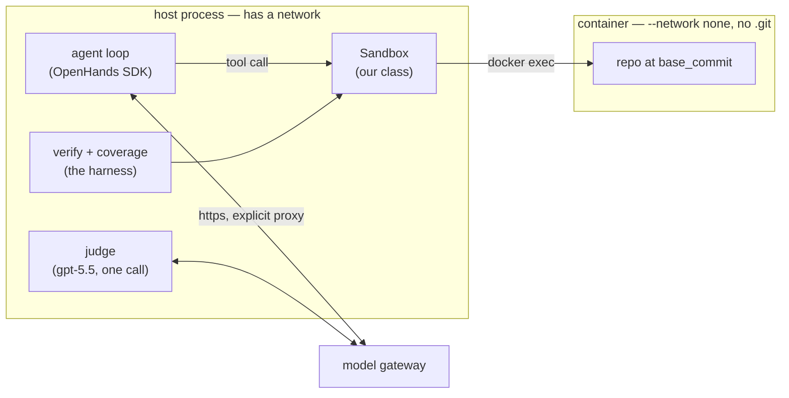
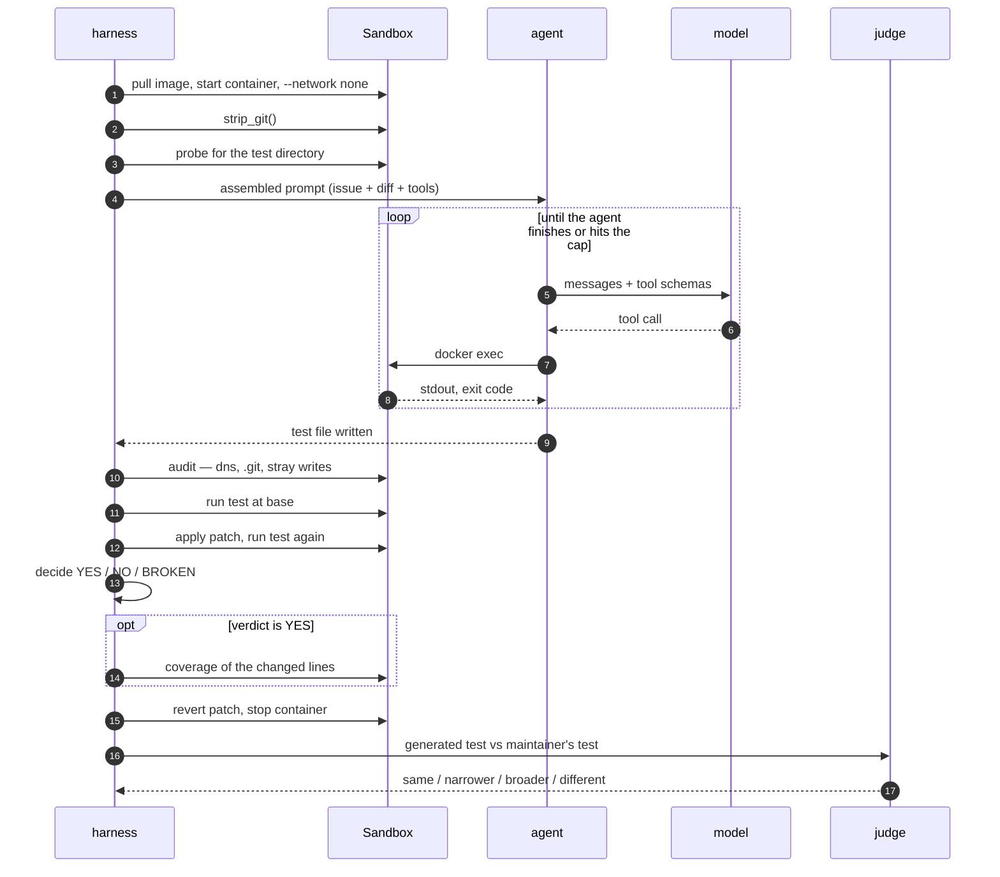

# System design

An OpenHands agent writes a regression test for a merged SWE-bench pull request. The test
has to **fail at the base commit and pass once the fix is applied** — fail-to-pass, F2P.
The maintainer's own test for the same bug is the held-out answer: it is read once, at the
end, to judge the result, and never during generation.

There is no head commit in these images. "After the fix" is a state the harness
constructs by applying the patch and then reverts.

## The one boundary



The agent runs on the host; only its *effects* enter the container, each as a
`docker exec`. That is what makes `--network none` possible at all — the model connection
stays outside, so the box can be sealed without cutting the agent off from the model.

Two things follow from it:

- The container cannot reach PyPI, GitHub or a search engine, so the fix cannot be looked
  up in a later release. Verified per run, not asserted: `dns_resolves` is recorded.
- `.git` is deleted before the agent starts. A worktree was shown to be able to read the
  future test out of history, which would have made every result meaningless.

`Sandbox` is roughly 130 lines of our own code, not an SDK concept. It owns the container
lifecycle and is the only route into it: every tool executor takes a `box` and has no
other exit.

## One pull request, end to end



Order is the safety property. The judge is the only step that reads the maintainer's test,
and it runs last — enforced by where the call site is, not by a flag.

## The verdict

Two runs of the same file, and a decision that touches no container:

| condition | verdict | reading |
|---|---|---|
| nothing collected on either side | `BROKEN` | the file never ran — our fault, not a result |
| an expected id never appeared | `BROKEN` | runner or parser problem |
| still failing after the fix | `NO` | the test is wrong, not the code |
| passing before the fix too | `NO` | it does not test the change |
| fails before, passes after | `YES` | |

`BROKEN` is kept apart from `NO` deliberately. Collapsed together, every harness bug reads
as a model failure — and on the first full pass over 26 instances, eleven distinct harness
bugs each produced a plausible number rather than an error.

`SKIPPED` is not a failure: only `FAILED` and `ERROR` count as behavioural, so a skipped
test contributes to neither side.

## Coverage

One definition: **of the executable lines this pull request changed, how many did the test
execute.** Not file coverage, and not a score to raise.

Four things make it easy to get wrong, and each returns a wrong number rather than an
error:

- It must be measured **at head**. Lines the patch adds do not exist at any other moment.
- The line numbers come from **diffing the file before and after**, not from the diff
  header. `git apply` relocates a hunk whose context has moved — one instance reported
  `Hunk #1 succeeded at 993 (offset 22 lines)`, and the header's numbers pointed at an
  unrelated method.
- Comments and blank lines are invisible to coverage, so the denominator is
  `executed | missing` rather than every changed line.
- The repository's own `.coveragerc` is overridden. One project sets `parallel = True`,
  which writes a suffixed data file and makes the report say `No data to report.`;
  another sets an `include` whitelist that silently hides changed files outside it.

Measured **only for a `YES`**. Asking how much of a change a test exercised presumes the
test exercises the change; for a `NO` or a `BROKEN` it presumes something false.

## Three test-runner conventions

Twelve repositories, three ways of naming and running a test. `run_tests` hides all of it
behind a path.

| kind | command | node ids |
|---|---|---|
| pytest | `python -m pytest -v -rA …` | `path::test_name` |
| django | `./tests/runtests.py --verbosity 2 <label>` | `test_x (a.b.C.test_x)`, or the test's **docstring** |
| sympy | `bin/test <path>` | bare function names, no path — and pytest is not installed |

Version spread matters as much as the repository. pytest 3.3 prints no short-summary
section at all, so `-v` is passed as well and the per-test line is parsed; `--no-header`
arrived in pytest 6.0 and is a usage error in the 4.5 that pytest's own repository runs.

## Parallelism

Workers are separate **processes**, because the SDK's tool registry is a process-global
resolved lazily at agent construction. Threads would share it.

That makes every shared resource a hazard, and two were real:

- Container reaping went by name, so each worker's `docker rm -f` over `f2p-*` deleted
  the containers its siblings were working in. Names now carry the owning process id and
  only unowned containers are reaped.
- Two 3 GB image pulls sharing a slow link finished neither. Pulls are serialised behind
  a lock file, and one attempt gets the whole link.

## Modules

<!-- generated:modules -->
| module | lines | what it is |
|---|---|---|
| `agent.py` | 807 | The agent arm: an OpenHands agent that writes fail-to-pass tests inside a container. |
| `compare.py` | 136 | Does the generated test check the same thing the developer's test checks? |
| `dataset.py` | 68 | Where the SWE-bench Verified rows come from, and how they are found. |
| `docs.py` | 122 | Refresh the generated blocks in `docs/system-design.md`. |
| `flow.py` | 114 | One chronological record of everything that happens to one PR. |
| `llm_config.py` | 143 | One place the model connection is configured, shared by every caller. |
| `oracle.py` | 105 | Oracle sweep: run the developer's own test through our verifier, on every PR. |
| `prompt.py` | 122 | Assemble the agent's prompt from the pieces in prompts/. |
| `prs.py` | 298 | The instances we develop against: twenty-six, spanning every repository and a decade. |
| `repo_info.py` | 139 | repo_info as a sub-agent: a second model reads the repository and answers. |
| `runs.py` | 126 | `out/RUNS.md` -- the state of every instance, for someone who has just cloned this. |
| `sandbox_tools.py` | 476 | OpenHands tools whose executors run inside the SWE-bench container. |
| `swebench_env.py` | 1091 | Per-instance SWE-bench containers: the environment, and the isolation. |
| `trace.py` | 127 | Read back everything a run left behind, in the order it happened. |
| `trajectory.py` | 302 | Export a run in the OpenHands trajectory format, for the trajectory visualizer. |
| `verify.py` | 278 | The F2P decision. One implementation, used by every arm. |
<!-- /generated:modules -->

## The agent's tools

<!-- generated:tools -->
- `run`
- `write_file`
- `run_tests`
- `coverage`
- `verify`
- `repo_info`
<!-- /generated:tools -->

`repo_info` is a sub-agent, not a lookup: a second, tool-less model call that reads the
repository's layout and configuration and reports only how tests are written here. It is
given the structure, never the diff and never the maintainer's test.

`verify` and `coverage` exist for the agent too, not only for the harness. The agent may
call them as often as it likes; what is *recorded* is the harness's own run, after the
agent has stopped. Under `--blind` neither is registered, because both need the diff.

## The prompt

Assembled at run time from one file per instruction, in filename order, so a result that
moves can be attributed to the instruction that moved it and a piece can be dropped for
one arm and kept for another.

<!-- generated:prompts -->
| file | job |
|---|---|
| `10-situation.md` | Establishes where the model is and, critically, that the bug is still present. Without this the model tends to assume the code is already correct and writes a t |
| `20-goal.md` | The deliverable, stated as an engineering task rather than as our scoring function. This was rewritten after review. The earlier version read "write a test that |
| `30-issue.md` | The bug report, verbatim from the dataset's problem_statement field. This is the only instance data the model ever sees. The developer's fix and the developer's |
| `35-change.md` | The pull request's diff, framed as evidence to interpret rather than a target to satisfy. The closing instruction used to be "the test has to run the lines abov |
| `40-tools.md` | Describes the four always-present tools in terms of when to reach for each, since the schemas already say what they are. The boundary between `repo_info` and `r |
| `45-tools-verify.md` | Introduces `verify` as the property the test must have rather than a score. Separable because it only exists once the diff is an input: with the patch withheld  |
| `46-tools-coverage.md` | Says what `coverage` is *for* -- a better test -- which the previous version left implicit while describing only what it reports. Sixteen of twenty-two agents n |
| `50-rules.md` | The constraints. The first one is load-bearing for the measurement rather than for the model -- an agent that edits the library can make any test pass, and then |
| `55-check-runs.md` | Step one of the finishing sequence, and the only step that exists in every arm -- `run_tests` is registered whether or not the diff was given. Split from the ot |
| `56-check-flips.md` | Step two. Dropped with the diff, since `verify` needs the patch to have a second state to run against. |
| `57-check-reaches.md` | Step three, plus how to read a low figure. Dropped with the diff, and dropped again by --compare-coverage, which is exactly what that flag measures. Rewritten t |
| `58-finish.md` | The stop condition, on its own so that changing when the agent stops does not mean editing what it checks. The previous wording ended the sequence at its first  |
| `60-runner-pytest.md` | Per-repo advice for the pytest projects. The `pytest` warning is here because it is where the guessing actually happened: agents typed `pytest -q <file>` in eig |
<!-- /generated:prompts -->

Some of it is load-bearing for the *measurement*: `50-rules.md` forbids editing anything
but the test file, without which an agent can make any test pass by changing the library
and the "before" run stops being a fact about the pull request.

The rest is workflow, and workflow is a thumb on the scale — the `5x` checks hand over a
sequence the agent might not have found alone. Their wording is deliberate in a second
way: an earlier version told the agent to iterate until coverage answered well, which is
an instruction to maximise the number we score by. Asking is mandatory; raising the answer
is not, and adding a call with no assertion behind it is called out as unacceptable.

## CLI

<!-- generated:cli -->
| flag | what it does |
|---|---|
| `--max-iterations` | hard cap on agent steps per PR. Observed use ranges from 12  (sympy) to 65 (scikit-learn), so the headroom is deliberate |
| `--dry-run` | show the target path and runner command, make no LLM call |
| `--blind` | withhold the PR diff. Harder task, comparable to TDD-Bench  baselines; drops the coverage and verify tools with it |
| `--no-compare` | skip the concept judgement against the developer's test |
| `--compare-coverage` | run each PR twice, with and without the coverage tool, into  out_compare_coverage/<pr>/{with,without}_coverage_tool/ |
| `--recheck` | re-judge the saved tests under the current harness, without  calling the model again |
| `--retry-broken` | run only instances with no result, or whose result is BROKEN.  A BROKEN verdict records that the harness or the connection  failed and says nothing about the instance, so it is worth  retrying; YES and NO are findings and are left alone |
| `--parallel` | how many PRs to run at once (F2P_MAX_PARALLEL, default 5).  Doubled in --compare-coverage, since each PR is two runs |
<!-- /generated:cli -->

## What a run leaves behind

`out/<instance_id>/`, indexed by [`out/RUNS.md`](../out/RUNS.md), which is regenerated
from the results on disk at the end of every run.

`tool_log.json` records what the executor *did*; `trajectory.json` records what the model
*asked for*. When they disagree, the disagreement is the finding.

`out/` is committed, so paths from the developer's machine are scrubbed on the way out.
No credential has reached it — the SDK's completion logger does not record request
headers — and that is checked rather than assumed.

## Layout

Sixteen modules, flat, one package. No subpackages, and that is deliberate at this size:
directories earn their keep when there are several independent consumers, and there is
one here — the CLI. The measurable properties are in better shape than a directory tree
would make them. The import graph has **no cycles** and layers cleanly:

```
flow, prs, prompt, llm_config, dataset      leaves, no internal imports
  └── swebench_env                          containers, runners, coverage
        └── verify, sandbox_tools, repo_info, trajectory
              └── agent, oracle, trace      entry points, imported by nothing
```

Two files are too large, which is a real scaffolding problem and a different one from
nesting. `swebench_env.py` is 1091 lines holding four subjects that barely touch each
other — image and disk management (~230), the test-runner conventions (~110), the
`Sandbox` lifecycle (~210), and coverage measurement (~270). Anyone who wants
`parse_output` imports all of it. `agent.py` is 807 lines of CLI, orchestration, child
processes, the coverage A/B and `recheck`.

The split is deferred rather than declined: it is a pure move of ~1300 lines with no
change in behaviour, and the results currently in `out/` were produced by this code.
`--recheck` would cover the verdict and coverage paths for free but not the agent's own
path, so the refactor is scheduled to land with the next full run, where both it and the
current prompt changes get measured together. Keeping `swebench_env` as a re-export layer
would leave its six dependents untouched, which makes the change revertible in one
commit.

## Known limits

- **One run per instance.** Same-instance variance is visible at n=1: sympy took 3 actions
  on one run and 4 on another, same model and prompt. Action counts are a range.
- **The judge is one model call.** A judgement, not coverage overlap or assertion-strength
  analysis. It is recorded beside the F2P verdict, never folded into it.
- **Isolation rests on discipline, not a process boundary.** The host has a network. The
  guarantee is that every executor takes `box` and has no other exit; a fourth tool
  written carelessly would undo it.
- **Memorisation is not addressed.** `psf/requests` is among the most-copied Python
  repositories on the internet. That can be disclosed, not closed.

---

The generated blocks above are refreshed by `python -m openhands_f2p.docs`, which runs at
the end of every agent run. `--check` fails instead of writing, for CI.
