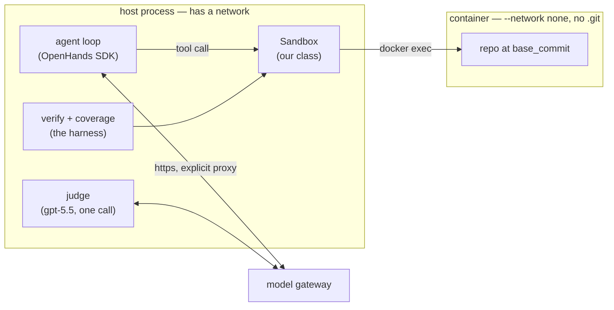
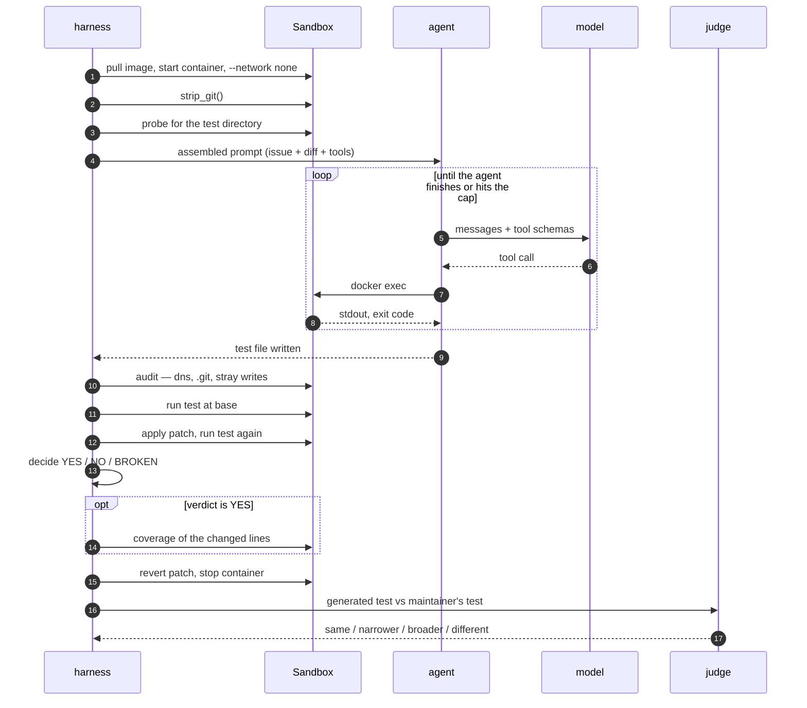

# System design

An OpenHands agent writes a regression test for a merged SWE-bench pull request. The test
has to **fail at the base commit and pass once the fix is applied** — fail-to-pass, F2P.
The maintainer's own test for the same bug is the held-out answer: it is read once, at the
end, to judge the result, and never during generation.

There is no head commit in these images. "After the fix" is a state the harness
constructs by applying the patch and then reverts.

## The one boundary



The agent runs on the host; only its *effects* enter the container, each as a
`docker exec`. That is what makes `--network none` possible at all — the model connection
stays outside, so the box can be sealed without cutting the agent off from the model.

Two things follow from it:

- The container cannot reach PyPI, GitHub or a search engine, so the fix cannot be looked
  up in a later release. Verified per run, not asserted: `dns_resolves` is recorded.
- `.git` is deleted before the agent starts. A worktree was shown to be able to read the
  future test out of history, which would have made every result meaningless.

`Sandbox` is roughly 130 lines of our own code, not an SDK concept. It owns the container
lifecycle and is the only route into it: every tool executor takes a `box` and has no
other exit.

## One pull request, end to end



Order is the safety property. The judge is the only step that reads the maintainer's test,
and it runs last — enforced by where the call site is, not by a flag.

## The verdict

Two runs of the same file, and a decision that touches no container:

| condition | verdict | reading |
|---|---|---|
| nothing collected on either side | `BROKEN` | the file never ran — our fault, not a result |
| an expected id never appeared | `BROKEN` | runner or parser problem |
| still failing after the fix | `NO` | the test is wrong, not the code |
| passing before the fix too | `NO` | it does not test the change |
| fails before, passes after | `YES` | |

`BROKEN` is kept apart from `NO` deliberately. Collapsed together, every harness bug reads
as a model failure — and on the first full pass over 26 instances, eleven distinct harness
bugs each produced a plausible number rather than an error.

`SKIPPED` is not a failure: only `FAILED` and `ERROR` count as behavioural, so a skipped
test contributes to neither side.

## Coverage

One definition: **of the executable lines this pull request changed, how many did the test
execute.** Not file coverage, and not a score to raise.

Four things make it easy to get wrong, and each returns a wrong number rather than an
error:

- It must be measured **at head**. Lines the patch adds do not exist at any other moment.
- The line numbers come from **diffing the file before and after**, not from the diff
  header. `git apply` relocates a hunk whose context has moved — one instance reported
  `Hunk #1 succeeded at 993 (offset 22 lines)`, and the header's numbers pointed at an
  unrelated method.
- Comments and blank lines are invisible to coverage, so the denominator is
  `executed | missing` rather than every changed line.
- The repository's own `.coveragerc` is overridden. One project sets `parallel = True`,
  which writes a suffixed data file and makes the report say `No data to report.`;
  another sets an `include` whitelist that silently hides changed files outside it.

Measured **only for a `YES`**. Asking how much of a change a test exercised presumes the
test exercises the change; for a `NO` or a `BROKEN` it presumes something false.

### Where the definition runs out

Two instances show the metric's edges, and both readings are correct rather than broken.

`scikit-learn-25747` reports **not measured — the changed lines are all comments or
blanks**. Its fix is a *deletion*: it removes two executable lines and its only added line
is a docstring sentence. There is nothing at any line number for a test to execute, so
changed-line coverage has no denominator. The test is genuinely fail-to-pass; the question
simply does not apply. Counting deleted lines would make full coverage unreachable, and
crediting the lines that surround the hole would measure the wrong thing — so the honest
answer is to decline. A patch whose whole behavioural change is a removal is invisible to
this metric, and that is a limitation of the definition, not a fault in the run.

`matplotlib-26208` reports **50% (1/2)**. Its fix applies the same one-line change in two
symmetric places, `twinx` and `twiny`, and the test exercises `twinx` only. That is the
metric doing exactly what it exists for: the test pins half of a symmetric bug, and the
number says so.

## Mutation

Fail-to-pass says the test fails at base and passes at head. Changed-line coverage says it
executed the lines the fix touched. Neither says the test would *object* to a fix that is
nearly right — a test can flip, run every changed line, and still pass against a version of
the patch with a comparison inverted or a boundary off by one.

So `--mutants N` adds a step between the agent's output and the judge. Each mutant is a
single small edit to the *fixed* code; the test is run against it. A mutant the test fails
on is **killed**, one it still passes is a **survivor**, and each survivor names something
the test does not pin down.

### Deterministic, and no model call

The mutants come from `mutmut` 3.7.0 — libcst 1.9.0 under it — not from a model. An
earlier version asked a frontier model for `{file, find, replace}` edits, and it worked,
but it made the metric depend on a sampling temperature: re-running an instance could
produce a different denominator and so a different score for an unchanged test. A
measurement that moves when nothing moved is not a measurement.

`create_mutations(filename, source, covered_lines)` returns every mutation the operator
set offers; `module.deep_replace(original, mutated)` applies exactly one. Two runs of the
same instance produce byte-identical mutants, which has been checked.

**Confined to the change.** `mutmut` will mutate a whole file given the chance; only
mutations landing on lines the pull request touched are kept. A mutant elsewhere in the
file asks whether the test covers code the pull request never changed, which is a
different question and not the one being scored.

**Spread, not clustered.** `_spread` round-robins over `(file, line)` groups before
taking the first N, so ten mutants on a two-file patch sample both files and several lines
rather than ten variants of one expression.

### No gate: both columns, raw

Every mutant is run against **two** tests — the agent's, and the maintainer's from
`test_patch` — on the identical mutant set, and both numbers are reported side by side:

| | agent test | developer test |
|---|---|---|
| `out/`, 23 instances, 90 mutants | 74 (82%) | 69 (77%) |
| `out_compare_repo_search/full`, 24 instances, 100 mutants | 75 | 79 |
| `out_compare_repo_search/repo-search`, same 100 mutants | 76 | 79 |

An earlier design filtered the denominator down to mutants the maintainer's test kills, on
the argument that the rest are unfair questions — equivalent mutants, or behaviour outside
what the pull request is about. That gate is gone by decision: it folded a judgement into
the number, and the raw pair says more. The developer column doubles as a control — the
same 100 mutants give 79 in both series, so an agent difference of 75 against 76 is a
like-for-like comparison and not two different exams.

The two corpora disagree about which test is stronger, and that is the honest finding:
across instances the agent's tests and the maintainer's are within a few points either
way, with real spread underneath. `sphinx-7454` went 10/10 against the maintainer's 9;
`flask-5014` killed 1 of 4.

### Operators, and the instances that score zero

Six of 23 instances produced **no mutants at all**. `mutmut`'s operators work on
expressions — comparisons, operators, constants, keywords — and a patch that only adds a
statement, a decorator or a framework declaration offers them nothing to change. A
statement-deletion operator would cover most of these; it is deliberately deferred, and
until then `0/0` is reported as what it is rather than counted as a perfect score.

### Two guards

Before any mutant, **both** tests must pass on the unmutated fixed code — otherwise every
mutant reads as killed and the score is meaningless rather than obviously wrong. And the
tree is returned to base afterwards, tests off, because a tree left patched would make the
next "before the fix" run be the after run.

Every mutant is written to `out/<instance>/mutations/NN-<name>.diff` with an `index.json`,
so a survivor can be read as a diff rather than taken on trust.

### Ordering, and what the agent never sees

This reads `test_patch`, the held-out answer, so it sits where the judge sits: after the
generated test is finalised and scored. It runs only for a `YES` — asking what a test
would notice about a wrong fix presumes it notices the right one — and inside the sandbox,
since every mutant needs the container the verdict was computed in.

The agent is never told a mutant exists, never sees a survivor, and never sees a mutation
score. A score in front of the agent is a score to raise.

## The judge

One call per instance to a stronger model that wrote none of these tests, after the F2P
verdict is settled. It answers three questions and they are kept apart, because a test can
be about the right behaviour and still be unreadable, or read well and miss half the bug.

| field | question |
|---|---|
| `verdict` | same / narrower / broader / different — is it about the same behaviour as the maintainer's test |
| `issue_coverage` | does it reach every behaviour the pull request settles, with the ones it misses named |
| `readability` | would it pass review — names, whether assertions state an expectation, whether a reader can tell what is pinned |

`issue_coverage` is judged against the **issue and the fix**, not against the maintainer's
test: that test is evidence of what mattered, not the definition of it, so a test covering
one branch of a two-branch fix is incomplete even where the maintainer tested only that
branch too.

It reads independently of changed-line coverage and the two agree in a useful way. On
`matplotlib-26208` the judge returned `issue partial` and named the missing behaviour as
"the twiny/shared-y symmetric case" — the same gap the 50% figure found by executing
lines. Two instruments, two routes, one answer.

None of the three feeds the F2P verdict.

## Three test-runner conventions

Twelve repositories, three ways of naming and running a test. `run_tests` hides all of it
behind a path.

| kind | command | node ids |
|---|---|---|
| pytest | `python -m pytest -v -rA …` | `path::test_name` |
| django | `./tests/runtests.py --verbosity 2 <label>` | `test_x (a.b.C.test_x)`, or the test's **docstring** |
| sympy | `bin/test <path>` | bare function names, no path — and pytest is not installed |

Version spread matters as much as the repository. pytest 3.3 prints no short-summary
section at all, so `-v` is passed as well and the per-test line is parsed; `--no-header`
arrived in pytest 6.0 and is a usage error in the 4.5 that pytest's own repository runs.

## Parallelism

Workers are separate **processes**, because the SDK's tool registry is a process-global
resolved lazily at agent construction. Threads would share it.

That makes every shared resource a hazard, and two were real:

- Container reaping went by name, so each worker's `docker rm -f` over `f2p-*` deleted
  the containers its siblings were working in. Names now carry the owning process id and
  only unowned containers are reaped.
- Two 3 GB image pulls sharing a slow link finished neither. Pulls are serialised behind
  a lock file, and one attempt gets the whole link.

## Modules

<!-- generated:modules -->
| module | lines | what it is |
|---|---|---|
| `agent.py` | 675 | The agent arm: an OpenHands agent that writes fail-to-pass tests inside a container. |
| `checks.py` | 119 | What the agent actually did, checked rather than assumed. |
| `compare.py` | 176 | Does the generated test check the same thing the developer's test checks? |
| `coverage_metric.py` | 398 | Of the lines this pull request changed, how many did the test execute? |
| `dataset.py` | 70 | Where the SWE-bench Verified rows come from, and how they are found. |
| `docs.py` | 122 | Refresh the generated blocks in `docs/system-design.md`. |
| `features.py` | 219 | What the agent is given, as one registry that everything else reads. |
| `flow.py` | 114 | One chronological record of everything that happens to one PR. |
| `image_cache.py` | 238 | Instance images kept on the host disk, so each one is pulled from the registry once. |
| `images.py` | 315 | Prepared SWE-bench images, and the disk they compete for. |
| `layout.py` | 24 | Where the project is on disk, and the environment it runs with. |
| `llm_config.py` | 150 | One place the model connection is configured, shared by every caller. |
| `mutants.py` | 378 | Does the test notice when the fix is subtly wrong? |
| `oracle.py` | 105 | Oracle sweep: run the developer's own test through our verifier, on every PR. |
| `parallel.py` | 235 | Running several pull requests at once, as separate processes. |
| `prompt.py` | 209 | Assemble the agent's prompt from the pieces in prompts/. |
| `prs.py` | 298 | The instances we develop against: twenty-six, spanning every repository and a decade. |
| `runners.py` | 315 | Three test-runner conventions, and how to read what they print. |
| `runs.py` | 261 | `out/RUNS.md` -- the state of every instance, for someone who has just cloned this. |
| `sandbox.py` | 283 | One container per instance, and the only door into it. |
| `sandbox_tools.py` | 518 | OpenHands tools whose executors run inside the SWE-bench container. |
| `swebench_env.py` | 89 | The SWE-bench environment, as one import. |
| `trace.py` | 128 | Read back everything a run left behind, in the order it happened. |
| `trajectory.py` | 304 | Export a run in the OpenHands trajectory format, for the trajectory visualizer. |
| `verify.py` | 307 | The F2P decision. One implementation, used by every arm. |
<!-- /generated:modules -->

## The agent's tools

<!-- generated:tools -->
- `run`
- `write_file`
- `run_tests`
- `coverage`
- `verify`
<!-- /generated:tools -->

There is no sub-agent for repository knowledge any more. There used to be: `repo_info`,
a second model call per instance that read the tree and reported how tests are written
here. It was removed because the same question was being answered in three places at
once -- its own `find` over the test directories, `run_tests` building the command, and
the runner detection in `runners` -- and the three could disagree. Once it was asked to
report the runner without being handed the answer it called `pytest` "the canonical
runner" for sympy, which does not use it.

All of it now comes from one place. `repo_facts(box, test_file)` in `runners` reads the
checkout directly -- runner, target directory, the project's own pytest configuration
verbatim, and the names of neighbouring tests -- and that text becomes the `15-repo.md`
prompt piece. It is measurement, not inference: no model call, nothing to disagree with,
and the same code path that `run_tests` uses to build the command. Style is the one thing
it does not try to answer, because it cannot be answered generally; the agent is told to
read one to three neighbouring tests and see for itself.

`verify` and `coverage` exist for the agent too, not only for the harness. The agent may
call them as often as it likes; what is *recorded* is the harness's own run, after the
agent has stopped. Under `--no-patch` neither is registered, because both need the diff.

## The prompt

Assembled at run time from one file per instruction, in filename order, so a result that
moves can be attributed to the instruction that moved it and a piece can be dropped for
one arm and kept for another.

<!-- generated:prompts -->
| file | job |
|---|---|
| `10-situation.md` | Establishes where the model is and, critically, that the bug is still present. Without this the model tends to assume the code is already correct and writes a t |
| `15-repo.md` | How testing works in this checkout -- runner, target path, neighbouring tests, and the project's own pytest configuration verbatim. Read off the tree by `repo_f |
| `16-explore.md` | What to establish about the checkout, for runs where the harness hands none of it over. The counterpart to `15-repo.md`, which is dropped in the same configurat |
| `20-goal.md` | The deliverable, stated as an engineering task rather than as our scoring function. This was rewritten after review. The earlier version read "write a test that |
| `30-issue.md` | The bug report, verbatim from the dataset's problem_statement field. This is the only instance data the model ever sees. The developer's fix and the developer's |
| `35-change.md` | The pull request's diff, framed as evidence to interpret rather than a target to satisfy. The closing instruction used to be "the test has to run the lines abov |
| `40-tools.md` | Describes the tools in terms of when to reach for each, since the schemas already say what they are. Two things are stated outright because leaving them implici |
| `45-tools-verify.md` | Introduces `verify` as the property the test must have rather than a score. Separable because it only exists once the diff is an input: with the patch withheld  |
| `46-tools-coverage.md` | Says what `coverage` is *for* -- a better test -- which the previous version left implicit while describing only what it reports. Sixteen of twenty-two agents n |
| `50-rules.md` | The constraints. The first one is load-bearing for the measurement rather than for the model -- an agent that edits the library can make any test pass, and then |
| `55-check-runs.md` | Step one of the finishing sequence, and the only step that exists in every configuration -- `run_tests` is registered whether or not the diff was given. Split f |
| `56-check-flips.md` | Step two. Dropped with the diff, since `verify` needs the patch to have a second state to run against. |
| `57-check-reaches.md` | Step three, plus how to read a low figure. Dropped with the diff, and by `--no-coverage-tool` on its own. Rewritten twice. The first version said "iterate until |
| `58-finish.md` | The stop condition, on its own so that changing when the agent stops does not mean editing what it checks. Rewritten twice. The first version ended the sequence |
<!-- /generated:prompts -->

Some of it is load-bearing for the *measurement*: `50-rules.md` forbids editing anything
but the test file, without which an agent can make any test pass by changing the library
and the "before" run stops being a fact about the pull request.

The rest is workflow, and workflow is a thumb on the scale — the `5x` checks hand over a
sequence the agent might not have found alone. Their wording is deliberate in a second
way: an earlier version told the agent to iterate until coverage answered well, which is
an instruction to maximise the number we score by. Asking is mandatory; raising the answer
is not, and adding a call with no assertion behind it is called out as unacceptable.

## Configuration

A run is defined partly by its instance and partly by what the agent was *given*. Those
switches used to be booleans threaded by hand: a `--blind` that removed the diff, a
`coverage_tool` that removed one tool, each with its own branch in the prompt builder and
its own line in the child command. Adding a third meant touching five files and hoping
none was missed.

They are now one registry, `features.py`. A `Feature` names itself, the tools that live
and die with it, and the features it depends on:

```python
Feature("coverage-tool",
        "withhold the `coverage` tool. The harness still measures changed-line "
        "coverage; the agent just cannot see it while it works",
        needs=("patch",), tools=("coverage",))
```

That single entry produces a `--no-coverage-tool` flag, a line in `--help`, dependency
handling, a place in every recorded result, and the ability to gate a prompt piece. There
is nowhere else to edit.

Two rules are enforced rather than documented. **Dependencies cascade**: `coverage`
needs the diff, so `--no-patch` withdraws it too and reports
`without patch, coverage-tool (needs patch)` — refusing the combination would only make
the caller pass two flags to mean one thing. **Something has to describe the bug**:
`--no-issue --no-patch` is refused, because with neither the report nor the diff the task
is not harder but impossible, and the run would still write a row that looks like a
measurement.

### Withholding a component can mean adding an instruction

`--repo-search` (also spelled `--no-repo-facts`) is the first feature where taking a
component away is not enough. The other four make the prompt shorter and nothing else:
drop the diff and there is simply no diff. Drop the briefing on how this project tests
and the agent has to be *told* to work it out, or the run measures a missing instruction
rather than a missing input — a distinction the whole point of these switches depends on.

So `prompt.py` grew a negated condition. `needs: !repo-facts` keeps a piece only while
that feature is off, and `16-explore.md` uses it to ask the same questions `15-repo.md`
answers: where a new test file has to live to be collected, what the test configuration
enforces, how the tests already there are written. It answers none of them — an answer
would be the per-repository advice that was deleted from `prompts/` once already.

Two things about it are worth stating plainly, because they bound what the flag measures.

**The runner is not really withheld.** `run_tests` picks this project's runner in every
configuration and converts a path to whatever form it wants, and the agent could always
have read a configuration file with `run`. What the briefing uniquely supplied is the
*destination*: the shallowest directory named `tests`, `testing` or `test`, which is the
one fact that took twelve repositories to get right.

**So the destination moves to the agent, and the harness follows it.** The filename stays
ours — it is not repo knowledge, it keeps the file findable afterwards, and it stops the
agent overwriting a test that was already there — while the directory becomes the agent's
to establish. `written_test_path` resolves it: the write log first, confirmed against the
container, then a `find`, then the path the harness would have chosen. It runs before
`audit`, which flags every write that is not the test file; left later, the agent's own
chosen path would be reported as a stray write on every run.

Resolving it once is not enough, and finding that out cost a run. `verify` derived the
path itself from `gen_test_path`, so an agent that put its test in django's
`tests/auth_tests/` — beside the model it imports, where django's own developers keep
this test — wrote `from .models import ...`, correct there, and the harness relocated the
file to `tests/`, where there is no parent package. The verdict came back *"still failing
after the fix — the test is wrong, not the code"* about an ImportError the harness had
manufactured. `verify` now takes `test_path`, `recheck` passes what the run recorded, and
`mutate_saved` prefers it over re-deriving. Re-judging that run with no LLM call turned it
from `NO` to `YES` at 100% coverage.

The line that broke already carried a comment about the same class of bug one
configuration earlier: pytest keeps its tests in `testing/`, the briefing said so
correctly, and a verdict computed at `tests/` reported "nothing collected on either side"
for a test that was fine. A derived path is the bug; the parameter is the fix.

**The runner leaked through a channel the prompt scan cannot see.** `run_tests` built its
description from `runner_for(box)["cmd"]`, so every `--repo-search` run handed django's
`./tests/runtests.py --verbosity 2` to the model in the tool schema — before it took a
single action — while the briefing that was supposed to be withheld sat unused. The
observation echoed `$ <command>` too, which taught the dotted-label conversion on first
use. `prompt.build` had guaranteed for months that no assembled prompt names an
unregistered tool; tool *descriptions* had no such guarantee, and that is exactly where
the leak was.

Now the runner is named only when the briefing names it. `reveal_runner` controls both the
description and the echo, and `_check_no_leak` refuses to register a tool whose
description contains the runner command while `repo-facts` is withheld. The capability is
identical either way — `run_tests` still builds and runs the right command — and only the
knowledge differs. The first A/B measured before this fix; the second, after.

Both paths are recorded, always, as `test_path` and `test_path_default`. A test in a
directory the runner never collects from fails for a reason that has nothing to do with
how good the test is, and without the pair on record those two failures are
indistinguishable in the table.

### What the agent changed, verified

The measurement rests on the agent not having edited the library: the "before the fix" run
happens in the container as the agent left it, so a source edit makes that run a fact about
something other than the pull request. `50-rules.md` says so, and for a long time the
checking was a fiction. `audit` asked `git status`; `strip_git` had already deleted the
repository, so the answer was always "not a repository" and the tree always read clean. It
could not have caught anything. The other check, `files_written_outside_test`, reads the
tool log — which sees `write_file` calls and is blind to `sed -i` or a shell redirect.

The tree is now compared against a snapshot taken before the agent is let in. The
repository holding that snapshot lives **outside the checkout**:

    git --git-dir=/tmp/f2p_tree.git --work-tree=/testbed

Putting `.git` back under `/testbed` would have changed what we measure — `setuptools_scm`
and friends compute a package version from git, and every verdict on record was taken with
no repository there, so one untagged commit could change a version string and break tests
for reasons unrelated to the agent. Outside, the checkout still has no `.git`, the single
commit holds only the base state so there is no history to leak, and `tree_changes()`
still returns an exact list of what moved.

Verified on a live container: an agent editing `django/forms/models.py` with a shell
redirect is invisible to the tool log and appears immediately in the tree diff. Across the
48 runs of the first A/B, every run created exactly one file and changed nothing else —
which is now a checked fact rather than an assumption.

### An input is not its tool

The diff and `verify` were one switch to begin with, on the reasoning that a check against
the change is only possible once the change has been shown. That was wrong. The harness
holds the patch in *every* configuration — it applies it and reverts it itself — so
`verify` can report whether the agent's test flips without the agent seeing a line of the
diff. It leaks nothing: the verdict is a fact about the agent's own test.

Coupling them was also a methodological mistake. If `--no-patch` withheld the feedback
loop as well as the input, a drop in the result could not be attributed to either — which
defeats the purpose of having the switches at all. They are separate features now.

The one that genuinely cannot be separated is `coverage`. It prints the source of the lines
a test missed, and those lines *are* the diff, so it needs `patch`. What survives the split
is a graded scale of information:

| what the agent gets | leaks the diff? |
|---|---|
| the flip verdict from `verify` | nothing — it describes the agent's own test |
| `verify`'s shortfall line | a count: "3 of the 5 lines this pull request changed" |
| the `coverage` tool | **yes** — the source of each missed line and its conditions |

That middle row is why `verify` adapts its own output. When `coverage` is not registered it
must not say "call `coverage`" — the same failure the prompt scan catches, one layer later
in a tool's output, where no scan reaches. The executor is told whether the tool exists
beside it and words the shortfall accordingly.

### The prompt has to follow

A configuration that removes a tool but leaves the text describing it sends the agent
after something that never answers — and that failure is silent, findable only by reading
a transcript several runs later. So the prompt adapts two ways.

`needs:` in a piece's header drops the piece: `35-change.md` *is* the diff. But most
instructions are not all-or-nothing, so `{?feature} ... {/feature}` inside a body drops a
paragraph. Withholding the diff should not delete the goal, only the clause telling the
agent to work out what the code will do *after* the change; and the finishing sequence
keeps its first check while losing the sentence that frames three of them as a sequence.

| configuration | pieces | tools the agent holds |
|---|---|---|
| `full` | 13 | `run` `write_file` `run_tests` `verify` `coverage` |
| `no-issue` | 12 | `run` `write_file` `run_tests` `verify` `coverage` |
| `no-coverage-tool` | 11 | `run` `write_file` `run_tests` `verify` |
| `no-patch+coverage-tool` | 10 | `run` `write_file` `run_tests` `verify` |
| `no-verify-tool+coverage-tool` | 9 | `run` `write_file` `run_tests` |
| `no-patch+verify-tool+coverage-tool` | 8 | `run` `write_file` `run_tests` |

Eight configurations are reachable from four switches, and every one of them is built and
scanned as part of checking this in.

Then it is checked. `prompt.build` scans the assembled text for the names of tools that
were not registered and raises, naming the piece to fix; an unknown feature name in a
`needs:` or a `{?...}` raises when the piece is parsed. The scan works because the pieces
backtick tool names consistently — `` `coverage` `` is the tool, "changed-line coverage"
is prose.

### Comparing configurations

There is no pair-comparison code. There was: an `arms.py` that ran every pull request
twice, once with the coverage tool and once without, and reported the paired difference.
It is gone, because a pair is the wrong unit — the interesting comparisons are between
*series* of runs whose configurations differ, and a paired harness fixes the axis at two
values chosen when it was written.

What replaces it is bookkeeping. Every result records `features.config`; `RUNS.md` states
which configuration produced its rows and warns when they came from more than one. A
series is a directory:

```bash
uv run openhands-f2p --out-root out_full
uv run openhands-f2p --out-root out_nocov --no-coverage-tool
```

## CLI

<!-- generated:cli -->
| flag | what it does |
|---|---|
| `--max-iterations` | hard cap on agent steps per PR. Observed use ranges from 12  (sympy) to 65 (scikit-learn), so the headroom is deliberate |
| `--dry-run` | show the target path and runner command, make no LLM call |
| `--no-compare` | skip the concept judgement against the developer's test |
| `--mutants` | measure mutation on the tests already in out/, without  running the agent again. Adds the `mutation` field and  changes nothing else. Needs --mutants N |
| `--recheck` | re-judge the saved tests under the current harness, without  calling the model again |
| `--retry-broken` | run only instances with no result, or whose result is BROKEN.  A BROKEN verdict records that the harness or the connection  failed and says nothing about the instance, so it is worth  retrying; YES and NO are findings and are left alone |
| `--parallel` | how many PRs to run at once (F2P_MAX_PARALLEL, default 5) |
| `--out-root` | write results here instead of out/. One directory per  configuration is how a series of runs is kept separable |
| `--label` | a name for this run, recorded in every result. Defaults to  the configuration, e.g. no-coverage-tool |
<!-- /generated:cli -->

## What a run leaves behind

`out/<instance_id>/`, indexed by [`out/RUNS.md`](../out/RUNS.md), which is regenerated
from the results on disk at the end of every run.

`tool_log.json` records what the executor *did*; `trajectory.json` records what the model
*asked for*. When they disagree, the disagreement is the finding.

`out/` is committed, so paths from the developer's machine are scrubbed on the way out.
No credential has reached it — the SDK's completion logger does not record request
headers — and that is checked rather than assumed.

## Layout

Twenty-four modules, flat, one package. No subpackages, and that is deliberate at this
size: directories earn their keep when there are several independent consumers, and there
is one here — the CLI. The import graph has **no cycles** and layers cleanly:

```
features  flow  images  layout  llm_config  prs  runners      leaves
   ├── prompt, parallel        (read the feature registry)
   ├── dataset, runs, trace, compare
   └── sandbox ── coverage_metric
         └── swebench_env      (facade: re-exports images/runners/sandbox/coverage)
               └── verify, sandbox_tools, checks, trajectory
                     └── agent                               entry point
                         oracle                              entry point
```

`features.py` is a leaf on purpose. It is the registry of what the agent is given, and
four layers read it -- the prompt builder, the tool registration, the child command line,
and the recorded result -- so anything it imported would be imported by all of them.

`swebench_env.py` was 1091 lines holding four subjects that barely touched each other, and
`agent.py` was 807 holding six. Both are split:

| was | is now |
|---|---|
| `swebench_env` 1091 | `images` 282 &middot; `runners` 315 &middot; `sandbox` 238 &middot; `coverage_metric` 398 &middot; facade 89 |
| `agent` 807 | `agent` 470 &middot; `parallel` 211 &middot; `checks` 107 |

`runners` grew past its extracted size on purpose: it absorbed `repo_facts`, `test_config`
and `example_tests` when the `repo_info` sub-agent was deleted, so everything the system
knows about how a repository is tested is now in one file.

Three things made it safe. `swebench_env` stays as a re-export facade, so every existing
`from openhands_f2p import swebench_env as E` keeps working and none of its six dependents
changed. The move was done by slicing exact line ranges rather than retyping. And
`--recheck` re-ran the saved tests through the whole verdict and coverage path afterwards,
with no model call, to show nothing moved.

`coverage_metric` rather than `coverage`, so it cannot be confused with the `coverage`
package it drives inside the container. `layout.py` holds `PROJECT_ROOT` and `OUT`, which
five modules had each been deriving for themselves.

## Known limits

- **One run per instance.** Same-instance variance is visible at n=1: sympy took 3 actions
  on one run and 4 on another, same model and prompt. Action counts are a range.
- **The judge is one model call.** A judgement, not coverage overlap or assertion-strength
  analysis. It is recorded beside the F2P verdict, never folded into it.
- **Isolation rests on discipline, not a process boundary.** The host has a network. The
  guarantee is that every executor takes `box` and has no other exit; a sixth tool
  written carelessly would undo it.
- **Memorisation is not addressed.** `psf/requests` is among the most-copied Python
  repositories on the internet. That can be disclosed, not closed.

---

The generated blocks above are refreshed by `python -m openhands_f2p.docs`, which runs at
the end of every agent run. `--check` fails instead of writing, for CI.
