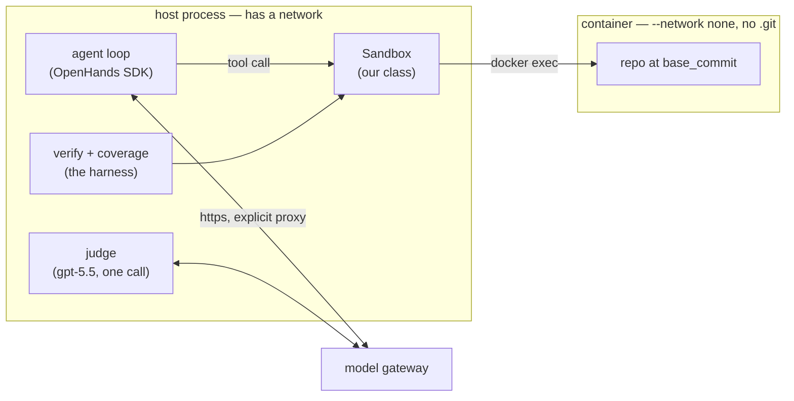
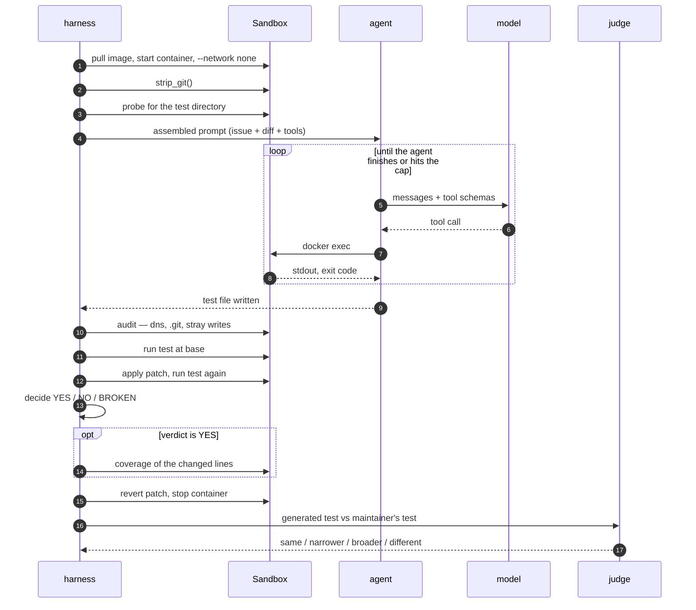
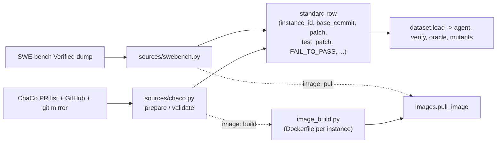

# System design

An OpenHands agent writes a regression test for a merged pull request -- from SWE-bench
Verified or, since 2026-10-08, the ChaCo benchmark (see [Datasets](#datasets)). The test
has to **fail at the base commit and pass once the fix is applied** — fail-to-pass, F2P.
The maintainer's own test for the same bug is the held-out answer: it is read once, at the
end, to judge the result, and never during generation.

There is no head commit in these images. "After the fix" is a state the harness
constructs by applying the patch and then reverts.

This file describes the system as it stands. The measurements that settled each design,
the bugs that changed one, and what was tried and removed are in [decisions.md](decisions.md).

## The one boundary



The agent runs on the host; only its *effects* enter the container, each as a
`docker exec`. That is what makes `--network none` possible at all — the model connection
stays outside, so the box can be sealed without cutting the agent off from the model.

Two things follow from it:

- The container cannot reach PyPI, GitHub or a search engine, so the fix cannot be looked
  up in a later release. Verified per run, not asserted: `dns_resolves` is recorded.
- The container never has a network, not even at setup. `coverage` -- the one package
  the harness adds -- is installed from a wheel the host downloads from PyPI (the release
  pip would pick for the container's Python, sha256-checked, cached in `.cache/wheels/`)
  and `docker cp`s in; see `wheels.py` and `Sandbox._install_offline`. Until 2026-09-26 it
  was pip-installed over a bridge disconnected right after, and a failed install let the
  run go on without it: Docker Desktop's proxy stopped answering and `full` runs went
  ahead with a coverage tool that measured nothing. A failed install is now fatal (the
  run is BROKEN and `--retry-broken` picks it up).
- `.git` is deleted before the agent starts. A worktree was shown to be able to read the
  future test out of history, which would have made every result meaningless.

`Sandbox` is roughly 130 lines of our own code, not an SDK concept. It owns the container
lifecycle and is the only route into it: every tool executor takes a `box` and has no
other exit.

## One pull request, end to end



Order is the safety property. The judge is the only step that reads the maintainer's test,
and it runs last — enforced by where the call site is, not by a flag.

## The verdict

Two runs of the same file, and a decision that touches no container:

| condition | verdict | reading |
|---|---|---|
| nothing collected on either side | `BROKEN` | the file never ran — our fault, not a result |
| an expected id never appeared | `BROKEN` | runner or parser problem |
| still failing after the fix | `NO` | the test is wrong, not the code |
| passing before the fix too | `NO` | it does not test the change |
| fails before, passes after | `YES` | |

`BROKEN` is kept apart from `NO` deliberately: collapsed together, every harness bug reads
as a model failure ([decisions.md](decisions.md)).

`SKIPPED` is not a failure: only `FAILED` and `ERROR` count as behavioural, so a skipped
test contributes to neither side.

### A test file that imports only after the fix (since 2026-10-09)

Sometimes a test module cannot import at base because it uses a name the pull request
adds: a class, a function or a module. pytest then reports one collection ERROR under the
file's name, and no test ids at all. If the same file imports after the fix, its tests are
**fail-to-pass**. They failed at base because the fixed code did not exist yet. SWE-bench
counts them that way, and `verify.unimportable_at_base` now does too. The verdict, the
agent's `verify` tool and ChaCo's `validate` all apply it.

Before this change, such a test read as "produced no usable failure" (an agent's test) or
as BROKEN (a developer test). The user asked how much that rule had cost, and across all
2,580 saved SWE-bench results it changed exactly one final verdict:
`sphinx-doc__sphinx-7590` in an old experiment, which was not one of the 36 PRs. A file
that fails to import on both sides, through a typo or a missing package, has no tests
after the fix either and still counts for nothing.

### Fixes from the ChaCo trajectory audit (2026-10-11)

Two read-only audits of the first 23 ChaCo runs found no wrong verdict. They did find
flaws that made a YES harder to reach or a number look better than it was. All of these
apply to SWE-bench as well:

- **Coverage counts changed files the test never imports.** Their executable lines
  (statement starts, docstrings excluded, `statements.executable_lines`) are now *missed*,
  and listed in `unimported_files`. Before, they were in neither hit nor missed, which
  inflated the figure: Qiskit-14024 reported 50% with 2 of its 5 changed files left out.
- **Long patches are clipped, not cut.** `prompt.clip_patch` keeps the full list of
  changed files and fills the budget (now 60,000 characters) with the hunks that add the
  most code. Its note says that the repository is at base and so does not contain what is
  left out. The old 30,000-character cut hid scipy-21700's new class, and told the agent
  to "read the rest" in a checkout that does not have it.
- **The agent's instructions no longer assume a bug fix.** The prompt says "change". A
  test that fails at base because a name the change adds does not exist yet fails for the
  right reason; this matches `verify.unimportable_at_base`. The old line ("an import error
  tells you nothing") led agents to catch or skip exactly that error.
- **A base run with some tests skipped and some passing is named as such**, not
  reported as "every test passes".
- **`coverage` says its line numbers refer to the files with the change applied**, and
  says to get the flip from `verify` first when the test has not flipped yet.
- **Tests go beside the changed code.** `runners.near_test_directory` applies to pytest
  projects only. It walks up from the most-changed source file to the nearest test
  directory, or finds the mirrored directory (Qiskit's `test/python/<package path>`). It
  falls back to the repo-wide rule.
- **Smaller fixes.** Doc, benchmark and tooling `.py` files are out of the coverage and
  mutation pools. The developer mutation column says why it was not measured. A timeout
  reports one message, not two. Inline prompt blocks keep the space before them.

### Fixes from the second ChaCo audit (2026-10-11/12)

A canary wave of 3 PRs runs before any wide wave, and `sources/watch.py` scans every
finished run for the failure signatures found so far. This second round of fixes again
applies to SWE-bench as well:

- **The briefing lists the instance image's environment settings** (the row's
  `environment_notes`). With these notes, ChaCo pandas-59854 went from NO in 92 actions
  to YES in 26: the agent had not known that pandas' future string dtype was on.
- **A coverage or mutation loop closes after two attempts that broke the flip.** Such
  attempts were never measured, so the loop could only end at `MAX_REFUSALS`
  (`verify._broke_flip_since`).
  An attempt "broke the flip" when its `verify` was not fail-to-pass by the verdict's rule
  (something flipped *and* nothing still fails), not only when nothing flipped: SciPy
  22549 (canary, 2026-10-12) broke its file eight times with one test still flipping and
  never counted, so the loop ran into `MAX_REFUSALS` at 0% and 0/20.
- **`verify` and the refusals offer back the last version `verify` called
  fail-to-pass** when the current file has lost it (`verify.lost_flip`).
- **`verify` names tests that skip on the old code, even when the file flips.**
- **A test that passes and then fails on the fixed code is called flaky** in mutation.
- **A backwards test is no longer also listed as "still failing".**
- **`coverage` refuses to run until the test is fail-to-pass** by its own last `verify`,
  unchanged since -- the same gate `mutation` has (user, 2026-10-12). A verify-first note
  at the top was tried first and was ignored: in the 9-PR fix rerun, SciPy 20382 still
  made 10 coverage calls before any flip and Qiskit 13343 made 8. A refused call is
  logged with `error`, so it never counts as an answer in the coverage loop.
- **`verify` names the error on each side for a test that fails on both** (2026-10-12).
  When they differ it says the failure before the change can be the right one and the one
  after is the test's own mistake; when they match, that the change does not touch what
  fails (`sandbox_tools._why_both`). SciPy 22549 failed at base on the missing `workers`
  keyword and after on its own `hess=None`, and ran `verify` ten more times unchanged.
- **The goal prompt says to simulate a situation the container lacks** -- a missing
  optional package, another library version -- for example with `monkeypatch`
  (2026-10-12). pandas 60196 (jinja2 missing) and Qiskit 13251 (another symengine
  version) were NO for the agent and YES by hand that way.
- **The coverage loop ends at an exhaustion point, not after one attempt** (user,
  2026-10-15). Each coverage refusal names one target: the biggest function holding a
  missed line that has not had its turn (`<module>` lines of a file count as one). A
  target is tried once the test changed after its refusal and `coverage` measured again,
  covered or not; the loop ends when every such function has been tried or every line
  runs (`verify.coverage_tried`, replayed from the record). Before, one attempt that did
  not raise the score ended it: Qiskit-12825 (large set) stopped at 17% of 307 lines with
  93 actions unused. The mutation loop keeps the one-attempt rule.
- **A coverage regression is refused until restored** (user, 2026-10-16). While the file
  runs fewer changed lines than its best fail-to-pass version `coverage` measured, the stop
  is refused and that version is handed back, every time rather than once
  (`_rewind(..., repeat=True)`), ahead of the next target. Under the exhaustion rule long
  loops ended on worse files: Qiskit-12825 best 15% final 1%, Qiskit-12904 67% then 39%.
  The agent's last file is still what is scored.
- **`verify` and `coverage` warn about catch-all handlers** (`except Exception: pass`,
  `verify.swallow_note`), naming the lines (user, 2026-10-16: warn, not refuse). Under the
  exhaustion rule 6 of 20 fail-to-pass tests in the large sets swallowed errors (0 of 9
  before): changed lines run, untested.
- **Hand-backs carry the whole file** (2026-10-16). The lost fail-to-pass version
  (`lost_flip`) was cut at 3000 characters and the coverage-regression version at 8000
  (silently), while both tell the model to write that version back. Large-set base: 11 runs
  got a cut copy; pylint-5136 lost its flip and ended NO, matplotlib-24013 and sphinx-7380
  ended below their best.
- **`trajectory.json` leaves out the harness's plumbing** (2026-10-19, user). The patch
  applied and reverted around every check, each scored mutant and each stop-check probe
  are not written as environment events (pylint-4492: 103 of 116); setup, the final scoring
  and the audit stay. The steps remain in `flow.log`, `tool_log.json` and `result.json`;
  the audits (`sources/watch.py`, `datasets/large/summarize_runs.py`) never read them.
- **Tests go into mirrored test trees** (`pandas/tests/arrays` for `pandas/core/arrays`),
  and the example tests offered are named after the changed modules.
- **The goal prompt says not every PR fixes a bug**, and that a check that a private name
  exists tests spelling, not behaviour.

## Coverage

One definition: **of the executable lines this pull request changed, how many did the test
execute.** Not file coverage, and not a score to raise.

Four things make it easy to get wrong, and each returns a wrong number rather than an
error:

- It must be measured **at head**. Lines the patch adds do not exist at any other moment.
- The line numbers come from **diffing the file before and after**, not from the diff
  header. `git apply` relocates a hunk whose context has moved — one instance reported
  `Hunk #1 succeeded at 993 (offset 22 lines)`, and the header's numbers pointed at an
  unrelated method.
- Comments and blank lines are invisible to coverage, so the denominator is
  `executed | missing` rather than every changed line.
- The repository's own `.coveragerc` is overridden. One project sets `parallel = True`,
  which writes a suffixed data file and makes the report say `No data to report.`;
  another sets an `include` whitelist that silently hides changed files outside it.

Measured **only for a `YES`**. Asking how much of a change a test exercised presumes the
test exercises the change; for a `NO` or a `BROKEN` it presumes something false.

**The agent sees lines, never the percentage.** The `coverage` tool, `verify`'s reach line
and the stop check all name the changed lines a test never runs, with the code on each and
the conditions above it, and ask for a test that runs every line the change touched. None
of them states a figure or calls anything a target. Until 2026-09-25 the tool led with the
percentage and closed with "100% is the target", while `58-finish.md` told the same agent
"none of these figures is a target" -- and the percentage it was told to push up was the
one this project publishes as a measure of test quality. The harness still computes it;
it is simply no longer the agent's objective.

Two instances sit at the metric's edges and a third shows what it cannot see at all --
a deletion-only patch, a symmetric fix half-tested, and a test at 100% that cannot
distinguish the fix from its absence. [decisions.md](decisions.md) has all three.

## Mutation

Fail-to-pass says the test fails at base and passes at head. Changed-line coverage says it
executed the lines the fix touched. Neither says the test would *object* to a fix that is
nearly right — a test can flip, run every changed line, and still pass against a version of
the patch with a comparison inverted or a boundary off by one.

So `--mutants N` adds a step between the agent's output and the judge. Each mutant is a
single small edit to the *fixed* code; the test is run against it. A mutant the test fails
on is **killed**, one it still passes is a **survivor**, and each survivor names something
the test does not pin down.

### Deterministic, and no model call

The mutants come from `mutmut` 3.7.0 — libcst 1.9.0 under it — not from a model, so the
denominator does not move between runs of an unchanged test ([decisions.md](decisions.md)).

`create_mutations(filename, source, covered_lines)` returns every mutation the operator
set offers; `module.deep_replace(original, mutated)` applies exactly one. Two runs of the
same instance produce byte-identical mutants, which has been checked.

**Confined to the change.** `mutmut` will mutate a whole file given the chance; only
mutations landing on lines the pull request touched are kept. A mutant elsewhere in the
file asks whether the test covers code the pull request never changed, which is a
different question and not the one being scored.

**Decorated code is mutated too** (since 2026-09-30). mutmut skips every decorated
function (a lone `@staticmethod` / `@classmethod` aside) and every decorated class, for
the sake of its own trampoline runner, which this harness does not use. `_allow_decorated`
lifts that rule for the node pairs we take; the decorator expressions themselves stay
unmutated, since they run at import. Before it, every line under `@property`,
`@cached_property`, `@functools.wraps` or `@dataclass` was silently outside the pool:
pytest-5262 and astropy-7336 reported "no mutations on the lines this patch changed",
and the agent's tool said the same to pytest-5262 three times.

**Special methods too.** mutmut also never mutates `__new__`, `__getattribute__` or
`__setattr__` (same runner reason); the list is emptied with the decorator rule
(sympy-24562's patch is all in `Rational.__new__`).

**A developer test that cannot pass here is left out, not the measurement.** Both columns
need their tests passing on the unmutated fix. The developer's column uses the developer
tests that pass in this sandbox and lists the others under `excluded` (no network:
requests' httpbin tests, astropy's IERS downloads); it is "not measured" only when none
pass. The agent's column is measured either way.

**Every coverage reading finds where the patch landed.** The agent's `coverage`, `verify`'s
reach line and the stop-check diagnoses read the patched files before applying the patch
(`E.base_texts`) and pass them to `changed_line_coverage`, as the scored measurement always
did. The diff header's numbers are wrong when `git apply` relocates a hunk
(scikit-learn-10908: 22 lines).

**Spread, not clustered.** `_spread` round-robins over `(file, line)` groups before
taking the first N, so ten mutants on a two-file patch sample both files and several lines
rather than ten variants of one expression.

### No gate: both columns, raw

Every mutant is run against **two** tests — the agent's, and the maintainer's from
`test_patch` — on the identical mutant set, and both numbers are reported side by side,
unfiltered. The developer column is the control: the same mutants asked of a test nobody
here wrote. An earlier design filtered the denominator down to mutants the maintainer's
test kills; that gate is gone, and [decisions.md](decisions.md) says why, with the figures.

`mutmut`'s operators work on expressions, so a patch that only adds a statement or a
declaration offers them nothing and scores `0/0` — reported as that rather than as a
perfect score. Six of 23 instances do ([decisions.md](decisions.md)).

### Two guards

Before any mutant, **both** tests must pass on the unmutated fixed code — otherwise every
mutant reads as killed and the score is meaningless rather than obviously wrong. And the
tree is returned to base afterwards, tests off, because a tree left patched would make the
next "before the fix" run be the after run.

Every mutant is written to `<run>/<instance>/mutations/NN-<name>.diff` with an `index.json`,
so a survivor can be read as a diff rather than taken on trust.

### The agent's copy, and why the pool is split

`mutation` is also one of the agent's tools. That is a problem for the metric before it is
a feature: `generate` is deterministic, so the tool and the measurement would otherwise be
handed the *same* mutants, and an agent that tunes its test until those ten die would then
be scored on those ten. Testing on the training set.

So `split_pool` draws a pool and halves it — the agent sees one half, the harness scores
the other, and `held_out: true` goes into the result when the agent held the tool.

**Every configuration is scored on that held-out half** since 2026-09-28. Before, runs
without the tool were scored on the whole pool (often 10 mutants) and runs with it on the
half (often 1-3), so the per-instance scores of two arms were different quantities and
the "mutation tool" comparison could not be paired. `--mutants N` caps *each half* at N;
the default is 20, which enlarges the scored half only where a patch offers more than 20
candidates -- a small patch stays small whatever the cap.

The halving happens at the *candidate* level, inside each `(file, line)` group, and the
side each group starts on rotates with its position. Both details are load-bearing and
both were bugs first — splitting by line, then splitting by operator kind ([decisions.md](decisions.md)).

The agent's copy never applies `test_patch`. The developer's test is the held-out answer,
and a tool that installed it during the agent's turn would put it in a tree the agent can
read.

What it can buy is bounded: across 90 mutants in 23 instances there is exactly one
survivor the maintainer's test kills and the agent's does not ([decisions.md](decisions.md)).

### Ordering, and what the agent never sees

This reads `test_patch`, the held-out answer, so it sits where the judge sits: after the
generated test is finalised and scored. It runs only for a `YES` — asking what a test
would notice about a wrong fix presumes it notices the right one — and inside the sandbox,
since every mutant needs the container the verdict was computed in.

The agent is never told a mutant exists, never sees a survivor, and never sees a mutation
score. A score in front of the agent is a score to raise.

## The judge

One call per instance to a model that wrote none of these tests, after the F2P verdict is
settled. It compares the generated test with the developer's on three questions and keeps
them apart, because a test can pin the right behaviour and be hard to read, or read well
and miss half the fix.

**Comparative since 2026-09-28 (scale 6).** Each question is a level on one symmetric
scale -- 1 the developer's test clearly better, 2 somewhat better, 3 on a par, 4 the
generated test somewhat better, 5 clearly better:

| scale | 1 | 2 | 3 | 4 | 5 |
|---|---|---|---|---|---|
| concept — which pins the behaviour the fix establishes better? | developer's clearly better | developer's better | on a par | generated better | generated clearly better |
| issue coverage — which covers more of what the fix settles? | developer's covers clearly more | developer's covers more | same coverage | generated covers more | generated covers clearly more |
| readability — which reads better, in this project? | clearly less readable | less readable | as readable | more readable | clearly more readable |

The absolute scale before it (scale 5: `different … equivalent`, `none … complete`,
`reject … exemplary`) had no level for a generated test that was *better* than the
developer's; an equivalent test and a stronger one both scored 5. Its labels stay in
`compare.SCALES_V5`, and RUNS.md prints whichever legend its rows were judged on.

**Questions under each level (2026-09-29, `rubric: questions-v1`).** Before each level
the judge answers five questions about the generated test, each with one label from a fixed
list; the labels are evidence it records, and they can be counted
across runs where a 1-5 number cannot say why. The judge answers both: the labels, and
the level.

| subject | questions |
|---|---|
| concept | **C1** what its main assertion checks (`contract` / `symptom` / `neighbour` / `source-text` / `other`) · **C2** how exact the expected outcome is (`exact` / `partial` / `weak` / `none`) · **C3** would it fail on a plausible wrong fix (`yes` / `partly` / `no` / `unclear`) · **C4** same behaviour as the developer's (`same` / `overlapping` / `different`) · **C5** developer's project knowledge (`none` / `present-and-matched` / `present-and-missed`) |
| issue coverage | **I1** share of the fix's behaviours covered (`all` / `most` / `main-only` / `minor-only` / `none`) · **I2** main behaviour covered (`yes` / `weakly` / `no`) · **I3** error, boundary, edge paths (`all` / `some` / `none` / `n/a`) · **I4** several changed places (`all` / `some` / `one` / `n/a`) · **I5** against the developer's (`generated-covers-more` / `same` / `developer-covers-more` / `each-covers-something-else`) |
| readability | **R1** intent clear from the test alone (`clear` / `partly` / `unclear`) · **R2** names (`descriptive` / `mixed` / `poor`) · **R3** setup (`minimal` / `some-noise` / `heavy`) · **R4** assertion style (`direct` / `indirect` / `vacuous`) · **R5** project conventions (`follows` / `partly` / `ignores`) |

**The prompt is a folder**, `judge_prompts/`, built like the agent's `prompts/`: numbered
pieces with a header naming each and its job, joined in order into the system prompt
(`00-role`, `10-context`, `20-concept`, `30-issue`, `40-readability`, `50-answer`), and
`user.md` for the user turn. The questions and their labels are read *from the pieces*
(`compare.QUESTIONS`) -- one list, in the prompt -- and every answer's labels are checked
against it; a label off its list makes the answer `unparsed`. `uv run python -m
openhands_f2p.compare --show` prints the assembled prompt.

**The levels are the judge's own decision** (user, 2026-09-29). It answers the questions
first and weighs them with everything else it found, but no rule ties a level to a label;
an answer is re-asked only when it cannot be read or uses a label off its list.

How the prompt is built to come close to a human reviewer:

- **The judge knows which test is the developer's**, deliberately. A maintainer's choice
  that looks odd -- an escaping path a django fix must not reopen, a compatibility case --
  can carry experience the generated test's author did not have. Blinding the judge would
  make it read those as defects. It is told to look for such a reason before ranking the
  generated test higher on a point where the two differ, to name it
  (`developer_reasons`), and not to invent one.
- **The two tests arrive differently, and the judge is told so** (taken from the
  annotation study's judge, `Task/llm_judge.py`): the developer's test is the lines a patch
  added to existing test files and can lean on fixtures and helpers it is not shown; the
  generated test is a whole file. It is told not to credit the one for brevity or fault
  the other for its own setup.
- **Concept** is judged against the contract the fix implements, worked out from the report
  and the fix first; each anchor says what makes one test pin it better.
- **Issue coverage** lists the behaviours the pull request settles from the report *and
  the fix*, never from either test -- including a hazard the fix handles that the report
  never mentioned -- and, for each, quotes the asserting line from each test or says
  `none`. A behaviour is covered only with a quotable assertion on its outcome.
- **Readability** gives each test an absolute review outcome first (`accept`, `nits`,
  `changes`, `reject`) with its concrete problems, then compares. Length, docstrings and
  comments are named as not readability in themselves.
- Thin evidence goes into `confidence`, not toward 3. The model writes numbers and labels
  only; level labels come from `compare.SCALES`. `uncovered` is derived for the reports.

None of the three feeds the F2P verdict. Scale-6 levels are not comparable with scale-5
levels from v1 and v2.

## Datasets

Since 2026-10-08 an instance comes from a named dataset. `--dataset` (or
`F2P_DATASET_NAME`) sets it, the default is `swebench`, and every `result.json` records it.
Each dataset has an adapter in `sources/`. The adapter turns the dataset into the one row
shape the harness reads, which is SWE-bench Verified's, and says how the instance's image
is obtained. Nothing past the adapter knows which dataset it is running. The full contract
and the CLI are in [datasets/README.md](../datasets/README.md).



**SWE-bench** reads as it always did: the same dump and the same pulled images, with three
fields added to each row (`dataset`, `image`, `image_source`).

**ChaCo** (Zhou et al., ICSE 2026; 145 merged PRs of SciPy, Qiskit and pandas) ships only
PR numbers, so every field is derived:
- **The change.** Base is the merge commit's first parent, and the change is
  `diff(base, merge commit)` taken from a blobless git mirror. Files under test
  directories go to `test_patch`; the rest go to `patch`.
- **The problem statement.** The issues the PR closes, then the PR's own title and
  description, fetched from the GitHub API and cached.
- **The image.** A Dockerfile per PR, adapted from ChaCo's own Dockerfiles. `/testbed`
  sits at base and the project is installed editable. Dependencies are resolved as of
  the base commit's date (`uv --exclude-newer`), so a 2024 PR does not meet a 2026 numpy.
- **FAIL_TO_PASS and PASS_TO_PASS.** `validate` runs the developer's test files in the
  built image at base and at head, the way SWE-bench derived them. A row is runnable
  only if some developer test flips and `verify()` with the developer's test
  reproduces it.

ChaCo's own task is covering a PR's uncovered lines at head, with no flip required, so
not every ChaCo PR has a fail-to-pass test at all. `validate` records why for each row
that is not runnable.

## Three test-runner conventions

Twelve repositories, three ways of naming and running a test. `run_tests` hides all of it
behind a path.

| kind | command | node ids |
|---|---|---|
| pytest | `python -m pytest -v -rA …` | `path::test_name` |
| django | `./tests/runtests.py --verbosity 2 <label>` | `test_x (a.b.C.test_x)`, or the test's **docstring** |
| sympy | `bin/test <path>` | bare function names, no path — and pytest is not installed |

**A labels runner collects only `unittest.TestCase` methods.** django's `runtests.py` is
unittest discovery underneath: a module-level `def test_x():` is skipped without a word,
the run prints `Ran 0 tests ... OK` and exits 0, and the harness scores nothing collected.
Across the ten arms, 127 of 127 successful django runs used a `TestCase` class and not one
bare-function file ever passed; 31 runs were lost to it while the briefing described only
how common each style was. `repo_facts` now states it as a rule for any `labels` runner --
keyed on the runner kind, not the repository -- and its style samples are files that
actually define a test (django's top-level `tests/test_sqlite.py` is a settings module,
and was the only example django agents were ever shown).

Version spread matters as much as the repository. pytest 3.3 prints no short-summary
section at all, so `-v` is passed as well and the per-test line is parsed; `--no-header`
arrived in pytest 6.0 and is a usage error in the 4.5 that pytest's own repository runs.

**Reading what django and sympy print** (`runners.parse_output`, reworked after
experiments-v2; every saved log of both series was replayed through the old and new
parser, 2,305 runs, and no YES verdict changed):

- *A status on a later line.* A test that prints between `name ...` and its status --
  argparse usage, a warning -- gets the status when it arrives alone. django since the v2
  audit; sympy now too (`test_x <printed text>` ... `ok [OK]`), where 15 of the agent's
  `run_tests` calls in v2 had read "no tests ran".
- *The id, not the docstring.* django 3+ prints `test_x (mod.Class)` on one line and the
  docstring with the status on the next. Keyed on the docstring, tests sharing one
  collapsed (django-14765: three tests, two counted). The id is the key now; the docstring
  is kept as an alias, so a FAIL_TO_PASS recorded as a docstring still resolves in
  `outcome_of` (several tests behind one docstring answer with the worst of them).
- *subTests.* A test whose subTests fail prints `name ... ` and no status, and the next
  test's name runs on after it. Its status is taken from its `FAIL:` / `ERROR:` traceback
  header (django-13023, 14792).
- *A module that does not import is not a test.* django reports it as one erroring test,
  `unittest.loader._FailedTest`; it is dropped, so the file reads as collecting nothing --
  the same as pytest's collection error. Replayed, 3 v2 runs and 11 v1 runs (plus their retries)
  move from NO to BROKEN ("nothing collected"); all are test files django could not
  import, 10 of the 14 under −repo-facts, where the agent put the file at the repository
  root. The published v2 numbers were not re-scored.

## Which model answers

Everything a model needs is data in `models.json`, the way `features.py` holds what the
agent is given — and unlike `features.py`, outside the code, because adding a model is
configuration rather than a change to how the system works. A `ModelProfile` names the provider, API mode,
token ceiling, timeout and retries for a glob of model ids; a `Provider` names the prefix
litellm needs and which variables hold the credentials. `models.py` is the loader.
`--model`, `--judge-model` and `--provider` are generated from the registry, and
`parallel.py` forwards them to children — without that a `--parallel` run would print one
model in its header and use another.

A JSON registry has no compiler behind it, so the loader supplies what the dataclass used
to. An unknown key is refused by name: `"timout": 900` is a `TypeError` in Python and a
silent no-op in JSON. A model naming an undefined provider is refused. A missing or
malformed file says which path it read. And every entry carries a `note`, because the
reason for a value is the part a config file usually loses — the `gpt-5.5` entry explains
the `choices[0]` bug where a bare `false` would explain nothing.

**Precedence is CLI flag, then `models.json`, then `FALLBACK_LLM_*`, then the built-in
defaults.** It was written the other way round first, and the reason it was inverted is
in [decisions.md](decisions.md). Two things follow from the order. Profile tuning fields default to `None`, since
a field with a real default can never fall through to a fallback; `None` is how an entry
says *this one has no opinion*. And `describe()` prints resolved values with a star on
the ones the file actually names.

### Retries (since 2026-09-30)

A model call that gets no answer is re-sent up to 60 times (`models.BUILTIN`, and
`FALLBACK_LLM_NUM_RETRIES` in `.env`), backing off to two minutes. A retry repeats a
request that produced nothing, so the agent's view is unchanged; only the wait grows. At
10 a proxy outage of about forty minutes (2026-09-30) cut thirteen agents off mid-run;
60 covers about two hours of refused connections. An outage longer than that still ends
the run as BROKEN with an outside-failure reason, which `run_exp.py --retry-broken`
reruns from scratch.

### Temperature

`--temperature` sets the agent's sampling temperature (0 to 2; anything else is refused,
not clamped). **The default is 0.3** (`models.DEFAULT_TEMPERATURE`, since 2026-09-26): on
the 26-instance set it scored 20/26 against 16/26 with none sent, 15 genuine once a
source-text test is discounted (`experiments-tests/temperature-0.3.md`). Every run
before that -- the ten arms included -- sent none and the provider picked;
`configure_llm(temperature=None)` still sends nothing at all rather than `None`, which
is how those requests stay reproducible. It is the agent's only; the judge keeps its
own settings. `parallel.py` forwards it tested against `None`, because `0.0`
is a real temperature and the truthiness test used for `--model` would drop it. What is
recorded in `result.json` as `temperature` is read back from the configured LLM, not
from the flag; results from before the flag have no such field.

### What a profile cannot fix

`gpt-5.5` through the LiteLLM gateway puts a text preamble in `choices[0]` and the tool
call in `choices[1]`. The SDK reads the first and treats the reply as final, so the agent
records zero actions. No value in a registry reaches that, because the choice is made
inside the SDK: the profile carries `picks_first_choice: false`, and `llm_adapters.py`
wraps the SDK's `LLM` to reorder the choices ([decisions.md](decisions.md)).

## Parallelism

Workers are separate **processes**, because the SDK's tool registry is a process-global
resolved lazily at agent construction. Threads would share it.

That makes every shared resource a hazard, and two were real:

- Container reaping went by name, so each worker's `docker rm -f` over `f2p-*` deleted
  the containers its siblings were working in. Names now carry the owning process id and
  only unowned containers are reaped.
- Two 3 GB image pulls sharing a slow link finished neither. Pulls are serialised behind
  a lock file, and one attempt gets the whole link.

### On the server (since 2026-10-04)

Runs moved to a server: 16 CPUs, 31 GB RAM, 287 GB disk, Docker logged in to Docker Hub,
checkout at `<repo>`. `uv` is on the system PATH; `.env` is
the laptop's without `LLM_PROXY` -- the server reaches the gateway directly (health in
12 ms), so no proxy is set there. `run_exp.py` defaults to `--parallel 36` and six
concurrent pulls (`F2P_PULL_CONCURRENCY`); every image used is archived to
`image-cache/` in the checkout (git-ignored), so a later run loads it instead of pulling.

Since 2026-10-04 every run has an action cap of 125 (was 100) and **no judge by default**:
`run_exp.py` passes `--no-compare` unless `--with-judge` is given, and `--judge <exp>`
grades the saved test of every unjudged YES of a finished experiment afterwards (threads,
no containers), writing `concept`, `judge_usage` and `judge/completions/` into each run.
The experiment plan is `out-v2/tool-experiments-out-v2-36-prs.md`.

### On the laptop (2026-09-27 to 2026-10-03)

Experiments go in **`out-v2/<name>/`**, one folder per experiment, named after the change
it tests, run by `swe-bench-outs/out-v2/run_exp.py` (the 36 local instances, both caches, `--mutants 20`,
the model and temperature fixed; see its docstring). `out-v2/base/` is the reference.

The free-space guard reads the smaller of the Docker VM's free space and the host's:
Docker Desktop's disk is a sparse file on the host, and on the laptop the VM reported
79 GB free while the host had 52. A load needs 14 GB plus 1.5 GB for every `f2p-*`
container running (`CONTAINER_RESERVE_GB`): those keep writing after their image is in,
and the first 36-instance base run (2026-09-29, parallel 18, 27 GB free at launch) loaded
its last images with room to spare and then wrote the host to 0 -- Docker Desktop
stopped and every job hung. Short of room while jobs run, a load now waits for one to
finish (its image becomes evictable) instead of falling through to a pull the laptop
cannot make. Deleting an image frees VM space at once; the host's copy of it shrinks
when Docker Desktop reclaims the sparse file (it did on restart: 49 GB -> 19 GB).

There is no server any more. Runs are on the laptop at `--parallel 20`, over the 36
instances whose images are cached locally: 26 in `image-cache/` (the development set) and
10 in `image-cache-evaluation/` (the evaluation set). `F2P_IMAGE_CACHE` takes several
directories separated like `PATH`, relative to the project root; archives are looked up in
each and new ones go to the first. The combined list is `evaluation/local-36-prs.json`
(each entry marks its `set`):

```bash
cd openhands-f2p
uv run python ../swe-bench-outs/out-v2/run_exp.py --parallel 18 --dry-run base    # sets both variables
```

Leave archiving on (no `F2P_NO_ARCHIVE`): the laptop link is what the cache exists for.
Thirty-six paired instances detect less than seventy -- a gap of three or four runs between
two arms is inside the noise on seventy already (see the v2 comparison), so a single arm
pair on 36 should be read as direction, not effect.

## Modules

<!-- generated:modules -->
| module | lines | what it is |
|---|---|---|
| `agent.py` | 1485 | The agent arm: an OpenHands agent that writes fail-to-pass tests inside a container. |
| `checks.py` | 167 | What the agent actually did, checked rather than assumed. |
| `compare.py` | 293 | How does the generated test compare with the developer's, on concept, issue coverage and readability? |
| `coverage_metric.py` | 608 | Of the lines this pull request changed, how many did the test execute? |
| `dataset.py` | 13 | One instance, from whichever dataset this run is over. |
| `docs.py` | 168 | Refresh the generated blocks in `docs/system-design.md`. |
| `features.py` | 337 | What the agent is given, as one registry that everything else reads. |
| `flow.py` | 114 | One chronological record of everything that happens to one PR. |
| `image_build.py` | 125 | Images no registry has: built here, from the Dockerfile a dataset's adapter wrote. |
| `image_cache.py` | 313 | Instance images kept on the host disk, so each one is pulled from the registry once. |
| `images.py` | 480 | Instance images -- pulled from a registry or built (image_build.py) -- and the disk they compete for. |
| `layout.py` | 41 | Where the project is on disk, and the environment it runs with. |
| `llm_adapters.py` | 184 | Adaptations that a configuration value cannot express. |
| `llm_config.py` | 187 | One place the model connection is configured, shared by every caller. |
| `models.py` | 343 | Which model answers, and what it needs, read from `models.json`. |
| `mutants.py` | 710 | Does the test notice when the fix is subtly wrong? |
| `oracle.py` | 105 | Oracle sweep: run the developer's own test through our verifier, on every PR. |
| `parallel.py` | 262 | Running several pull requests at once, as separate processes. |
| `prompt.py` | 346 | Assemble the agent's prompt from the pieces in prompts/. |
| `prs.py` | 354 | The instances we develop against: twenty-six, spanning every repository and a decade. |
| `runners.py` | 611 | Three test-runner conventions, and how to read what they print. |
| `runs.py` | 653 | `RUNS.md` in a run folder -- the state of every instance, for someone who has just cloned this. |
| `sandbox.py` | 369 | One container per instance, and the only door into it. |
| `sandbox_tools.py` | 1031 | OpenHands tools whose executors run inside the SWE-bench container. |
| `sources/__init__.py` | 119 | Where instances come from: one adapter per dataset, one standard row for the harness. |
| `sources/__main__.py` | 162 | The datasets, and getting one ready to run. |
| `sources/chaco.py` | 972 | ChaCo: the 145 pull requests of "Change And Cover" (Zhou et al., ICSE 2026). |
| `sources/swebench.py` | 97 | SWE-bench Verified: the dataset the harness was built on, read as it always was. |
| `sources/watch.py` | 163 | Scan finished runs for every failure signature found so far, so none repeats unseen. |
| `statements.py` | 111 | Which statement a line belongs to. |
| `swebench_env.py` | 94 | The SWE-bench environment, as one import. |
| `trace.py` | 128 | Read back everything a run left behind, in the order it happened. |
| `trajectory.py` | 437 | Export a run in the OpenHands trajectory format, for the trajectory visualizer. |
| `verify.py` | 1479 | The F2P decision. One implementation, used by every arm. |
| `wheels.py` | 118 | Packages the harness puts into a container, fetched on the host. |
<!-- /generated:modules -->

## The agent's tools

<!-- generated:tools -->
- `run`
- `write_file`
- `run_tests`
- `verify`
<!-- /generated:tools -->

### One `verify`, with stages (2026-10-19, user)

`coverage` and `mutation` are no longer tools. `verify` runs, in order: the fail-to-pass
check; then, once the test is fail-to-pass and only if the configuration has them, the
**coverage stage** (`--add-coverage-tool`) and the **mutation stage**
(`--add-mutation-tool`) -- on every call. One report: the verdict, then
`## Coverage: N% ... The target is 100%.` with every missed changed line as line numbers
grouped by file and function (no source: the agent reads them in the diff), then
`## Mutation: N% ... Maximise it.` with every surviving variant, then the runner output.
Each stage is also logged as its own entry (`tool: coverage|mutation`, `via: verify`)
right after the `verify` entry, so the stop checks (`duty_gap`, the exhaustion rule, the
regression rewind) read them as they read the old tools; the trajectory export skips
`via` entries (the call's `shown` text already holds them).

- The scores are always shown and are targets: `require-tools-with-score-report` is gone
  and its text is the default (`duty_gap(scored=True)`).
- `base` no longer has the mutation stage (`Feature.in_base=False`); `base-coverage` is
  base without the coverage stage. `Feature.stage` replaces `tools` for the two;
  `instruments()` lists stages. `prompt.RETIRED_TOOLS` refuses a prompt that names
  `coverage` or `mutation` as a tool.
- **Full missed-line report.** The old tool printed source and guards for at most 20
  lines per file and then "... and N more" (pylint-4492: 15 lines only as a count).
  `coverage_metric._by_function` now keeps each function's missed `lines`.
- **Fix 1, first test around a call** (`20-goal.md`): an import, `hasattr`, signature
  check or caught error flips without testing anything.
- **Fix 2, the hand-back does not pull back** (`lost_flip`): `verify` records `reach`
  (changed lines run) on each entry, measuring a non-fail-to-pass version too once an
  earlier one flipped. When the current version runs more than the last fail-to-pass one,
  the old version is offered for reference only and the agent is told to keep its new
  calls (Qiskit-12904: sent back to an import-only test three times).
- **Fix 3, low-start alarm** (`coverage_report`): under 10% coverage, a rewrite around
  the largest missed function is asked for, not another assertion.
- **Fix 4, refusal count**: only rounds the agent acted in count towards `MAX_REFUSALS`
  (Qiskit-12474: three of ten spent on back-to-back stops).
- **A coverage regression is refused only when real** (2026-10-20, user): the best
  fail-to-pass version ran at least 10% of the change and the file now runs at least 3
  fewer changed lines (`_real_regression`); otherwise the next target is named. Trial:
  sphinx-10807 (best 1.3%) got six rewinds and no target, sklearn-24145 six rewinds over
  one line.

**Iteration on a hard and a healthy PR** (2026-10-20, user). Each change is run on
sphinx-10807, a hard case where the change runs only inside a Sphinx build (the measure),
and xarray-7444, a run that already reached 92% with real calls (the guard against making
things worse). Round 1, from sphinx-10807's base-rule2 trajectory (11.5%, all of it
import-time, sixteen `hasattr`/config checks):
- **A target needs progress.** A part counts as tried once a turn runs at least one more
  of its missed lines, or after `TARGET_TURNS` (2) turns that ran none (`coverage_turns`).
  The second turn says the first ran none of its lines and that checking a name, reading a
  table or building a mock that never reaches the body runs none of them. Before, any
  measured change counted: seven targets went by at 10.2% flat, one `hasattr` each, and
  the cap ended the loop with 59 actions unused.
- **Keep the new calls, really.** `verify` passed `lost_flip` the log without its own
  entry, so `_reach_now` read the previous version's reach and fix 2 never fired from
  `verify`. The model tried a deeper test three times (a hand-built Sphinx app, a
  directive built with missing arguments, a Mock); each lost the flip on a setup error,
  and each time it was told "write that version back" and did.
- **Tests already in the repository** (`related_tests`): for the files holding missed
  lines, up to three test files that name the module or carry the file's name (a
  package's `__init__.py` goes by the package). Shown in the coverage report and with the
  target. One `grep`/`find`, ~0.5 s, looked up once per file. For sphinx-10807:
  `tests/test_environment_toctree.py`, which builds a small project with the `app` fixture.
- **Nested functions** name the function to call: `missed_by_function` groups carry
  `outer`, and the target or alarm says a function defined inside `X` runs only while `X`
  runs (`where_to_call`). `TocTreeCollector.process_doc.build_toc` was called "complex".
- **The low-start alarm also fires when every line the test runs is import-time**, not
  only below 10%.
- **Prompt (`20-goal.md`)**: a deeper test that fails on its own setup gets its setup
  fixed, not swapped for a shallower one; read one of the repository's tests first.
- **Swallow note** covers `except <any class>: pass` (`except ImportError: pass` hid a
  missing function).

Round 1 result (base-it1): xarray-7444 94.1% (guard holds); sphinx-10807 9.6%. Its
trajectory showed a measurement bug: twice the model built a Sphinx project in a
temporary directory -- the right test -- and `coverage json` stopped at "No source for
code: /tmp/.../conf.py" (the test had deleted it), so `verify` said "Could not measure"
and the model gave the test up. Round 2:
- **`ignore_errors = True`** in our coverage rcfile: files without source are skipped.
  The same test then measures 46.2% (72 of 156).
- **A test skipped before the change** is told to drop the skip and fail there; "remove
  it" only when it does not test the change. The model's build test skipped itself on the
  old code, was told "... or remove it", and was removed.

Round 2 result (base-it2): see RUNS. Its sphinx-10807 trajectory: the hand-back did say
"keep the new calls" (13 lines against 10), but the headline above it still said "fix
them or delete them", and twice the model deleted. Its deeper tests guessed at APIs
(`docutils.nodes.signature`) and it read only the first 30 lines -- the imports -- of the
test file it was pointed to. Round 3:
- **No "or delete them" beside "keep the new calls"** (`KEEP_NEW_SAID`): the headline says
  to fix those tests, which run more of the change than the version that flipped.
- **One example test from the repository** in the coverage report (`related_example`): the
  first test function of the first file found for the biggest missed part, decorators
  included, at most 18 lines -- preferring one that names a missed function. For
  sphinx-10807, `test_process_doc` with `@pytest.mark.sphinx(testroot=...)` and
  `app.build()`.

Round 3 result (base-it3): sphinx-10807 16.6% (best so far, from calling the new methods
directly), xarray-7444 94.1% (its extra actions came before fail-to-pass -- a backwards
assertion, a restart -- not from the coverage stage). The sphinx model saw the example in
18 reports and read the file, then wrote "this is a very constrained environment ... I
can't easily create a full Sphinx build". Round 4:
- **The example is run once** (`related_run`, pytest only, cached per file) and the
  report says it passes in this container, so its fixtures and test data work here.
- **Prompt (`50-rules.md`)**: using the repository's test helpers, pytest fixtures,
  `conftest.py` and existing test projects is not editing them; the same setup works in
  the agent's test. "Do not modify ... an existing fixture" read as "do not use one".

Round 4 result (base-it4): sphinx-10807 12.8%, xarray-7444 **NO** -- fail-to-pass at 80%,
then the model misread its own failure on the old code as a bug in the test, rewrote it and
never got back in sixty actions, though the hand-back pasted the working version. The
sphinx model decided "we can't easily test this without a full Sphinx setup" at step 30,
before any report, and held to it through eleven reports. Round 5 (user, 2026-10-21: raise
the low ones, never lower the good ones; "restore it and explain it to agent ... agent must
know what it was restored and how to continue"):
- **The harness keeps the best version.** This reverses "the agent's last file is its
  answer" (2026-09-30). During the run, `verify` puts the best fail-to-pass version
  (`best_f2p`: most changed lines run, latest among equals) back on disk when the version
  just checked is not fail-to-pass and does not run more of the change, or is a real
  coverage regression (`restore_reason`). The answer gains a `## Restored` section: what
  was put back, from which call, why, that the report below is about the version the agent
  wrote, and to improve on the restored file in small steps with `verify` after each. Logged
  as a `restore` entry (`via: verify`, so no counter takes it for a call; `test_writes`
  counts it as a write). At the end, when the last file scores worse than the best one --
  not YES, or fewer changed lines -- the harness scores the best one too and hands in
  whichever is better (`restored` in result.json; the last file kept as `last_<name>`).
- **What the repository's tests reach, measured** (`_reach_of`, `related_reach`): the first
  related test file of each of the two biggest missed files (at most 2500 lines) is run once
  under coverage, with the change applied, inside the `verify` call. The report says which
  of the agent's missed lines it runs, per function, and that its setup therefore works here,
  with one of its tests as the example. No example is shown for a file that reaches none of
  the missed code (round 4 showed xarray `test_consolidate_slices`). The round-4 "it passes
  in this container" run is gone; the reach is the evidence.

Round 5 result (base-it5): **sphinx-10807 65.4%** (from 11.5% before the loop): its first
test already built the repository's `ext-autodoc` test project (the round-4 rules
sentence), and it added `domain-js` -- the file the reach map named -- and `domain-py`; one
in-run restore. xarray-7444 NO: it called `run_tests` nineteen times and `verify` never,
rewriting blind each time a test passed on the old code; with no fail-to-pass version
there was nothing to restore. Round 6:
- **`run_tests` says which side it ran** when `verify` exists: the code before the change
  only; when every test passes there, that a fail-to-pass test must fail on this code and
  that `verify` shows what the same tests do once the change is in.

Round 6 result (base-it6): **sphinx-10807 70.5%** (second run above 60%), xarray-7444 YES
80.4% -- handed in by the end-of-run restore (its last file was NO), three in-run restores.
Each time `verify` said fail-to-pass, the model read its `pytest.raises(match=...)` failing
on the old code's message as "the error message matching is too strict", loosened it,
passed on the old code and was restored; it never reached the coverage loop that took it to
94% in rounds 1-3. Round 7:
- **A fail-to-pass answer names the catch**: for each flipping test, its first error on the
  old code, and that this failure is the test catching what the change fixes -- keep those
  assertions; loosening one undoes the flip.

Round 7 result (base-it7): **xarray-7444 98.0%** (best of all rounds; 45 actions, $0.09),
sphinx-10807 8.3% -- this time its first approach was not a build, and the reach note in
twelve reports did not change it (rounds 5 and 6 built from the first test: 65%, 70%).
Round 8:
- **The target refusal carries the measured reach**: when the repository test file runs at
  least half of the target part's missed lines, the refusal names it, the count, and shows
  one of its tests, and says to start from it -- copy its decorators, fixtures and setup --
  and change the input and assertions to check what the change does.

Round 8 result (base-it8): xarray-7444 90.2% (the reach refusals pointed at
`test_cftimeindex_resample.py`, which runs those lines; coverage rose 78.4 -> 90.2 under
them). sphinx-10807 3.2%: it never called `verify` -- "let me run verify to see what happens
when I apply the change" became `git status`, "not a git repository", then "I don't have the
actual verify command available", and the refusal cap ended the run at 48 of 125 actions
(xarray round 5 failed the same way). The agent still calls `verify` itself (user,
2026-10-04: never auto-run). Round 9:
- **`run` catches an attempt to apply the change by hand**: a "not a git repository" answer,
  or `git apply/am/stash/checkout/diff` or `patch -p`, gets a note that no git is needed and
  that `verify` is one of its tools, like `run_tests`, which applies the change itself.
- **"You never called `verify`"** now also says it is a tool, not a shell command, and that
  no git is needed.

Round 9 result (base-it9): **sphinx-10807 62.2%**, xarray-7444 92.2% (its level before the
loop). The `run` note fired three times and sphinx called `verify` nineteen times; it sat at
3-7% until the refusal naming `build_toc` said `tests/test_domain_js.py` runs 32 of its 35
missed lines and showed that test's setup -- the next versions ran 49.4% and 62.2%.

The ceiling, measured with no model (2026-10-21): with the change applied, round 9's final
test runs 62.2% of sphinx-10807's changed lines, the developer's own test 60.3%, each of
`test_domain_js/py/rst.py` 50%, and all of them together 85.3%; 23 lines no test runs --
mostly the `toc_object_entries_show_parents == 'hide'` / `'all'` returns. Two flaws stood
between 62% and 85%: the reach map measured only two related files and showed
`test_domain_js.py` (1 of the 59 lines left) for every target while `test_domain_rst.py`
(30 of them) was never run; and the same example for every part. Round 10:
- **Reach per part** (`related_by_part`): the first related test file of every missed file
  (up to `RELATED_REACH_FILES` = 6) is measured; each target refusal names the file that
  reaches most of that part, with an example from that file. The first `verify` that
  measures coverage takes longer once (sphinx: ~170 s for six files); then cached.
- **The example prefers a test with a setup** -- decorators, or fixtures it takes -- when no
  test names a missed function (`test_domain_rst.py` opens with a string parser).
- **Configuration branches** (`config_branches`): a missed part whose lines, or the line
  above each, read `config.X` / `settings.X` gets "some of these lines run only for another
  value of `X`: set it in your test ... and assert on what each value changes" in its
  target refusal.

Round 10 result, two runs (base-it10, base-it10-r2): sphinx-10807 62.8% and 62.2%,
xarray-7444 94.1% and 98.0% -- both stable, both above where they started. Sphinx did not
climb towards the 85% ceiling: the `rst.py` targets now named `test_domain_rst.py` (12 of
14 lines) with the configuration hint, but the example, `test_rst_directive(app)`, came
without its `restructuredtext` and `assert_node` imports and has no decorator (it uses the
default test project); the model added an invented `testroot='domain-rst'`, read "test root
directory doesn't exist" and deleted the test. Round 11:
- **The example comes with the imports it uses** (parsed with `ast`, trimmed to the names
  the example uses), and the refusal says to copy it exactly as it is -- imports,
  decorators, fixtures; a test project or data directory it does not name does not exist
  -- run it, then change the input and assertions.

Round 11 result (base-it11): xarray-7444 96.1%, sphinx-10807 56.4%. Its targets this time
were the JS parts, each pointing to `test_domain_js.py` (9 of 15 lines) with a copy-ready
example and its imports; the model wrote its own mock tests instead (`JSObject(None,
None)` inside `try: ... except Exception: pass`), they failed, and it reverted. Over the
last five runs of the current design sphinx scored 62.2, 62.8, 62.2, 56.4 and 70.5 (round
6) against 11.5% before the loop; xarray never fell below its starting 92.2% (92.2, 94.1,
98.0, 96.1). What is left on sphinx is the model not acting on a correct, measured pointer.

**Option 1: seeding repository tests** (user, 2026-10-21: "give the already existing repo
data to model"; never a stronger model -- the point is what the tools add on a weak one).
When a target part's first turn ran none of its lines and a repository test file was
measured to run at least half of them (`related_by_part`), the harness copies one of that
file's tests into the agent's file, unchanged, renamed `test_seeded_<name>`, with the
imports and module-level helpers it uses (`seed_block`), and adds a `## Seeded` section to
the refusal: what was copied from where, how many of the part's lines it runs, that as a
copy it tests nothing about the change and is not counted as the agent's test until
changed. Only tests in the repository before the change -- never the pull request's. The
copy is kept only if it passes on the code as it is; one seed per part (`_seed`, a `seed`
entry with `via: harness`, counted as a write). At the end, `seeded` in result.json records
each seed (kept, changed) and the coverage with the seeds and without the ones left
unchanged (`_seed_account`, a second scoring of the file without them); the file handed in
is scored as it is. No-model check on round 9's sphinx test: one seed
(`test_domain_rst.py::test_rst_directive` for `ReSTMarkup._toc_entry_name`) took it from
62.2% to 75.6%, still fail-to-pass.

Option 1 first run (base-it12): sphinx-10807 62.2% -- it sat at 10-13 lines (7%) before the
first seed and reached 77 lines after the JS seed and 97 after the Python one, so the seeds
carried a run that had not found the build setup (rounds 7-8 ended at 3-8% that way). But
the agent "changed" both seeds by deleting most of their assertions -- the JS copy failed
once the change was in (the seed was checked on the old code only) and the agent "fixed" it
-- and its next write dropped the third seed. xarray-7444 80.4%: its seed did not collect
(module-level constants were not copied), and eight in-run restores held its first
fail-to-pass version while the model kept adding tests that fail after the change. Fixes:
- **A seed must pass on both sides of the change** (checked with the change applied too),
  so it never breaks the flip; the message says to keep its assertions and add to them.
- **`seed_block` copies module-level constants** the test or its helpers read.
- **`write_file` says when a write leaves out a seeded test.**
- **The record counts assertions**: each seed is `unchanged`, `weakened` (fewer assertions
  than the copy), `extended` or `missing`; coverage "without" drops unchanged and weakened
  copies.
  No-model check after the fixes: sphinx (round 9's test) 62.2% -> 75.6% with one seed;
  xarray (round 12's test) 80.4% -> 94.1% with one seed (`test_cftimeindex_resample.py::
  test_resample`, which now collects); both still fail-to-pass.

Everything the agent is told about how this repository tests comes from one place.
`repo_facts(box, test_file)` in `runners` reads the checkout directly — runner, target
directory, the project's own pytest configuration verbatim, and the names of
neighbouring tests — and that text becomes the `15-repo.md` prompt piece. It is
measurement, not inference: no model call, and the same code path `run_tests` uses to
build the command. Style is the one thing it does not answer, because it cannot be
answered generally; the agent is told to read a neighbouring test and see for itself.
There was a `repo_info` sub-agent here once, and [decisions.md](decisions.md) says why it went.

`verify` and `coverage` exist for the agent too, not only for the harness. The agent may
call them as often as it likes; what is *recorded* is the harness's own run, after the
agent has stopped. Under `--no-patch` neither is registered, because both need the diff.

`verify` answers by the harness's own rule: fail-to-pass means something flipped **and**
nothing still fails once the change is applied. Its headline always did; the lines under
it -- the duty line, the coverage pointer, the pointer to `mutation`, the error flag --
asked only whether anything flipped, so a file with two good tests and one broken one read
"NOT fail-to-pass" and then "That it flips, and what it reaches, are two of the three
questions". A negative verdict is also no longer flagged as a tool error: it used to arrive
prefixed `[An error occurred during execution.]`, a median of five times per run by the
point a stop was refused.

What `verify` and `run_tests` print of the runner's output leaves out the lines about the
runner (pytest's session header and warnings summary, django's banner: `_condense`), and
`verify` gives the room to the side that explains its answer -- the run after the change
when a test still fails there or fails only there, the run before it otherwise (2400
characters against 1000). Clipped evenly before, the header and the warnings filled both
ends, and matplotlib-22719 never saw its `DID NOT WARN` in four verifies. `coverage` adds
a note when the test did not pass with the change applied: which lines ran says nothing
about fail-to-pass, and "runs every line" had been read eight times as done.

### Refusing a stop

**Who refuses a stop, and what the second chance is (2026-09-28, second revision).**

| feature | what it does | reasons |
|---|---|---|
| `require-tools` | three loops (user, 2026-09-29). **verify**: a stop is refused while the test is not fail-to-pass -- no file, collects nothing, passes or is skipped at base (the harness runs it), or the agent's own last `verify` of the scored file did not say fail-to-pass or predates an edit. **Then coverage and mutation**: refused while `coverage` lists a missed changed line or `mutation` a surviving variant, or while the last answer predates an edit to the test; each ends at its goal, or when the agent's last attempt did not improve it (`V._no_better`: two calls with the test changed between them and no better score) -- a line no test reaches, a variant that breaks nothing observable. A score below the best the file ever had keeps the loop open. Also refuses a test that reads project source as text, and (coverage tool) asks once about a test that flips without running the change | `no_test`, `collects_nothing`, `passes_at_base`, `skipped_at_base`, `verify_open`, `duties_open[coverage+mutation]`, `reads_source`, `runs_no_change` |
| `require-tools-with-score-report` | the same loops, with the scores shown by `coverage`, `mutation` and `verify` and named in the prompt: changed-line coverage has the target 100%, mutation score is to be maximised. Implies `require-tools` | as above |
| `second-chance` | not a refusal: after the run is scored, one that ended without a YES (and was not cut off by an outside failure) is restarted when actions remain -- a fresh conversation sent the same task and `followups/restart.md`: why the attempt was not accepted (the harness's verdict and what each test did before and after the fix), the test it left whatever the verdict, the record of the attempt (each tool call and what it returned, shortened, newest kept past 40,000 characters), and the remaining budget. The run is scored again; `second_chance` in the result keeps the first verdict | -- |

For one day (2026-09-28, first revision) the verify loop belonged to the second chance and
require-tools held only the duties; before that require-tools held the verify loop and the
duties while `--second-chance` added refusals that, in experiments-v2's base arm, always
fired together with the loop (40 of 40 rounds). The second chance is now what its name
says: a second attempt, with the first one's record.

The restart tells the agent why its first attempt was not accepted, including what its
tests did after the fix (user decision, 2026-09-28). That is the one place the head run
reaches the agent directly -- the stop checks still say only what the agent could have
established at base. With the `verify` tool the agent could have learned the same itself.

Model limits, checked 2026-09-28: the gateway serves qwen3-coder with 262,144 input and
235,929 output tokens; the harness asks for at most 32,000 output tokens per call. In the
first live runs of this design (597 calls, restarts included) the largest prompt was
58,738 tokens, the largest completion 1,562, and every call ended with `tool_calls`, none
with `length`; no v2 run hit a context error. A restart note adds about 16k tokens.

The stop checks' refusals are recorded as `refusals` in the result (`second_chance` before
2026-09-28) and log as `stop check` in `flow.log`.

With `require-tools` on, every stop is checked, not just the first. A
stop that leaves a gap -- no test, a file that collects nothing, a test that passes on the
unfixed code, a finishing loop left open -- is refused with the current reason, and the
agent carries on with what is left of the budget. It ends when the gap closes, the budget
is spent, five refusals have been made, or the agent does nothing but stop again twice in a
row. Until 2026-09-25 this happened once: 162 of 630 runs with a verify tool ended on an
edit they never verified, 144 of them after the single refusal had fired. Every refusal is
written to `injected_messages.json` and appears in `trajectory.json` at the point it
arrived; the export used to show the opening task alone.

Three rules shape it, all from the first run of the loop (`experiments-tests/new-system-26`),
where the model's pattern under refusal was *write → verify → finish* every round:

- **A test that passes at base is told which mistake it is making.** "Passes on this code"
  has two causes that need opposite corrections: the test never executes the changed lines
  (move the input), or it executes them and asserts something true on both sides (change
  the assertion). The refusal says which, from the changed-line coverage at head. Only when
  the agent holds `coverage`, which reports exactly this, so the refusal adds nothing the
  agent could not ask for itself.
- **A test that cannot be scored is refused at most twice in a row** -- `passes_at_base`,
  `skipped_at_base` or `collects_nothing` (`V.UNSCOREABLE`). Seven of eight runs that
  reached it stayed for all five rounds; the one that recovered left after the first. A
  test failing on both sides is not capped: replayed over every recorded run, capping it
  would have cut four conversions. `collects_nothing` joined the limit after an
  `eval5-arms` run spent five rounds on a file that never collected. (From 2026-09-26 to
  -28 the −second-chance arm also capped `loop_open` rounds whose own `verify` showed the
  same state; every refusal is require-tools' now, so there is one rule.)
- **A test that already flips is in the coverage and mutation loops** (`duties_open[...]`,
  since 2026-09-29; one reminder before). Each loop ends on the tool's own answer -- the
  goal, or an attempt that did not improve it -- and the refusal cap is 10 (5 before), so
  three loops end on their answers rather than on the cap. Refusals over an unanswered `coverage` or
  `mutation` cannot change its verdict, and two tests were refused five times each while
  already passing.

Four more, from reading all 700 experiments-v2 runs (2026-09-27):

- **Only answers about the scored file count.** `verify_gap`, `duty_gap` and
  `verify_settled` read the last `verify` / `coverage` / `mutation` *on the scored
  test* (`V.same_file` accepts `/testbed/…`, `./…`, `path::test`, a path without `.py` and
  a dotted label), and "you edited the test since" counts writes to that file only. A
  verify on a side file had closed the loop in six runs, four of them NO, and a scratch
  file written after a passing verify had reopened it in two. When every verify went to
  another file the refusal says so and names both files. The `verify` tool itself adds a
  note when its target is not the file carrying the scored name.
- **A test skipped at base is refused like one passing there** (`skipped_at_base`), and counts toward the two-rounds-running limit (`V.UNSCOREABLE`).
  django-16560 had every test skipped and nothing refused it.
- **A tree off base stops the loop.** Only reachable without `--add-guard`: a library file the
  agent changed makes `verify` answer "unexpected state" to every call, and the loop kept
  asking for one. Telling the agent to put the file back would be the guard the arm
  removes, so the loop ends and the verdict reports the tree.
- **A `verify_open` refusal quotes the last `verify` and names what does not answer it.**
  When the test was edited after a NOT fail-to-pass, the refusal carries that answer's
  headline and says `run_tests` and `coverage` each run one side of the change only.
  matplotlib-22719 got the bare sentence ten times and answered each with those two.
- **A loop ends short of its goal only on an attempt made after it was refused** (user,
  2026-09-30). `V._no_better` needs the two latest calls of the tool with the test edited
  between them, no gain, *and* that edit after the first refusal naming the duty (the
  position `injected` records). Before, any edit counted, so a loop could close with no
  refusal at all (requests-1142: 50% coverage, 3 of 5 mutants, "not needed").
- **Fail-to-pass snapshots, record only.** Each time `verify` says fail-to-pass the file
  is kept (`f2p_test` on that tool-log entry, and `f2p_snapshots/` in the run folder); the
  result's `f2p_history` says how many there were and `made_worse` when the agent handed in
  a test the harness does not score YES. Nothing is picked or restored -- the agent's last
  file is its answer (user). RUNS.md counts them under "Fail-to-pass, then lost".
- **Duty loops after the base at cap 125 (2026-10-04).** An edit is a write that changes
  the test's content (`V.test_writes`); staleness and attempts both use it. `_no_better`
  compares the last call with the last call before the latest edit (a re-run with no edit
  no longer reopens a closed loop), and the two must have measured different content (a
  revert is not an attempt). `verify` logs `reach_full`, and a settled verify that ran
  every changed line answers the coverage loop (user: at 100% only). Errored tool calls
  are not answers. Refusals say when the round since the last refusal for that duty
  changed nothing, and that an attempt is a changed test followed by the tool.
- **Second pass after the fix check (2026-10-04).** Which file a tool target names:
  `V.names_test` (a bare `test_x.py` is the scored file unless the agent wrote that root
  path); which write edits it: `V.wrote_to` (exact path) and the write's `sha`. Mutants
  are kept and labelled by a character-level diff (`mutants._rewrite`). The "last round
  did not change the test" note follows only a shortfall refusal (`SHORTFALL_SAID`);
  "reached N% earlier" counts only fail-to-pass measurements. While a test reads source,
  duties are not asked, `verify` warns and `mutation` refuses. Unmeasurable coverage
  ("never imported") names the changed modules, in the tool and the reach diagnosis.
- **Coverage minus the environment (user, 2026-10-05: A').** Every coverage measurement
  also runs an empty test in the target's directory (`coverage_metric.environment_lines`,
  `test_f2p_environment_probe.py`, removed afterwards). Changed lines it executes -- run by
  the runner, conftest, plugins or imports -- go to `environment` and count neither as hit
  nor missed; all of them environment means "not measured". The tool, verify's reach line,
  the reach diagnosis and the score all use it. Probe on the 36: 6 PRs have such lines
  (django-15098, django-17029 entirely; pytest-5262, pylint-6903, django-13279 partly).
  The probe is the runner's smallest test -- a `unittest.TestCase` for django's runner, a
  plain function otherwise (2026-10-05: a `TestCase` under pytest ran pytest's unittest
  plugin, which is pytest-10081's change). A probe that fails is an error, never an empty set.
- **What the runner says about itself is dropped (2026-10-06).** `_condense` (verify,
  run_tests) also drops astropy's report header and traceback frames inside pytest/pluggy,
  so the clipped window holds the test's own failure. `verify` and `coverage` add a
  child-process note when a test that spawns one is told lines never ran (`_spawn_note`,
  `V.starts_process`); "backwards" also names tests failing on both sides; the `run_tests`
  summary lists the agent's own ids only (`V.own_outcomes`).
- **Staleness by content (2026-10-05):** an answer is stale when the file on disk differs
  from the one it measured (`wrote_test_after` compares `_content_at`), not whenever a
  write happened since. The run tool flags a tool name typed as a shell command.
- **The prompt carries the whole issue and fix (2026-10-05).** `prompt.ISSUE_CHARS` 20,000
  and `PATCH_CHARS` 30,000 (were 6000 / 8000, cut silently); `prompt.clip_marked` adds a
  line when anything is cut. The judge uses the same marker (issue 20,000, fix 30,000,
  tests 12,000).
- **A long missed list names the functions (2026-10-05).** `changed_line_coverage` adds
  `missed_by_function` (changed lines per enclosing function, ran/missed; a `def` or
  decorator line run at import does not count as entering it). From 10 missed lines a
  coverage shortfall refusal names the functions the test never enters (`V._never_entered`).
  The coverage tool's own output is unchanged.
- **Rewind on a regression (user, 2026-10-05).** When a coverage or mutation score falls
  below the best the file had while fail-to-pass, the refusal hands back that version in
  full (`V._rewind`: what it scored, what it caught or ran that is lost now, the text as
  the tool measured it -- the tools now log `measured_text`) and asks the agent to write it
  back. Offered once per duty and conversation (`V.rewind_said`); after it a lower score is
  an attempt like any other, so the loop closes on the next one that does not improve.
  Nothing is restored by the harness: the agent's last file is still what is scored.
- **Rule B, tightened (2026-10-04).** The refusal an attempt must follow is the first
  *shortfall* refusal for that duty (`_first_refusals` filters on `SHORTFALL_SAID`); the
  attempt must measure content the tool never measured before; a loop that closed on some
  content stays closed while the file holds it (`_no_better` / `_attempt_failed`). The
  reach diagnosis hedges for tests that spawn a process (`V.starts_process`: names in
  the parsed code -- `subprocess`, `Popen`, `multiprocessing`, `sys.executable`, ... --
  never words in strings or comments, since 2026-10-05).
- **Images stay loaded on a roomy disk; loads run six at once (2026-10-04).** After a run
  `image_cache.release` keeps Docker's copy while the volume has 100 GB free
  (`F2P_KEEP_IMAGES_FREE_GB`); `make_room` still evicts when short. Archive loads use
  `pigz` and up to `F2P_LOAD_CONCURRENCY` slots (run_exp: one per parallel job, user
  2026-10-05). Before, every image was
  dropped after its run and loads took one lock: the 30-PR base started one container a
  minute.
- **No source-reading gate (user, 2026-10-04).** The `reads_source` refusal, the NO
  verdict for it, verify's warning and mutation's refusal are gone: the regex caught 2 of
  1,373 YES tests and nothing else of the kind (`isinstance`-only, `hasattr`-only ...).
  `reads_source` stays in result.json as a record. Meaningfulness is the judge's job now.
- **The judge's first label: `meaningful`, yes/no (user, 2026-10-04).**
  `judge_prompts/15-meaningful.md`, before concept, issue and readability; absolute (the
  generated test alone against the report and the fix), no questions, one sentence on
  what the flip rests on. `concept.meaningful = {answer, rests_on}`; a missing or
  misspelled answer makes the judgement unparsed (re-asked). Rubric `questions-v2`.
  RUNS.md shows it as the first judge column and counts meaningful YES. The judge is
  still off by default (`run_exp.py --judge <exp>`).
- **The guard also removes files the patch creates (2026-10-04).** A new file the fix
  adds, written by the agent, stops the patch applying; `_undo_edits` deletes it after the
  action and tells the agent, as it puts back an edited pre-existing file.
- **`mutation` needs a fail-to-pass test (user, 2026-10-04).** The tool refuses unless the
  agent's own last `verify` said fail-to-pass for the file as it is.
- **Passes-at-base cap: 2 per conversation (user, 2026-10-04)**, no longer 2 in a row.
- **Reach diagnosis:** "does not run the changed code" when every line it runs is
  import-time and some are missed (with the missed lines); "runs every line ... running a
  line is not taking the path" replaces "keep the input". The restart message carries it.
- **Restart history:** head (14k chars) and tail kept, middle dropped; refusals cut to
  their first paragraph (repeats marked); tool outputs condensed and clipped at both ends.
- **Outcomes are the agent's file's only** (`V.own_outcomes`): pytester inner ids dropped
  in verify, the verdict, the stop-check probe and mutation.
- **Mutants must rewrite a changed line** (statement widening is for selection only).
- **Coverage reported both ways (user):** `changed_line_coverage.excluding_import_time` in
  result.json, and a second figure in RUNS.md when import-time lines are involved.
- **Timeouts kill inside the container; mutant runs scale with the fix's test time
  (2026-10-04).** `Sandbox.exec` runs every command under coreutils `timeout -k 10 N`, so a
  timed-out command is really gone (before, only the `docker exec` client died). A mutant
  run is limited to `max(60, 10 x` the unmutated run's seconds`)`, per side (agent's test,
  developer's tests), in `mutants.measure` and the `mutation` tool; it was 1800 s, which a
  looping mutant used in full (sympy-24562). A timeout reads as killed.
- **RUNS.md says what the second chance rescued (user, 2026-10-04).** In any folder whose
  runs had `second-chance` on, the headline gives the number rescued (no YES on the first
  attempt, YES after the restart) and the first-attempts-only score, and "The second
  chance" section is always written -- "rescued 0" included -- with restarts skipped for
  too few actions listed.
- **An answer at goal is re-asked after an edit, like a short one.** `duty_gap` used to
  check "no missed line / no survivor" before "edited since", so a `coverage` of 100% was
  believed for the rest of the run whatever the mutation loop then did to the test (and
  the same for `mutation`). Now staleness is checked first, as `verify_gap` always did.
  Across 57 runs two stopped on such a stale answer; neither had lost anything.
- **"It only imports the change"** when every changed line the test runs is module-level
  (`import_time_hits`: outside any function body -- assignments, class attributes,
  decorators, defaults). Those run for any test that imports the module. `coverage` and
  `verify`'s reach line add the same note. django-15098 changed a module-level regex, copied
  it into its test and asserted on the copy, and was told "keep the input" twice.
- **"It reaches the change" only when it reaches all of it.** The diagnosis on a test that
  passes at base said "keep the input" whenever any changed line ran; with some missed it
  now names them and says the difference may lie there (sphinx-9602: 7 of 8 lines, the one
  missed the line the new nodes go through).
- **Not with fewer than 3 actions left** (`MIN_USEFUL_ACTIONS`), and no restart below that
  either: rewriting the test and calling `verify` takes two, stopping a third.
- **A refusal from the base run hands back the file and the run.** Such a refusal
  (`no_test` aside) carries the test file as it is on disk and what running it at base
  printed, both clipped. The refused v2 runs rewrote a median of five times and converted
  1 in 20, working from a file and a run far up the context. Both are base-side facts the
  agent could fetch itself, so the line `shortfall` keeps is not crossed.

Replayed over that run's recorded refusals, the last two rules drop 25 of 55 rounds without
losing any of the three conversions. (One of those three, django-13406, later turned out to
be a source-text test -- see below.)

**A test that asserts the fix's source text is refused.** Eight "fail-to-pass" tests across
every run read the patched function with `inspect.getsource` and asserted that the patch's
lines were in it. That flips, because the agent was shown the patch, and it tests nothing;
the judge rated all eight tangential / none / reject. `V.source_gap` reads the test file
before accepting any stop, in every configuration, and refuses one that calls `getsource`
on a named project object or opens a `.py` file -- a bare local (`inspect.getsource(f)` on
the function sympy's `lambdify` just generated) is the behaviour itself and is not matched.
The prompt says the same in `50-rules.md`, and every result records the offending line as
`reads_source`. Separately, and only when the agent holds `coverage`, a test that flips
while executing none of the changed lines is asked about once (`V.no_reach_gap`); softly,
because two genuine behavioural tests also measured 0%.

**Tools are named as the prompt names them.** The SDK derives a tool's API name from its
class (`SandboxVerifyTool` -> `sandbox_verify`) and ignores the `name=` passed to the
constructor, so the model saw `sandbox_verify` while every prompt and refusal said `verify`.
Two of 52 runs spent all five refusals looking for a `verify` command. Each tool class now
sets `name`.

**`verify` names the part that is right.** When some tests flip and others still fail, the
headline lists the flipping ones and says to keep them, and the refusal says the same; "the
test is wrong" alone sent one run into deleting its only flipping test. A refusal after an
edit no longer claims the test "has not changed since".

**Without `coverage`, `verify` says nothing about coverage.** Its "runs every changed line"
/ "some lines never run" sentence used to go out in every arm, so −coverage got that
yes/no as often as base (42 times in 18 runs against 45 in 16) and lost only *which*
lines; the arm measured "no line detail", not "no coverage feedback". The sentence, and the
"you cannot finish having read that" that went with it under `require-tools` -- enforced by
nothing in an arm without `coverage` -- now go out only when `coverage` is registered.
A skipped-at-base file gets its own headline, and a call that cannot run (tree off base) is
logged in `tool_log` like any other.

### `mutation`

Registered beside `coverage` and gated the same way. It is the only tool whose existence
changes how the harness measures -- see **The agent's copy, and why the pool is split**.

Watching it be used produced two prompt fixes and one instructive non-fix ([decisions.md](decisions.md)).

## The prompt

Assembled at run time from one file per instruction, in filename order, so a result that
moves can be attributed to the instruction that moved it and a piece can be dropped for
one arm and kept for another.

<!-- generated:prompts -->
| file | job |
|---|---|
| `10-situation.md` | Establishes where the model is and, critically, that the change is not in this code. "A bug" until 2026-10-11; feature and refactor PRs (ChaCo) are not bug fixe |
| `15-repo.md` | How testing works in this checkout -- runner, target path, neighbouring tests, and the project's own pytest configuration verbatim. Read off the tree by `repo_f |
| `16-explore.md` | What to establish about the checkout, for runs where the harness hands none of it over. The counterpart to `15-repo.md`, which is dropped in the same configurat |
| `20-goal.md` | The deliverable, stated as an engineering task rather than as our scoring function. This was rewritten after review. The earlier version read "write a test that |
| `30-issue.md` | What the pull request is about, verbatim from the dataset's problem_statement field (SWE-bench: the issue; ChaCo: the issues it closes and the PR's own descript |
| `35-change.md` | The pull request's diff, framed as evidence to interpret rather than a target to satisfy. The closing instruction used to be "the test has to run the lines abov |
| `40-tools.md` | Describes the tools in terms of when to reach for each, since the schemas already say what they are. Two things are stated outright because leaving them implici |
| `45-tools-verify.md` | Introduces `verify` as the property the test must have rather than a score. Separable because it only exists once the diff is an input: with the patch withheld  |
| `46-tools-coverage.md` | Says what `coverage` is *for* -- a better test -- which the previous version left implicit while describing only what it reports. Sixteen of twenty-two agents n |
| `47-tools-mutation.md` | Says what `mutation` is for, and how to read a survivor without gaming it. This is the sharpest instrument in the set and the easiest to cheat, so the wording c |
| `50-rules.md` | The constraints. The first one is load-bearing for the measurement rather than for the model -- an agent that edits the library can make any test pass, and then |
| `55-check-runs.md` | Step one of the finishing sequence, and the only step that exists in every configuration -- `run_tests` is registered whether or not the diff was given. Split f |
| `56-check-flips.md` | Step two. Dropped with the diff, since `verify` needs the patch to have a second state to run against. |
| `57-check-reaches.md` | Step three, plus how to read a low figure. Present only with `--add-coverage-tool`, which needs the diff. Rewritten twice. The first version said "iterate until |
| `57b-check-notices.md` | The mutation step of the finishing sequence. Numbered between `coverage` and the stop condition because it is the last and strictest of the three questions, and |
| `58-finish.md` | The stop condition, on its own so that changing when the agent stops does not mean editing what it checks. Rewritten twice. The first version ended the sequence |
<!-- /generated:prompts -->

`prompts/followups/` holds messages sent *after* the task rather than pieces of it, and
the table above does not list them because `pieces()` globs `prompts/*.md` and joins
everything it finds into the opening prompt. There are two: `second-chance.md`, the
refusal `--add-require-tools` sends when a stop leaves a gap (named for its history), and
`restart.md`, the second chance's opening after the task in a fresh conversation.

Some of it is load-bearing for the *measurement*: `50-rules.md` forbids editing anything
but the test file, without which an agent can make any test pass by changing the library
and the "before" run stops being a fact about the pull request.

The rest is workflow, and workflow is a thumb on the scale — the `5x` checks hand over a
sequence the agent might not have found alone. One rule governs their wording: an
instruction has to be equally correct advice if no judge existed. Asking is mandatory,
raising the answer is not, and a call with no assertion behind it is named as
unacceptable. Several pieces have been rewritten against that test ([decisions.md](decisions.md)).

## Configuration

A run is defined partly by its instance and partly by what the agent was *given*. Those
switches are one registry, `features.py`, rather than booleans threaded by hand through
the prompt builder, the tool registration and the child command line. A `Feature` names itself, the tools that live
and die with it, and the features it depends on:

```python
Feature("coverage-tool",
        "withhold the `coverage` tool. The harness still measures changed-line "
        "coverage; the agent just cannot see it while it works",
        needs=("patch",), tools=("coverage",))
```

That single entry produces an `--add-coverage-tool` flag, a line in `--help`, dependency
handling, a place in every recorded result, and the ability to gate a prompt piece. There
is nowhere else to edit.

Two rules are enforced rather than documented. **Dependencies cascade**: `coverage`
needs the diff, so `--no-patch` withdraws it too and reports
`without patch, coverage-tool (needs patch)` — refusing the combination would only make
the caller pass two flags to mean one thing. **Something has to describe the bug**:
`--no-issue --no-patch` is refused, because with neither the report nor the diff the task
is not harder but impossible, and the run would still write a row that looks like a
measurement.

### Withholding a component can mean adding an instruction

`--repo-search` is the one feature where taking a component away is not enough: drop the
briefing on how this project tests and the agent has to be *told* to work it out, or the
run measures a missing instruction rather than a missing input. So `prompt.py` has a
negated condition — `needs: !repo-facts` keeps a piece only while that feature is off —
and `16-explore.md` asks the questions `15-repo.md` would have answered.

Two mechanisms exist because of it. `written_test_path` resolves where the agent actually
put its test — the write log, confirmed against the container, then a `find`, then the
harness default — and `verify`, `recheck` and `mutate_saved` all take that path rather
than re-deriving it. Both paths are recorded, as `test_path` and `test_path_default`.
And `reveal_runner` controls whether a tool's *description* names the runner command,
with `_check_no_leak` refusing to register one that does while `repo-facts` is withheld.
Each of those was a leak or a manufactured failure first ([decisions.md](decisions.md)).

### New files are allowed; edits are not

The agent may create whatever files its test genuinely needs -- a fixture directory, a
sample package, data to read. It may not modify or delete a file that was already there.

The asymmetry is the whole point, and it is about the measurement rather than about
tidiness. **A file that did not exist at base is present in the before run and the after
run alike, so it cannot make a test appear to flip.** A file that did exist and now
differs can: library source most obviously, and an edited fixture also risks rejecting the
maintainer's test when that is applied later.

This is enforced, not requested. `tree_status()` separates git's `??` from `M` and `D`,
and a run that altered anything pre-existing is recorded `BROKEN` with the paths named --
its before-the-fix run is not a fact about the pull request, whatever the test does.
Mutation is skipped for it, since there is nothing trustworthy to mutate against.

The rule used to be "create only the test file", which is a blunter proxy for the same
concern and one that forbids what real tests need: `sphinx-10614`'s bug is about links
*in nested directories*, the base fixture has no nested directory, and the maintainer's
own test for it touches six files. See [decisions.md](decisions.md).

### What the agent changed, verified

The tree is compared against a snapshot taken before the agent is let in, held in a
repository **outside** the checkout:

    git --git-dir=/tmp/f2p_tree.git --work-tree=/testbed

Outside, because `setuptools_scm` and friends compute a package version from git and
every verdict on record was taken with no repository under `/testbed`. `tree_changes()`
returns an exact list of what moved, including a `sed -i` or a shell redirect that the
tool log cannot see. The check it replaced could not have caught anything ([decisions.md](decisions.md)).

### An input is not its tool

The diff and `verify` are separate features. The harness holds the patch in every
configuration, so `verify` can report whether the agent's test flips without the agent
seeing a line of the diff — the verdict is a fact about the agent's own test. `coverage`
is the one that genuinely cannot be separated: it prints the source of missed lines, and
those lines *are* the diff.

| what the agent gets | leaks the diff? |
|---|---|
| the flip verdict from `verify` | nothing — it describes the agent's own test |
| `verify`'s shortfall line | a count: "3 of the 5 lines this pull request changed" |
| the `coverage` tool | **yes** — the source of each missed line and its conditions |

That middle row is why `verify` adapts its own output: when `coverage` is not registered
it must not say "call `coverage`". The executor is told whether the tool exists beside
it and words the shortfall accordingly ([decisions.md](decisions.md)).

### The prompt has to follow

A configuration that removes a tool but leaves the text describing it sends the agent
after something that never answers — and that failure is silent, findable only by reading
a transcript several runs later. So the prompt adapts two ways.

`needs:` in a piece's header drops the piece: `35-change.md` *is* the diff. But most
instructions are not all-or-nothing, so `{?feature} ... {/feature}` inside a body drops a
paragraph. Withholding the diff should not delete the goal, only the clause telling the
agent to work out what the code will do *after* the change; and the finishing sequence
keeps its first check while losing the sentence that frames three of them as a sequence.

| configuration | pieces | tools the agent holds |
|---|---|---|
| `full` | 15 | `run` `write_file` `run_tests` `verify` `coverage` `mutation` |
| `no-issue` | 14 | `run` `write_file` `run_tests` `verify` `coverage` `mutation` |
| `no-coverage-tool` | 13 | `run` `write_file` `run_tests` `verify` `mutation` |
| `no-mutation-tool` | 13 | `run` `write_file` `run_tests` `verify` `coverage` |
| `no-coverage-tool+mutation-tool` | 11 | `run` `write_file` `run_tests` `verify` |
| `no-patch+coverage-tool+mutation-tool` | 10 | `run` `write_file` `run_tests` `verify` |
| `no-verify-tool+coverage-tool+mutation-tool` | 9 | `run` `write_file` `run_tests` |
| `no-patch+verify-tool+coverage-tool+mutation-tool` | 8 | `run` `write_file` `run_tests` |

Twenty-four configurations are reachable from six switches — `--no-issue` with `--no-patch`
is refused, since with neither the report nor the diff nothing says which bug to write a
test for, and a run that still produced a verdict would be worse than one that stopped.
Every reachable one is built and scanned as part of checking this in.

Then it is checked. `prompt.build` scans the assembled text for the names of tools that
were not registered and raises, naming the piece to fix; an unknown feature name in a
`needs:` or a `{?...}` raises when the piece is parsed. The scan works because the pieces
backtick tool names consistently — `` `coverage` `` is the tool, "changed-line coverage"
is prose.

### Comparing configurations

There is no pair-comparison code, by decision. Every result records `features.config`,
and `RUNS.md` states which configuration produced its rows and warns when they came from
more than one. A series is a directory ([decisions.md](decisions.md)):

```bash
uv run openhands-f2p --out-root out/full
uv run openhands-f2p --out-root out/nocov --add-verify-tool --add-mutation-tool --add-guard --add-second-chance --add-require-tools
```

## CLI

<!-- generated:cli -->
**the instances to run**

| flag | what it does |
|---|---|
| `which` | 1..26, an instance id, a repository prefix ('django'), a tier ('tier5'), or 'all'. Default: `all`. |

**the run**

| flag | what it does |
|---|---|
| `--max-iterations` | hard cap on agent steps per PR. Observed use ranges from 12 (sympy) to 65 (scikit-learn), so the headroom is deliberate. Default: `100`. |
| `--dry-run` | show the target path and runner command, make no LLM call |
| `--no-compare` | skip the concept judgement against the developer's test |
| `--mutants` | after the verdict, mutate the lines the patch changed with mutmut and count how many mutants each test kills -- the generated one and the developer's, on the same set. Bare --mutants uses 20. Deterministic and offline; the diffs land in <run>/<id>/mutations/. 0 is off |
| `--mutate-saved` | measure mutation on the tests already written, without running the agent again. Adds the `mutation` field and changes nothing else. Needs --mutants N |
| `--recheck` | re-judge the saved tests under the current harness, without calling the model again |
| `--retry-broken` | run only instances with no result, or whose result is BROKEN. A BROKEN verdict records that the harness or the connection failed and says nothing about the instance, so it is worth retrying; YES and NO are findings and are left alone |
| `--parallel` | how many PRs to run at once (F2P_MAX_PARALLEL, default 5) |
| `--out-root` | write results here instead of swe-bench-outs/out/default/ (<dataset>-outs/default/ for another dataset). `out/` is a container of run folders -- one per run, e.g. out/out_full_run/ -- which is how a series stays separable |
| `--dataset` | which dataset the instances come from (F2P_DATASET_NAME, default swebench). `python -m openhands_f2p.sources list` shows each and what is prepared of it. Choices: `swebench`, `chaco`. |
| `--label` | a name for this run, recorded in every result. Defaults to the configuration, e.g. no-coverage-tool |

**what the agent is shown (on unless withheld)**

| flag | what it does |
|---|---|
| `--no-issue` | withhold the bug report; the agent has only the diff to work out what the change is for |
| `--no-patch` | withhold the pull request diff from the prompt. The agent has to work out the intended behaviour from the report alone |
| `--no-repo-facts`, `--repo-search` | withhold the briefing on how this project tests: the target convention, where a new test file has to live to be collected, the neighbouring tests and the test configuration. The agent establishes those itself, and chooses the directory its test goes in |

**what is added to the agent (off unless asked for)**

| flag | what it does |
|---|---|
| `--add-verify-tool` | add the `verify` tool, which runs the agent's test before and after the fix and says whether it flips. Without it the agent can watch its test fail on this code but never watch it pass; the harness decides the verdict either way |
| `--add-coverage-tool` | add the coverage stage to `verify`: once the test is fail-to-pass, every `verify` reports changed-line coverage (target 100%) and every missed line, by function. The harness measures changed-line coverage either way |
| `--add-mutation-tool` | add the mutation stage to `verify`: once the test is fail-to-pass, every `verify` runs it against small wrong variants of the fix and reports the mutation score and each variant it fails to notice. The harness measures a mutation score either way, on mutants the agent was never shown |
| `--add-guard` | add the guard: edits the agent makes to files that were already here are reverted between actions. Without it the prohibition stays in the prompt and the audit still reports a dirty tree as BROKEN, but an agent that applies the fix to the library keeps it |
| `--add-require-tools` | add the stop checks, as loops on what `verify` reports: until the test is fail-to-pass (the harness also runs it at base: no file, nothing collected, passing or skipped is refused), then, with the coverage stage, until coverage is 100% or each function holding a missed line has had a turn, and with the mutation stage, until no variant survives or an honest attempt stops improving the score |
| `--add-second-chance` | add a restart: when the run ends without a test that scores fail-to-pass and actions remain, the agent starts a fresh conversation with the task, the record of its first attempt, the test it left (unless the run was BROKEN) and the rest of its budget. The run is scored again at the end |

**which model answers**

| flag | what it does |
|---|---|
| `--model` | the agent's model (default: gpt-5-mini, from the registry). Profiled: gpt-5-mini, gpt-5.5, gpt-5-nano, gpt-oss-20b, qwen3-coder-30b-a3b-instruct, qwen3-14b, llama-3.1-8b-instruct, gpt-5.6-luna |
| `--judge-model` | the model that compares the generated test with the developer's (default: gpt-5.6-luna, from the registry) |
| `--temperature` | the agent's sampling temperature, 0 to 2 (default: 0.3). Runs before 2026-09-26 sent none and the provider picked. Applies to the agent only; the judge is not affected |
| `--provider` | override the profile's provider, for reaching the same model id through a different gateway. Choices: `litellm-proxy`, `openai`, `anthropic`. |
<!-- /generated:cli -->

## What a run leaves behind

One directory per instance inside the run folder, indexed by that folder's `RUNS.md` --
[`out/out_full_run/RUNS.md`](../swe-bench-outs/out/out_full_run/RUNS.md) for the twenty-six -- which is
regenerated from the results on disk at the end of every run.

`out/` is a container, not a run: one subdirectory per run (`out/out_full_run/`,
`out/out_compare_repo_search/`), and `out/default/` for a run given no `--out-root`.
Evaluation runs live apart, under `evaluation/out_<model>/`.

`tool_log.json` records what the executor *did*; `trajectory.json` records what the model
*asked for*. When they disagree, the disagreement is the finding.

Each tool-log entry also keeps `shown`: the exact text the model was handed back, and
`shown_as_error`. The trajectory uses it. Before, the trajectory re-rendered structured
results in its own words and drifted from what the agent read -- coverage appeared as a
percentage the agent was never shown, `mutation` appeared empty, a `guard` revert was
drawn as an empty shell command, and the reasoning attached to each call slipped by one
after every `think`, `finish` or unparsed call. Thoughts are now paired per tool, and a
re-rendering for runs that predate `shown` says that it is one.

`out/` is committed, so paths from the developer's machine are scrubbed on the way out.
No credential has reached it — the SDK's completion logger does not record request
headers — and that is checked rather than assumed.

## Layout

Thirty modules in one flat package, plus one subpackage, `sources/`, with one adapter per
dataset. That is the only place directories have earned their keep: the adapters are
independent of each other and more will follow. The image builder (`image_build.py`)
sits beside `images.py`, which calls it for any image a registry does not have. The import graph has **no cycles** and layers cleanly:

```
features  flow  images  layout  llm_config  prs  runners      leaves
   ├── prompt, parallel        (read the feature registry)
   ├── dataset, runs, trace, compare
   └── sandbox ── coverage_metric
         └── swebench_env      (facade: re-exports images/runners/sandbox/coverage)
               └── verify, sandbox_tools, checks, trajectory
                     └── agent                               entry point
                         oracle                              entry point
```

`features.py` is a leaf on purpose. It is the registry of what the agent is given, and
four layers read it -- the prompt builder, the tool registration, the child command line,
and the recorded result -- so anything it imported would be imported by all of them.

Two prompt folders sit beside the modules, each a set of numbered markdown pieces with a
header naming the piece and its job: `prompts/` (the agent's task, plus `followups/` for
the refusal and the restart) and `judge_prompts/` (the judge's system prompt, its user
turn, and the questions and labels `compare.QUESTIONS` is read from). Each has a README
listing its pieces.

`coverage_metric` rather than `coverage`, so it cannot be confused with the `coverage`
package it drives inside the container. `layout.py` holds `PROJECT_ROOT` and `OUT`.
`swebench_env.py` is a re-export facade left over from splitting two large modules ([decisions.md](decisions.md)).

## The evaluation set

`evaluation/prs.json` holds ten instances nobody looked at while the prompts were
written — one per repository, drawn by seed — and `F2P_PRS_FILE` points the same code at
them with nothing special-cased. They are the only evidence here that the system works
on instances it was not tuned against.

`gpt-5-mini` passes **10/10** of them. Four models have been run over the set; the table
and what it says about where a tool can still help are in
[`evaluation/RUNS.md`](../swe-bench-outs/evaluation/RUNS.md) and [decisions.md](decisions.md).

## A line is not always a statement

Coverage and `mutmut` both work in statements, and a changed line need not be one. A
continuation -- the second line of a wrapped condition -- is in coverage's
`executed_lines` when it runs and in neither list when it does not, so it can be scored
*hit* and never *missed*, and `mutmut` offers nothing on it at all.

`statements.py` maps a line to the innermost statement containing it. Coverage scores the
statement when the changed line itself is unmeasurable, deduplicated so two continuations
of one statement count once; `mutants.py` widens the line set it hands `create_mutations`
the same way. A line that is blank or a bare comment maps to nothing, so a patch touching
only comments is still correctly reported as having nothing to measure.

Widening applies to continuation lines only: a changed line that is already a statement
start maps to itself and nothing changes, which is every ordinary patch. Where it does
apply it widens the question from *this line* to *this statement*, which is the unit the
tools can actually answer for. See [decisions.md](decisions.md).

## Not spending a run to discover it will fail

Two checks run once at startup, before any container. `daemon_refusal` runs `docker info`;
`gateway_refusal` makes one cheap completion, because a LiteLLM key that has spent its
budget answers 429 `budget_exceeded`, which litellm classifies as a rate limit and retries
ten times — twenty minutes per instance, failing with nothing written. Docker is checked
first: it is the cheaper call, and a missing daemon fails every instance rather than some.
Both failures have happened, and both cost a run to discover before the checks existed.

## Known limits

- **One run per instance.** Same-instance variance is visible at n=1: sympy took 3 actions
  on one run and 4 on another, same model and prompt. Action counts are a range.
- **The judge is one model call.** A judgement, not coverage overlap or assertion-strength
  analysis. It is recorded beside the F2P verdict, never folded into it.
- **Isolation rests on discipline, not a process boundary.** The host has a network. The
  guarantee is that every executor takes `box` and has no other exit; a sixth tool
  written carelessly would undo it.
- **Memorisation is not addressed.** `psf/requests` is among the most-copied Python
  repositories on the internet. That can be disclosed, not closed.
- **ChaCo rows whose change touches Qiskit's Rust are not run.** pandas and SciPy are
  installed editable with meson-python, which rebuilds a changed extension on the next
  import, offline. Qiskit's Rust is built once, so the head run would use the base
  binary.
- **`BROKEN` conflates the harness failing with the model failing.** It means "the harness
  or connection broke, this says nothing about the instance", and `--retry-broken` treats
  it as retryable. But a model that writes a file which does not import is recorded
  `BROKEN` too -- `nothing collected on either side` -- after finishing normally. On weak
  models that is common, and counting it as `BROKEN` rather than `NO` flatters them.

---

The generated blocks above are refreshed by `python -m openhands_f2p.docs`, which runs at
the end of every agent run. `--check` fails instead of writing, for CI.
