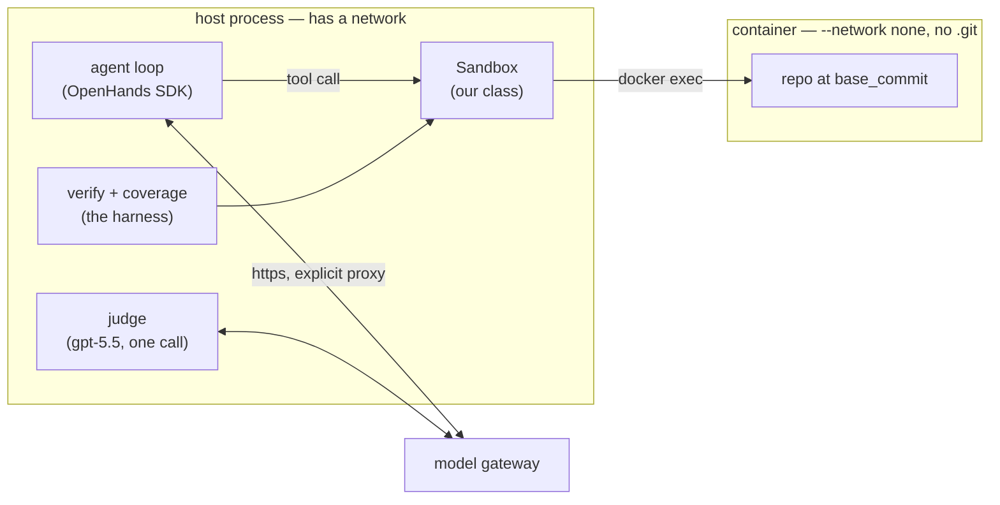
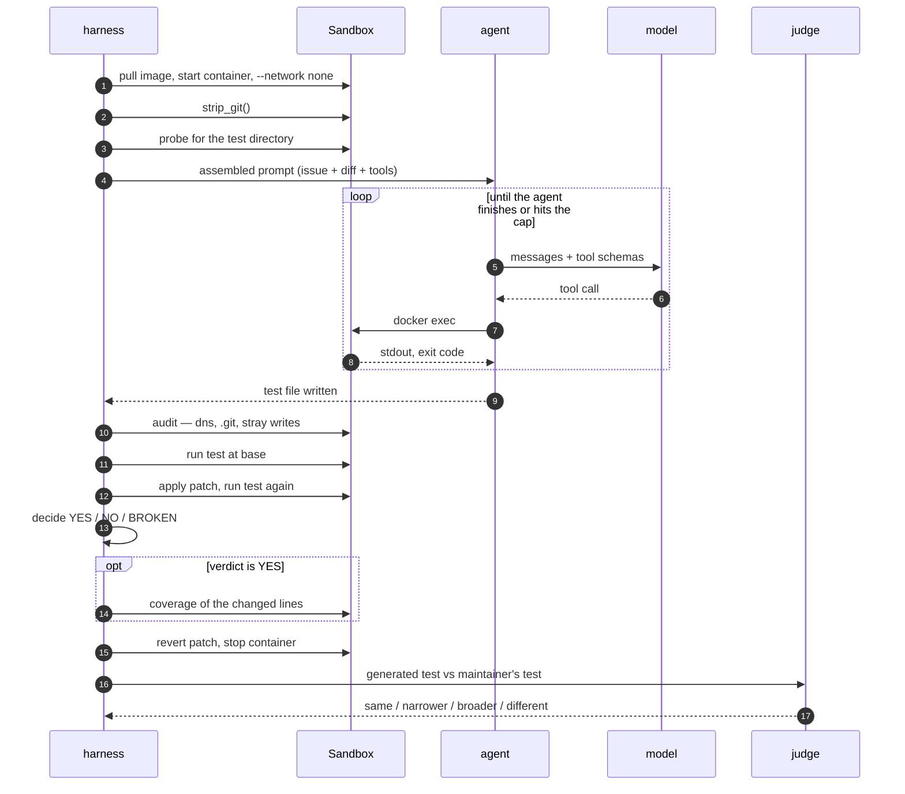

# System design

An OpenHands agent writes a regression test for a merged SWE-bench pull request. The test
has to **fail at the base commit and pass once the fix is applied** — fail-to-pass, F2P.
The maintainer's own test for the same bug is the held-out answer: it is read once, at the
end, to judge the result, and never during generation.

There is no head commit in these images. "After the fix" is a state the harness
constructs by applying the patch and then reverts.

This file describes the system as it stands. The measurements that settled each design,
the bugs that changed one, and what was tried and removed are in [decisions.md](decisions.md).

## The one boundary



The agent runs on the host; only its *effects* enter the container, each as a
`docker exec`. That is what makes `--network none` possible at all — the model connection
stays outside, so the box can be sealed without cutting the agent off from the model.

Two things follow from it:

- The container cannot reach PyPI, GitHub or a search engine, so the fix cannot be looked
  up in a later release. Verified per run, not asserted: `dns_resolves` is recorded.
- `.git` is deleted before the agent starts. A worktree was shown to be able to read the
  future test out of history, which would have made every result meaningless.

`Sandbox` is roughly 130 lines of our own code, not an SDK concept. It owns the container
lifecycle and is the only route into it: every tool executor takes a `box` and has no
other exit.

## One pull request, end to end



Order is the safety property. The judge is the only step that reads the maintainer's test,
and it runs last — enforced by where the call site is, not by a flag.

## The verdict

Two runs of the same file, and a decision that touches no container:

| condition | verdict | reading |
|---|---|---|
| nothing collected on either side | `BROKEN` | the file never ran — our fault, not a result |
| an expected id never appeared | `BROKEN` | runner or parser problem |
| still failing after the fix | `NO` | the test is wrong, not the code |
| passing before the fix too | `NO` | it does not test the change |
| fails before, passes after | `YES` | |

`BROKEN` is kept apart from `NO` deliberately: collapsed together, every harness bug reads
as a model failure ([decisions.md](decisions.md)).

`SKIPPED` is not a failure: only `FAILED` and `ERROR` count as behavioural, so a skipped
test contributes to neither side.

## Coverage

One definition: **of the executable lines this pull request changed, how many did the test
execute.** Not file coverage, and not a score to raise.

Four things make it easy to get wrong, and each returns a wrong number rather than an
error:

- It must be measured **at head**. Lines the patch adds do not exist at any other moment.
- The line numbers come from **diffing the file before and after**, not from the diff
  header. `git apply` relocates a hunk whose context has moved — one instance reported
  `Hunk #1 succeeded at 993 (offset 22 lines)`, and the header's numbers pointed at an
  unrelated method.
- Comments and blank lines are invisible to coverage, so the denominator is
  `executed | missing` rather than every changed line.
- The repository's own `.coveragerc` is overridden. One project sets `parallel = True`,
  which writes a suffixed data file and makes the report say `No data to report.`;
  another sets an `include` whitelist that silently hides changed files outside it.

Measured **only for a `YES`**. Asking how much of a change a test exercised presumes the
test exercises the change; for a `NO` or a `BROKEN` it presumes something false.

Two instances sit at the metric's edges and a third shows what it cannot see at all --
a deletion-only patch, a symmetric fix half-tested, and a test at 100% that cannot
distinguish the fix from its absence. [decisions.md](decisions.md) has all three.

## Mutation

Fail-to-pass says the test fails at base and passes at head. Changed-line coverage says it
executed the lines the fix touched. Neither says the test would *object* to a fix that is
nearly right — a test can flip, run every changed line, and still pass against a version of
the patch with a comparison inverted or a boundary off by one.

So `--mutants N` adds a step between the agent's output and the judge. Each mutant is a
single small edit to the *fixed* code; the test is run against it. A mutant the test fails
on is **killed**, one it still passes is a **survivor**, and each survivor names something
the test does not pin down.

### Deterministic, and no model call

The mutants come from `mutmut` 3.7.0 — libcst 1.9.0 under it — not from a model, so the
denominator does not move between runs of an unchanged test ([decisions.md](decisions.md)).

`create_mutations(filename, source, covered_lines)` returns every mutation the operator
set offers; `module.deep_replace(original, mutated)` applies exactly one. Two runs of the
same instance produce byte-identical mutants, which has been checked.

**Confined to the change.** `mutmut` will mutate a whole file given the chance; only
mutations landing on lines the pull request touched are kept. A mutant elsewhere in the
file asks whether the test covers code the pull request never changed, which is a
different question and not the one being scored.

**Spread, not clustered.** `_spread` round-robins over `(file, line)` groups before
taking the first N, so ten mutants on a two-file patch sample both files and several lines
rather than ten variants of one expression.

### No gate: both columns, raw

Every mutant is run against **two** tests — the agent's, and the maintainer's from
`test_patch` — on the identical mutant set, and both numbers are reported side by side,
unfiltered. The developer column is the control: the same mutants asked of a test nobody
here wrote. An earlier design filtered the denominator down to mutants the maintainer's
test kills; that gate is gone, and [decisions.md](decisions.md) says why, with the figures.

`mutmut`'s operators work on expressions, so a patch that only adds a statement or a
declaration offers them nothing and scores `0/0` — reported as that rather than as a
perfect score. Six of 23 instances do ([decisions.md](decisions.md)).

### Two guards

Before any mutant, **both** tests must pass on the unmutated fixed code — otherwise every
mutant reads as killed and the score is meaningless rather than obviously wrong. And the
tree is returned to base afterwards, tests off, because a tree left patched would make the
next "before the fix" run be the after run.

Every mutant is written to `<run>/<instance>/mutations/NN-<name>.diff` with an `index.json`,
so a survivor can be read as a diff rather than taken on trust.

### The agent's copy, and why the pool is split

`mutation` is also one of the agent's tools. That is a problem for the metric before it is
a feature: `generate` is deterministic, so the tool and the measurement would otherwise be
handed the *same* mutants, and an agent that tunes its test until those ten die would then
be scored on those ten. Testing on the training set.

So `split_pool` draws a pool and halves it — the agent sees one half, the harness scores
the other, and `held_out: true` goes into the result because a score on a fresh sample and
a score on a tuned-against sample are different quantities that must not share a column.

The halving happens at the *candidate* level, inside each `(file, line)` group, and the
side each group starts on rotates with its position. Both details are load-bearing and
both were bugs first — splitting by line, then splitting by operator kind ([decisions.md](decisions.md)).

The agent's copy never applies `test_patch`. The developer's test is the held-out answer,
and a tool that installed it during the agent's turn would put it in a tree the agent can
read.

What it can buy is bounded: across 90 mutants in 23 instances there is exactly one
survivor the maintainer's test kills and the agent's does not ([decisions.md](decisions.md)).

### Ordering, and what the agent never sees

This reads `test_patch`, the held-out answer, so it sits where the judge sits: after the
generated test is finalised and scored. It runs only for a `YES` — asking what a test
would notice about a wrong fix presumes it notices the right one — and inside the sandbox,
since every mutant needs the container the verdict was computed in.

The agent is never told a mutant exists, never sees a survivor, and never sees a mutation
score. A score in front of the agent is a score to raise.

## The judge

One call per instance to a stronger model that wrote none of these tests, after the F2P
verdict is settled. It answers three questions and they are kept apart, because a test can
be about the right behaviour and still be unreadable, or read well and miss half the bug.

| field | question |
|---|---|
| `verdict` | same / narrower / broader / different — is it about the same behaviour as the maintainer's test |
| `issue_coverage` | does it reach every behaviour the pull request settles, with the ones it misses named |
| `readability` | would it pass review — names, whether assertions state an expectation, whether a reader can tell what is pinned |

`issue_coverage` is judged against the **issue and the fix**, not against the maintainer's
test: that test is evidence of what mattered, not the definition of it, so a test covering
one branch of a two-branch fix is incomplete even where the maintainer tested only that
branch too.

It reads independently of changed-line coverage, and the two have agreed on the same gap
by different routes ([decisions.md](decisions.md)).

None of the three feeds the F2P verdict.

## Three test-runner conventions

Twelve repositories, three ways of naming and running a test. `run_tests` hides all of it
behind a path.

| kind | command | node ids |
|---|---|---|
| pytest | `python -m pytest -v -rA …` | `path::test_name` |
| django | `./tests/runtests.py --verbosity 2 <label>` | `test_x (a.b.C.test_x)`, or the test's **docstring** |
| sympy | `bin/test <path>` | bare function names, no path — and pytest is not installed |

Version spread matters as much as the repository. pytest 3.3 prints no short-summary
section at all, so `-v` is passed as well and the per-test line is parsed; `--no-header`
arrived in pytest 6.0 and is a usage error in the 4.5 that pytest's own repository runs.

## Which model answers

Everything a model needs is data in `models.json`, the way `features.py` holds what the
agent is given — and unlike `features.py`, outside the code, because adding a model is
configuration rather than a change to how the system works. A `ModelProfile` names the provider, API mode,
token ceiling, timeout and retries for a glob of model ids; a `Provider` names the prefix
litellm needs and which variables hold the credentials. `models.py` is the loader.
`--model`, `--judge-model` and `--provider` are generated from the registry, and
`parallel.py` forwards them to children — without that a `--parallel` run would print one
model in its header and use another.

A JSON registry has no compiler behind it, so the loader supplies what the dataclass used
to. An unknown key is refused by name: `"timout": 900` is a `TypeError` in Python and a
silent no-op in JSON. A model naming an undefined provider is refused. A missing or
malformed file says which path it read. And every entry carries a `note`, because the
reason for a value is the part a config file usually loses — the `gpt-5.5` entry explains
the `choices[0]` bug where a bare `false` would explain nothing.

**Precedence is CLI flag, then `models.json`, then `FALLBACK_LLM_*`, then the built-in
defaults.** It was written the other way round first, and the reason it was inverted is
in [decisions.md](decisions.md). Two things follow from the order. Profile tuning fields default to `None`, since
a field with a real default can never fall through to a fallback; `None` is how an entry
says *this one has no opinion*. And `describe()` prints resolved values with a star on
the ones the file actually names.

### What a profile cannot fix

`gpt-5.5` through the LiteLLM gateway puts a text preamble in `choices[0]` and the tool
call in `choices[1]`. The SDK reads the first and treats the reply as final, so the agent
records zero actions. No value in a registry reaches that, because the choice is made
inside the SDK: the profile carries `picks_first_choice: false`, and `llm_adapters.py`
wraps the SDK's `LLM` to reorder the choices ([decisions.md](decisions.md)).

## Parallelism

Workers are separate **processes**, because the SDK's tool registry is a process-global
resolved lazily at agent construction. Threads would share it.

That makes every shared resource a hazard, and two were real:

- Container reaping went by name, so each worker's `docker rm -f` over `f2p-*` deleted
  the containers its siblings were working in. Names now carry the owning process id and
  only unowned containers are reaped.
- Two 3 GB image pulls sharing a slow link finished neither. Pulls are serialised behind
  a lock file, and one attempt gets the whole link.

## Modules

<!-- generated:modules -->
| module | lines | what it is |
|---|---|---|
| `agent.py` | 925 | The agent arm: an OpenHands agent that writes fail-to-pass tests inside a container. |
| `checks.py` | 131 | What the agent actually did, checked rather than assumed. |
| `compare.py` | 180 | Does the generated test check the same thing the developer's test checks? |
| `coverage_metric.py` | 416 | Of the lines this pull request changed, how many did the test execute? |
| `dataset.py` | 70 | Where the SWE-bench Verified rows come from, and how they are found. |
| `docs.py` | 167 | Refresh the generated blocks in `docs/system-design.md`. |
| `features.py` | 255 | What the agent is given, as one registry that everything else reads. |
| `flow.py` | 114 | One chronological record of everything that happens to one PR. |
| `image_cache.py` | 278 | Instance images kept on the host disk, so each one is pulled from the registry once. |
| `images.py` | 404 | Prepared SWE-bench images, and the disk they compete for. |
| `layout.py` | 29 | Where the project is on disk, and the environment it runs with. |
| `llm_adapters.py` | 184 | Adaptations that a configuration value cannot express. |
| `llm_config.py` | 182 | One place the model connection is configured, shared by every caller. |
| `models.py` | 299 | Which model answers, and what it needs, read from `models.json`. |
| `mutants.py` | 512 | Does the test notice when the fix is subtly wrong? |
| `oracle.py` | 105 | Oracle sweep: run the developer's own test through our verifier, on every PR. |
| `parallel.py` | 245 | Running several pull requests at once, as separate processes. |
| `prompt.py` | 237 | Assemble the agent's prompt from the pieces in prompts/. |
| `prs.py` | 322 | The instances we develop against: twenty-six, spanning every repository and a decade. |
| `runners.py` | 350 | Three test-runner conventions, and how to read what they print. |
| `runs.py` | 479 | `RUNS.md` in a run folder -- the state of every instance, for someone who has just cloned this. |
| `sandbox.py` | 326 | One container per instance, and the only door into it. |
| `sandbox_tools.py` | 790 | OpenHands tools whose executors run inside the SWE-bench container. |
| `statements.py` | 89 | Which statement a line belongs to. |
| `swebench_env.py` | 91 | The SWE-bench environment, as one import. |
| `trace.py` | 128 | Read back everything a run left behind, in the order it happened. |
| `trajectory.py` | 304 | Export a run in the OpenHands trajectory format, for the trajectory visualizer. |
| `verify.py` | 501 | The F2P decision. One implementation, used by every arm. |
<!-- /generated:modules -->

## The agent's tools

<!-- generated:tools -->
- `run`
- `write_file`
- `run_tests`
- `coverage`
- `mutation`
- `verify`
<!-- /generated:tools -->

Everything the agent is told about how this repository tests comes from one place.
`repo_facts(box, test_file)` in `runners` reads the checkout directly — runner, target
directory, the project's own pytest configuration verbatim, and the names of
neighbouring tests — and that text becomes the `15-repo.md` prompt piece. It is
measurement, not inference: no model call, and the same code path `run_tests` uses to
build the command. Style is the one thing it does not answer, because it cannot be
answered generally; the agent is told to read a neighbouring test and see for itself.
There was a `repo_info` sub-agent here once, and [decisions.md](decisions.md) says why it went.

`verify` and `coverage` exist for the agent too, not only for the harness. The agent may
call them as often as it likes; what is *recorded* is the harness's own run, after the
agent has stopped. Under `--no-patch` neither is registered, because both need the diff.

### `mutation`

Registered beside `coverage` and gated the same way. It is the only tool whose existence
changes how the harness measures -- see **The agent's copy, and why the pool is split**.

Watching it be used produced two prompt fixes and one instructive non-fix ([decisions.md](decisions.md)).

## The prompt

Assembled at run time from one file per instruction, in filename order, so a result that
moves can be attributed to the instruction that moved it and a piece can be dropped for
one arm and kept for another.

<!-- generated:prompts -->
| file | job |
|---|---|
| `10-situation.md` | Establishes where the model is and, critically, that the bug is still present. Without this the model tends to assume the code is already correct and writes a t |
| `15-repo.md` | How testing works in this checkout -- runner, target path, neighbouring tests, and the project's own pytest configuration verbatim. Read off the tree by `repo_f |
| `16-explore.md` | What to establish about the checkout, for runs where the harness hands none of it over. The counterpart to `15-repo.md`, which is dropped in the same configurat |
| `20-goal.md` | The deliverable, stated as an engineering task rather than as our scoring function. This was rewritten after review. The earlier version read "write a test that |
| `30-issue.md` | The bug report, verbatim from the dataset's problem_statement field. This is the only instance data the model ever sees. The developer's fix and the developer's |
| `35-change.md` | The pull request's diff, framed as evidence to interpret rather than a target to satisfy. The closing instruction used to be "the test has to run the lines abov |
| `40-tools.md` | Describes the tools in terms of when to reach for each, since the schemas already say what they are. Two things are stated outright because leaving them implici |
| `45-tools-verify.md` | Introduces `verify` as the property the test must have rather than a score. Separable because it only exists once the diff is an input: with the patch withheld  |
| `46-tools-coverage.md` | Says what `coverage` is *for* -- a better test -- which the previous version left implicit while describing only what it reports. Sixteen of twenty-two agents n |
| `47-tools-mutation.md` | Says what `mutation` is for, and how to read a survivor without gaming it. This is the sharpest instrument in the set and the easiest to cheat, so the wording c |
| `50-rules.md` | The constraints. The first one is load-bearing for the measurement rather than for the model -- an agent that edits the library can make any test pass, and then |
| `55-check-runs.md` | Step one of the finishing sequence, and the only step that exists in every configuration -- `run_tests` is registered whether or not the diff was given. Split f |
| `56-check-flips.md` | Step two. Dropped with the diff, since `verify` needs the patch to have a second state to run against. |
| `57-check-reaches.md` | Step three, plus how to read a low figure. Dropped with the diff, and by `--no-coverage-tool` on its own. Rewritten twice. The first version said "iterate until |
| `57b-check-notices.md` | The mutation step of the finishing sequence. Numbered between `coverage` and the stop condition because it is the last and strictest of the three questions, and |
| `58-finish.md` | The stop condition, on its own so that changing when the agent stops does not mean editing what it checks. Rewritten twice. The first version ended the sequence |
<!-- /generated:prompts -->

`prompts/followups/` holds messages sent *after* the task rather than pieces of it, and
the table above does not list them because `pieces()` globs `prompts/*.md` and joins
everything it finds into the opening prompt. There is one: `second-chance.md`, sent by
`--second-chance` when a run stops with nothing a judge could score.

Some of it is load-bearing for the *measurement*: `50-rules.md` forbids editing anything
but the test file, without which an agent can make any test pass by changing the library
and the "before" run stops being a fact about the pull request.

The rest is workflow, and workflow is a thumb on the scale — the `5x` checks hand over a
sequence the agent might not have found alone. One rule governs their wording: an
instruction has to be equally correct advice if no judge existed. Asking is mandatory,
raising the answer is not, and a call with no assertion behind it is named as
unacceptable. Several pieces have been rewritten against that test ([decisions.md](decisions.md)).

## Configuration

A run is defined partly by its instance and partly by what the agent was *given*. Those
switches are one registry, `features.py`, rather than booleans threaded by hand through
the prompt builder, the tool registration and the child command line. A `Feature` names itself, the tools that live
and die with it, and the features it depends on:

```python
Feature("coverage-tool",
        "withhold the `coverage` tool. The harness still measures changed-line "
        "coverage; the agent just cannot see it while it works",
        needs=("patch",), tools=("coverage",))
```

That single entry produces a `--no-coverage-tool` flag, a line in `--help`, dependency
handling, a place in every recorded result, and the ability to gate a prompt piece. There
is nowhere else to edit.

Two rules are enforced rather than documented. **Dependencies cascade**: `coverage`
needs the diff, so `--no-patch` withdraws it too and reports
`without patch, coverage-tool (needs patch)` — refusing the combination would only make
the caller pass two flags to mean one thing. **Something has to describe the bug**:
`--no-issue --no-patch` is refused, because with neither the report nor the diff the task
is not harder but impossible, and the run would still write a row that looks like a
measurement.

### Withholding a component can mean adding an instruction

`--repo-search` is the one feature where taking a component away is not enough: drop the
briefing on how this project tests and the agent has to be *told* to work it out, or the
run measures a missing instruction rather than a missing input. So `prompt.py` has a
negated condition — `needs: !repo-facts` keeps a piece only while that feature is off —
and `16-explore.md` asks the questions `15-repo.md` would have answered.

Two mechanisms exist because of it. `written_test_path` resolves where the agent actually
put its test — the write log, confirmed against the container, then a `find`, then the
harness default — and `verify`, `recheck` and `mutate_saved` all take that path rather
than re-deriving it. Both paths are recorded, as `test_path` and `test_path_default`.
And `reveal_runner` controls whether a tool's *description* names the runner command,
with `_check_no_leak` refusing to register one that does while `repo-facts` is withheld.
Each of those was a leak or a manufactured failure first ([decisions.md](decisions.md)).

### New files are allowed; edits are not

The agent may create whatever files its test genuinely needs -- a fixture directory, a
sample package, data to read. It may not modify or delete a file that was already there.

The asymmetry is the whole point, and it is about the measurement rather than about
tidiness. **A file that did not exist at base is present in the before run and the after
run alike, so it cannot make a test appear to flip.** A file that did exist and now
differs can: library source most obviously, and an edited fixture also risks rejecting the
maintainer's test when that is applied later.

This is enforced, not requested. `tree_status()` separates git's `??` from `M` and `D`,
and a run that altered anything pre-existing is recorded `BROKEN` with the paths named --
its before-the-fix run is not a fact about the pull request, whatever the test does.
Mutation is skipped for it, since there is nothing trustworthy to mutate against.

The rule used to be "create only the test file", which is a blunter proxy for the same
concern and one that forbids what real tests need: `sphinx-10614`'s bug is about links
*in nested directories*, the base fixture has no nested directory, and the maintainer's
own test for it touches six files. See [decisions.md](decisions.md).

### What the agent changed, verified

The tree is compared against a snapshot taken before the agent is let in, held in a
repository **outside** the checkout:

    git --git-dir=/tmp/f2p_tree.git --work-tree=/testbed

Outside, because `setuptools_scm` and friends compute a package version from git and
every verdict on record was taken with no repository under `/testbed`. `tree_changes()`
returns an exact list of what moved, including a `sed -i` or a shell redirect that the
tool log cannot see. The check it replaced could not have caught anything ([decisions.md](decisions.md)).

### An input is not its tool

The diff and `verify` are separate features. The harness holds the patch in every
configuration, so `verify` can report whether the agent's test flips without the agent
seeing a line of the diff — the verdict is a fact about the agent's own test. `coverage`
is the one that genuinely cannot be separated: it prints the source of missed lines, and
those lines *are* the diff.

| what the agent gets | leaks the diff? |
|---|---|
| the flip verdict from `verify` | nothing — it describes the agent's own test |
| `verify`'s shortfall line | a count: "3 of the 5 lines this pull request changed" |
| the `coverage` tool | **yes** — the source of each missed line and its conditions |

That middle row is why `verify` adapts its own output: when `coverage` is not registered
it must not say "call `coverage`". The executor is told whether the tool exists beside
it and words the shortfall accordingly ([decisions.md](decisions.md)).

### The prompt has to follow

A configuration that removes a tool but leaves the text describing it sends the agent
after something that never answers — and that failure is silent, findable only by reading
a transcript several runs later. So the prompt adapts two ways.

`needs:` in a piece's header drops the piece: `35-change.md` *is* the diff. But most
instructions are not all-or-nothing, so `{?feature} ... {/feature}` inside a body drops a
paragraph. Withholding the diff should not delete the goal, only the clause telling the
agent to work out what the code will do *after* the change; and the finishing sequence
keeps its first check while losing the sentence that frames three of them as a sequence.

| configuration | pieces | tools the agent holds |
|---|---|---|
| `full` | 15 | `run` `write_file` `run_tests` `verify` `coverage` `mutation` |
| `no-issue` | 14 | `run` `write_file` `run_tests` `verify` `coverage` `mutation` |
| `no-coverage-tool` | 13 | `run` `write_file` `run_tests` `verify` `mutation` |
| `no-mutation-tool` | 13 | `run` `write_file` `run_tests` `verify` `coverage` |
| `no-coverage-tool+mutation-tool` | 11 | `run` `write_file` `run_tests` `verify` |
| `no-patch+coverage-tool+mutation-tool` | 10 | `run` `write_file` `run_tests` `verify` |
| `no-verify-tool+coverage-tool+mutation-tool` | 9 | `run` `write_file` `run_tests` |
| `no-patch+verify-tool+coverage-tool+mutation-tool` | 8 | `run` `write_file` `run_tests` |

Twenty-four configurations are reachable from six switches — `--no-issue` with `--no-patch`
is refused, since with neither the report nor the diff nothing says which bug to write a
test for, and a run that still produced a verdict would be worse than one that stopped.
Every reachable one is built and scanned as part of checking this in.

Then it is checked. `prompt.build` scans the assembled text for the names of tools that
were not registered and raises, naming the piece to fix; an unknown feature name in a
`needs:` or a `{?...}` raises when the piece is parsed. The scan works because the pieces
backtick tool names consistently — `` `coverage` `` is the tool, "changed-line coverage"
is prose.

### Comparing configurations

There is no pair-comparison code, by decision. Every result records `features.config`,
and `RUNS.md` states which configuration produced its rows and warns when they came from
more than one. A series is a directory ([decisions.md](decisions.md)):

```bash
uv run openhands-f2p --out-root out/full
uv run openhands-f2p --out-root out/nocov --no-coverage-tool
```

## CLI

<!-- generated:cli -->
**the instances to run**

| flag | what it does |
|---|---|
| `which` | 1..26, an instance id, a repository prefix ('django'), a tier ('tier5'), or 'all'. Default: `all`. |

**the run**

| flag | what it does |
|---|---|
| `--max-iterations` | hard cap on agent steps per PR. Observed use ranges from 12 (sympy) to 65 (scikit-learn), so the headroom is deliberate. Default: `100`. |
| `--dry-run` | show the target path and runner command, make no LLM call |
| `--no-compare` | skip the concept judgement against the developer's test |
| `--mutants` | after the verdict, mutate the lines the patch changed with mutmut and count how many mutants each test kills -- the generated one and the developer's, on the same set. Bare --mutants uses 10. Deterministic and offline; the diffs land in <run>/<id>/mutations/. 0 is off |
| `--second-chance` | refuse the first stop. When a run ends with nothing to score for a reason the agent could have seen itself -- no file written, a file that collects nothing, a test that passes on the unfixed code -- say so and let it carry on, once, on whatever is left of --max-iterations. The cap is not raised and not reset, so a run that stopped at 41 of 100 resumes with 59 and one that reached the cap gets nothing. Never quotes the run against the fixed code, so the agent still only knows what it could establish at base |
| `--mutate-saved` | measure mutation on the tests already written, without running the agent again. Adds the `mutation` field and changes nothing else. Needs --mutants N |
| `--recheck` | re-judge the saved tests under the current harness, without calling the model again |
| `--retry-broken` | run only instances with no result, or whose result is BROKEN. A BROKEN verdict records that the harness or the connection failed and says nothing about the instance, so it is worth retrying; YES and NO are findings and are left alone |
| `--parallel` | how many PRs to run at once (F2P_MAX_PARALLEL, default 5) |
| `--out-root` | write results here instead of out/default/. `out/` is a container of run folders -- one per run, e.g. out/out_full_run/ -- which is how a series stays separable |
| `--label` | a name for this run, recorded in every result. Defaults to the configuration, e.g. no-coverage-tool |

**what to withhold from the agent**

| flag | what it does |
|---|---|
| `--no-issue` | withhold the bug report; the agent has only the diff to work out what the change is for |
| `--no-patch` | withhold the pull request diff from the prompt. The agent has to work out the intended behaviour from the report alone |
| `--no-verify-tool` | withhold the `verify` tool, so the agent can watch its test fail on this code but never watch it pass. The harness still decides the verdict either way |
| `--no-coverage-tool` | withhold the `coverage` tool. The harness still measures changed-line coverage; the agent just cannot see it while it works |
| `--no-mutation-tool`, `--no-mutation` | withhold the `mutation` tool, which runs the agent's test against small wrong variants of the fix and reports which ones it fails to notice. The harness still measures a mutation score afterwards, on mutants the agent was never shown |
| `--no-guard` | stop reverting edits the agent makes to files that were already here. The prohibition stays in the prompt and the audit still reports a dirty tree as BROKEN -- what goes away is the repair between actions, so an agent that applies the fix to the library keeps it. Withhold it to measure how often that happens rather than how often it is caught |
| `--no-require-tools` | stop requiring the agent to have used the tools it was given. With this on -- the default -- a run that finishes without calling a registered instrument is sent back with the names of the ones it skipped, because a tool that is present and unused is a configuration we are not actually measuring |
| `--no-repo-facts`, `--repo-search` | withhold the briefing on how this project tests: the target convention, where a new test file has to live to be collected, the neighbouring tests and the test configuration. The agent establishes those itself, and chooses the directory its test goes in |

**which model answers**

| flag | what it does |
|---|---|
| `--model` | the agent's model (default: gpt-5-mini, from the registry). Profiled: gpt-5-mini, gpt-5.5, gpt-5-nano, gpt-oss-20b, qwen3-coder-30b-a3b-instruct, qwen3-14b, llama-3.1-8b-instruct, gpt-5.6-luna |
| `--judge-model` | the model that compares the generated test with the developer's (default: gpt-5.6-luna, from the registry) |
| `--provider` | override the profile's provider, for reaching the same model id through a different gateway. Choices: `litellm-proxy`, `openai`, `anthropic`. |
<!-- /generated:cli -->

## What a run leaves behind

One directory per instance inside the run folder, indexed by that folder's `RUNS.md` --
[`out/out_full_run/RUNS.md`](../out/out_full_run/RUNS.md) for the twenty-six -- which is
regenerated from the results on disk at the end of every run.

`out/` is a container, not a run: one subdirectory per run (`out/out_full_run/`,
`out/out_compare_repo_search/`), and `out/default/` for a run given no `--out-root`.
Evaluation runs live apart, under `evaluation/out_<model>/`.

`tool_log.json` records what the executor *did*; `trajectory.json` records what the model
*asked for*. When they disagree, the disagreement is the finding.

`out/` is committed, so paths from the developer's machine are scrubbed on the way out.
No credential has reached it — the SDK's completion logger does not record request
headers — and that is checked rather than assumed.

## Layout

Twenty-four modules, flat, one package. No subpackages, and that is deliberate at this
size: directories earn their keep when there are several independent consumers, and there
is one here — the CLI. The import graph has **no cycles** and layers cleanly:

```
features  flow  images  layout  llm_config  prs  runners      leaves
   ├── prompt, parallel        (read the feature registry)
   ├── dataset, runs, trace, compare
   └── sandbox ── coverage_metric
         └── swebench_env      (facade: re-exports images/runners/sandbox/coverage)
               └── verify, sandbox_tools, checks, trajectory
                     └── agent                               entry point
                         oracle                              entry point
```

`features.py` is a leaf on purpose. It is the registry of what the agent is given, and
four layers read it -- the prompt builder, the tool registration, the child command line,
and the recorded result -- so anything it imported would be imported by all of them.

`coverage_metric` rather than `coverage`, so it cannot be confused with the `coverage`
package it drives inside the container. `layout.py` holds `PROJECT_ROOT` and `OUT`.
`swebench_env.py` is a re-export facade left over from splitting two large modules ([decisions.md](decisions.md)).

## The evaluation set

`evaluation/prs.json` holds ten instances nobody looked at while the prompts were
written — one per repository, drawn by seed — and `F2P_PRS_FILE` points the same code at
them with nothing special-cased. They are the only evidence here that the system works
on instances it was not tuned against.

`gpt-5-mini` passes **10/10** of them. Four models have been run over the set; the table
and what it says about where a tool can still help are in
[`evaluation/RUNS.md`](../evaluation/RUNS.md) and [decisions.md](decisions.md).

## A line is not always a statement

Coverage and `mutmut` both work in statements, and a changed line need not be one. A
continuation -- the second line of a wrapped condition -- is in coverage's
`executed_lines` when it runs and in neither list when it does not, so it can be scored
*hit* and never *missed*, and `mutmut` offers nothing on it at all.

`statements.py` maps a line to the innermost statement containing it. Coverage scores the
statement when the changed line itself is unmeasurable, deduplicated so two continuations
of one statement count once; `mutants.py` widens the line set it hands `create_mutations`
the same way. A line that is blank or a bare comment maps to nothing, so a patch touching
only comments is still correctly reported as having nothing to measure.

Widening applies to continuation lines only: a changed line that is already a statement
start maps to itself and nothing changes, which is every ordinary patch. Where it does
apply it widens the question from *this line* to *this statement*, which is the unit the
tools can actually answer for. See [decisions.md](decisions.md).

## Not spending a run to discover it will fail

Two checks run once at startup, before any container. `daemon_refusal` runs `docker info`;
`gateway_refusal` makes one cheap completion, because a LiteLLM key that has spent its
budget answers 429 `budget_exceeded`, which litellm classifies as a rate limit and retries
ten times — twenty minutes per instance, failing with nothing written. Docker is checked
first: it is the cheaper call, and a missing daemon fails every instance rather than some.
Both failures have happened, and both cost a run to discover before the checks existed.

## Known limits

- **One run per instance.** Same-instance variance is visible at n=1: sympy took 3 actions
  on one run and 4 on another, same model and prompt. Action counts are a range.
- **The judge is one model call.** A judgement, not coverage overlap or assertion-strength
  analysis. It is recorded beside the F2P verdict, never folded into it.
- **Isolation rests on discipline, not a process boundary.** The host has a network. The
  guarantee is that every executor takes `box` and has no other exit; a sixth tool
  written carelessly would undo it.
- **Memorisation is not addressed.** `psf/requests` is among the most-copied Python
  repositories on the internet. That can be disclosed, not closed.
- **`BROKEN` conflates the harness failing with the model failing.** It means "the harness
  or connection broke, this says nothing about the instance", and `--retry-broken` treats
  it as retryable. But a model that writes a file which does not import is recorded
  `BROKEN` too -- `nothing collected on either side` -- after finishing normally. On weak
  models that is common, and counting it as `BROKEN` rather than `NO` flatters them.

---

The generated blocks above are refreshed by `python -m openhands_f2p.docs`, which runs at
the end of every agent run. `--check` fails instead of writing, for CI.
