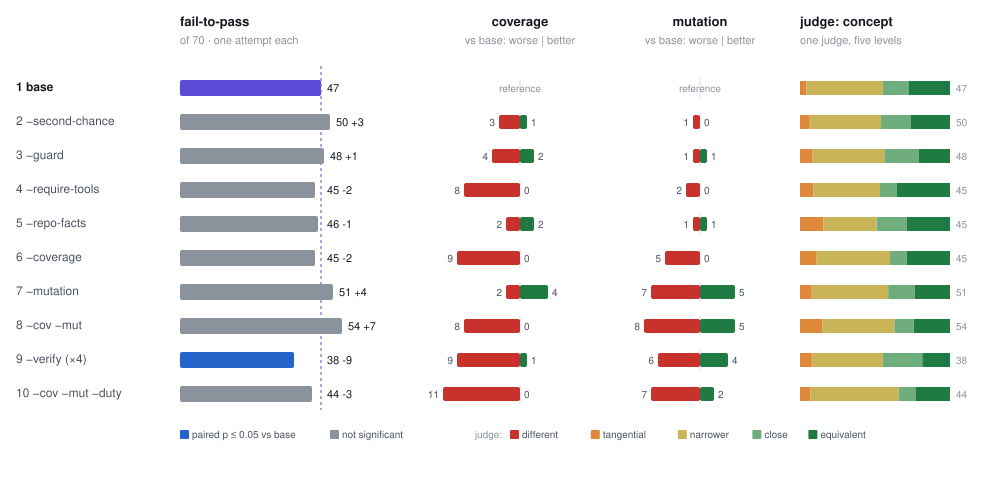
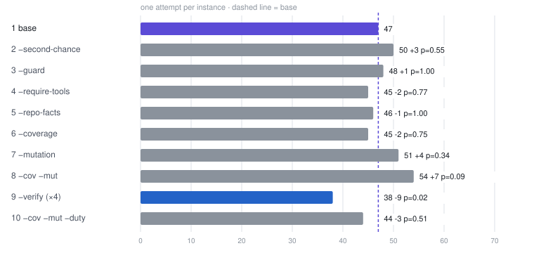
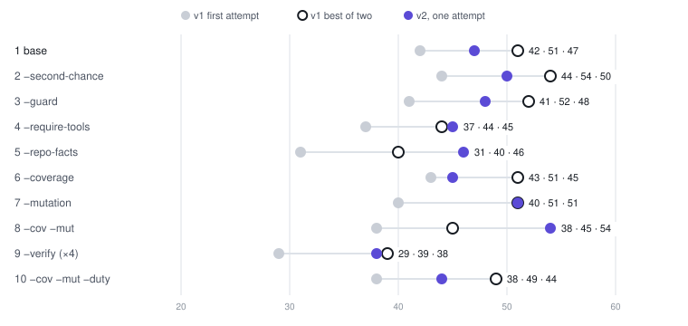
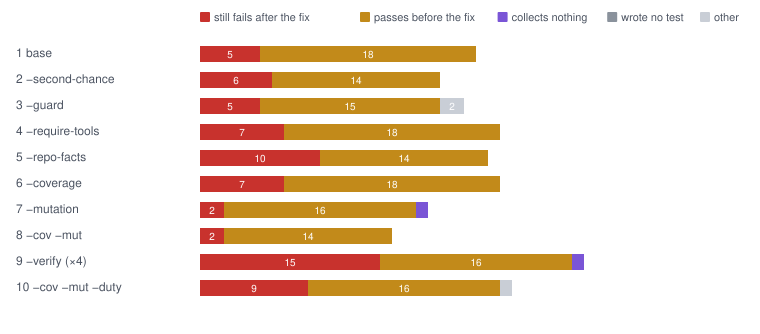
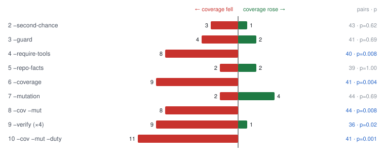
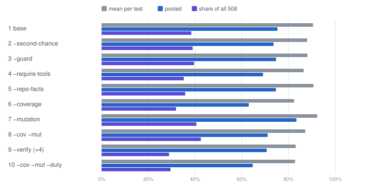
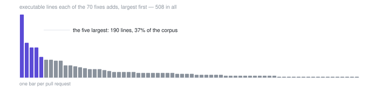
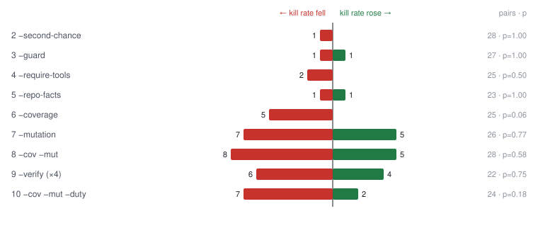
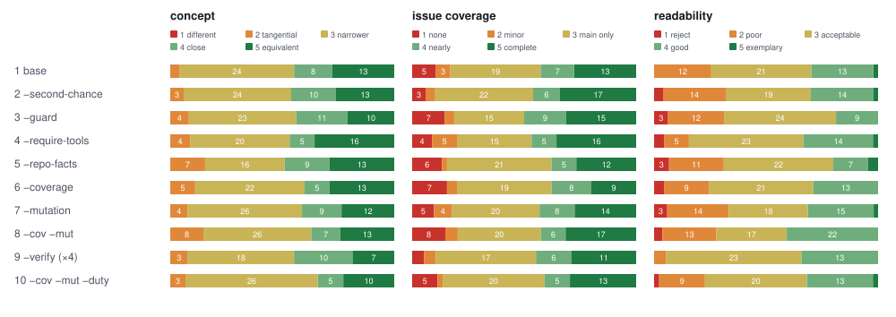
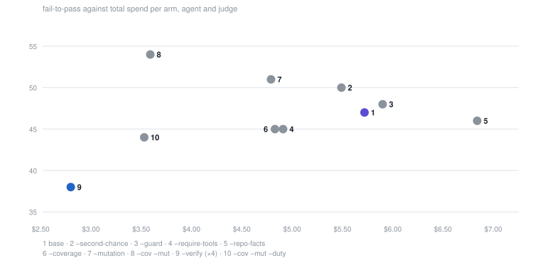

# Ten Arms, Take Two

The same seventy SWE-bench Verified pull requests and the same ten configurations as the first series, rerun on the rebuilt system. An agent writes a test that must fail before a bug fix and pass after it; each arm withholds one thing from it; every run is scored four ways — fail-to-pass, changed-line coverage, mutation kill rate and a judge's reading. What does each tool do to each score?

## The series at a glance

| | |
|---|---|
| runs | **700**, one attempt per instance and arm — no best-of-two retry |
| fail-to-pass at baseline | **47/70** (v1: 42 first attempt, 51 best of two) |
| fail-to-pass, all ten arms | **468/700** (v1 first attempts: 383) |
| removals that moved fail-to-pass at p ≤ 0.05 | **1 of 9** |
| removals that moved coverage at p ≤ 0.05 | **5 of 9** |
| paired mutation / judge comparisons at p ≤ 0.05 | 0 of 9 / 0 of 9 |
| spend per arm, agent and judge | $2.80–$6.84 |

Fail-to-pass is a count. The coverage and mutation columns are movements, not percentages: on the instances that passed in both the base and the arm, how many got worse and how many got better when the feature was removed. A global average cannot be read across arms, because each arm averages over a different set of passing tests. The judge column is a distribution from one judge on a five-level scale.

**In one paragraph.** Each score answers to a different part of the system. Fail-to-pass answers to `verify`: withholding it with the three features that need it costs 9 instances (p = 0.02), and nothing else separates from the base. Coverage answers to the coverage tool and the duty to act on it: every arm without one of them covers less of the change on the same instances, 5 of 9 at p ≤ 0.05, and the one arm that keeps both — −mutation — does not move. Mutation and the judge move for nothing. The second chance converted 1 of the 19 runs it refused.

## 01 What changed since the first series

The first series ran the older harness. Reading its 700 trajectories found defects that changed verdicts, all fixed before this one (the full list is in `docs/bugs-from-700-runs.md`):

- **Every stop is checked**, not just the first: a refused stop used to go through on the second try. A test that cannot be scored is refused at most twice in a row.
- **django's runner collects only `TestCase` methods**, and the briefing now says so.
- **`verify`'s lines agree with its headline**, and a negative verdict is no longer sent as a tool error.
- **A test that asserts the fix's source text is refused.** Six such YES were counted in the first series.
- **Sampling temperature 0.3**, and `coverage` installed from a wheel fetched on the host, so the container never has a network.
- **Each removal removes one thing.** Arms without the guard or the duty are no longer told those exist; the −repo-facts prompt no longer points at the repository root; the −second-chance arm stops refusing exactly where the base does.
- **A run cut off by the gateway is BROKEN, not scored**, and the verdict scores the file the agent ended with.

Each of these was found by reading runs, first on five evaluation instances with all ten arms, then on the first two arms of this series, and fixed once before the full 700 started. After that the code was frozen.

### One attempt, no retry

The first series retried every failure once and kept the better run. That retry measured the noise — 29% of failures passed on an unchanged re-run — but retrying only failures is one-sided: it gives a failure a second chance and never gives a success a chance to fail, which lifts every arm and compresses the differences. This series reports one attempt per instance. Runs that the OpenRouter key's monthly limit cut off partway (347, all BROKEN, none scored) were run again from scratch; that replaces an outage, not a verdict.

Every comparison is **paired**: the same instance in two arms, tested with McNemar's exact test or a sign test. Between two arms, 8 to 22 of the 70 instances change verdict in the two directions at once.

## 02 Fail-to-pass

| # | arm | withheld | YES | net | up | down | p | v1 first | v1 best of two |
|---|---|---|---:|---:|---:|---:|---:|---:|---:|
| 1 | `base` | — | **47** | — | — | — | — | 42 | 51 |
| 2 | `−second-chance` | the second chance | **50** | +3 | 7 | 4 | p = 0.55 | 44 | 54 |
| 3 | `−guard` | the source guard | **48** | +1 | 7 | 6 | p = 1.00 | 41 | 52 |
| 4 | `−require-tools` | the tool duty | **45** | -2 | 5 | 7 | p = 0.77 | 37 | 44 |
| 5 | `−repo-facts` | the testing briefing | **46** | -1 | 7 | 8 | p = 1.00 | 31 | 40 |
| 6 | `−coverage` | the coverage tool | **45** | -2 | 4 | 6 | p = 0.75 | 43 | 51 |
| 7 | `−mutation` | the mutation tool | **51** | +4 | 7 | 3 | p = 0.34 | 40 | 51 |
| 8 | `−cov −mut` | both instruments | **54** | +7 | 10 | 3 | p = 0.09 | 38 | 45 |
| 9 | `−verify (×4)` | verify, and the three that need it | **38** | -9 | 2 | 11 | p = 0.02 | 29 | 39 |
| 10 | `−cov −mut −duty` | two instruments and the duty | **44** | -3 | 3 | 6 | p = 0.51 | 38 | 49 |

One removal clears p ≤ 0.05: the verify bundle (arm 9, -9). −cov −mut is the nearest on the other side, +7 at p = 0.09. Everything else sits within a few instances of the base in both directions — the size of the gap between two runs of the same configuration.

### Against the first series

Every arm scores higher than its first-series first attempt, and 4 of ten reach the first series' best of two in a single attempt. The largest gain is −repo-facts, 31 → 46: that arm's prompt had told the agent something false about where to put its test, and the cost the first series attributed to the briefing (−11, p = 0.027) is gone (-1, p = 1.00).

### How the failures failed

"Still fails after the fix" is 5 in the base and 15 in the arm without verify: a test that does not work looks like a correct one to an agent working at the base commit, and only verify runs it on the fixed code. "Passes before the fix" ranges 14–18 and follows no feature.

## 03 Coverage

Changed-line coverage asks whether the test went near the code the fix changed: run the generated test under coverage, look only at the executable lines the pull request adds, and report the fraction that ran. The harness computes it after the verdict; the agent never sees a percentage.

### Paired, instance by instance

On instances that passed in both arms, each bar counts how many covered less (left) or more (right) with the feature removed. 5 of nine clear p ≤ 0.05, and they are exactly the arms that lose the coverage tool or the duty to act on it:

| removal | pairs | covered less | covered more | p |
|---|---:|---:|---:|---:|
| 2 the second chance | 43 | 3 | 1 | p = 0.62 |
| 3 the source guard | 41 | 4 | 2 | p = 0.69 |
| 4 the tool duty | 40 | 8 | 0 | p = 0.008 |
| 5 the testing briefing | 39 | 2 | 2 | p = 1.00 |
| 6 the coverage tool | 41 | 9 | 0 | p = 0.004 |
| 7 the mutation tool | 44 | 2 | 4 | p = 0.69 |
| 8 both instruments | 44 | 8 | 0 | p = 0.008 |
| 9 verify, and the three that need it | 36 | 9 | 1 | p = 0.02 |
| 10 two instruments and the duty | 41 | 11 | 0 | p = 0.001 |

The same removal can be asked twice, and here it replicates:

| pair asking the same question | pairs | fell | rose | p |
|---|---:|---:|---:|---:|
| coverage tool: base → arm 6 | 41 | 9 | 0 | p = 0.004 |
| coverage tool: arm 7 → arm 8 | 46 | 7 | 1 | p = 0.07 |
| the duty: base → arm 4 | 40 | 8 | 0 | p = 0.008 |
| the duty: arm 8 → arm 10 | 42 | 7 | 0 | p = 0.02 |

The effect is real and it is small, and the corpus explains why. Base covers 75.3% of the changed lines its passing tests could reach; −coverage covers 63.0%. Most fixes are tiny — the median adds 4 executable lines — so most passing tests reach every changed line with or without help. The tool matters on the minority where a line gets missed, and there every paired difference points the same way.

> **The −coverage arms still hear a yes or no.** `verify` measures coverage itself and says whether every changed line ran; the arms without the coverage tool receive that as often as the base (18 runs in −coverage, 16 in the base). What they lose is *which* lines and the code on them. The drop above is the value of that detail, not of coverage feedback as a whole.

### Three numbers that do not rank the arms alike

| # | arm | YES | mean per test | pooled | lines covered | share of 508 | of the five largest |
|---|---|---:|---:|---:|---:|---:|---:|
| 1 | `base` | 47 | 90.5% | 75.3% | 195 | 38.4% | 2 of 5 |
| 2 | `−second-chance` | 50 | 88.0% | 73.6% | 198 | 39.0% | 3 of 5 |
| 3 | `−guard` | 48 | 88.1% | 74.7% | 201 | 39.6% | 3 of 5 |
| 4 | `−require-tools` | 45 | 86.5% | 69.1% | 179 | 35.2% | 2 of 5 |
| 5 | `−repo-facts` | 46 | 90.7% | 74.6% | 182 | 35.8% | 2 of 5 |
| 6 | `−coverage` | 45 | 82.4% | 63.0% | 162 | 31.9% | 3 of 5 |
| 7 | `−mutation` | 51 | 92.3% | 83.4% | 206 | 40.6% | 2 of 5 |
| 8 | `−cov −mut` | 54 | 87.2% | 71.1% | 216 | 42.5% | 3 of 5 |
| 9 | `−verify (×4)` | 38 | 83.1% | 70.7% | 147 | 28.9% | 1 of 5 |
| 10 | `−cov −mut −duty` | 44 | 82.8% | 64.7% | 150 | 29.5% | 1 of 5 |

The seventy fixes add 508 executable lines, and the five largest hold 190 of them (37%). Unpaired averages reward passing fewer, and the corpus share is hostage to those five; the paired table is the one to read.

## 04 Mutation score

Plausible wrong versions of the fix are generated from the real patch and both tests run against each. Only mutants the maintainer's test kills enter the denominator, and the gated rate is the share of those the generated test also kills.

| # | arm | scored | gated mutants | killed | gated rate | raw rate |
|---|---|---:|---:|---:|---:|---:|
| 1 | `base` | 30 | 105 | 84 | 80.0% | 57.7% |
| 2 | `−second-chance` | 32 | 105 | 83 | 79.0% | 54.8% |
| 3 | `−guard` | 33 | 112 | 87 | 77.7% | 53.6% |
| 4 | `−require-tools` | 28 | 101 | 77 | 76.2% | 55.1% |
| 5 | `−repo-facts` | 28 | 106 | 83 | 78.3% | 56.6% |
| 6 | `−coverage` | 28 | 98 | 63 | 64.3% | 43.4% |
| 7 | `−mutation` | 38 | 201 | 169 | 84.1% | 65.0% |
| 8 | `−cov −mut` | 41 | 213 | 155 | 72.8% | 54.6% |
| 9 | `−verify (×4)` | 26 | 138 | 100 | 72.5% | 52.8% |
| 10 | `−cov −mut −duty` | 31 | 161 | 116 | 72.0% | 55.0% |

The series spans 64.3%–84.1%, and paired against the base no row clears p ≤ 0.05 — including −mutation, the arm without the tool. The strongest lean is −coverage, 5 lower and 0 higher (p = 0.06): a test that reaches more of the change also notices more wrong versions of it, but not significantly. A surviving mutant names a behaviour one test does not pin; between arms, at seventy instances, the score does not resolve.

## 05 The judge

A second model reads the generated test beside the maintainer's and answers three questions a passing verdict cannot. It runs only after the verdict, and it is the only step that opens the maintainer's test. 467 passing tests were judged on one five-level prompt.

| level | concept | issue coverage | readability |
|---:|---|---|---|
| 1 | different | none | reject |
| 2 | tangential | minor only | poor |
| 3 | narrower | main only | acceptable |
| 4 | close | nearly complete | good |
| 5 | equivalent | complete | exemplary |

| # | arm | judged | concept 1–5 | issue 1–5 | readability 1–5 | concept vs base: lower / higher | p |
|---|---|---:|---|---|---|---|---:|
| 1 | `base` | 47 | 0 · 2 · 24 · 8 · 13 | 5 · 3 · 19 · 7 · 13 | 0 · 12 · 21 · 13 · 1 | — | — |
| 2 | `−second-chance` | 50 | 0 · 3 · 24 · 10 · 13 | 3 · 2 · 22 · 6 · 17 | 2 · 14 · 19 · 14 · 1 | 8 / 8 | p = 1.00 |
| 3 | `−guard` | 48 | 0 · 4 · 23 · 11 · 10 | 7 · 2 · 15 · 9 · 15 | 3 · 12 · 24 · 9 · 0 | 6 / 6 | p = 1.00 |
| 4 | `−require-tools` | 45 | 0 · 4 · 20 · 5 · 16 | 4 · 5 · 15 · 5 · 16 | 2 · 5 · 23 · 14 · 1 | 5 / 9 | p = 0.42 |
| 5 | `−repo-facts` | 45 | 0 · 7 · 16 · 9 · 13 | 6 · 1 · 21 · 5 · 12 | 3 · 11 · 22 · 7 · 2 | 4 / 6 | p = 0.75 |
| 6 | `−coverage` | 45 | 0 · 5 · 22 · 5 · 13 | 7 · 2 · 19 · 8 · 9 | 2 · 9 · 21 · 13 · 0 | 8 / 5 | p = 0.58 |
| 7 | `−mutation` | 51 | 0 · 4 · 26 · 9 · 12 | 5 · 4 · 20 · 8 · 14 | 3 · 14 · 18 · 15 · 1 | 8 / 9 | p = 1.00 |
| 8 | `−cov −mut` | 54 | 0 · 8 · 26 · 7 · 13 | 8 · 3 · 20 · 6 · 17 | 2 · 13 · 17 · 22 · 0 | 6 / 5 | p = 1.00 |
| 9 | `−verify (×4)` | 38 | 0 · 3 · 18 · 10 · 7 | 2 · 2 · 17 · 6 · 11 | 0 · 2 · 23 · 13 · 0 | 5 / 4 | p = 1.00 |
| 10 | `−cov −mut −duty` | 44 | 0 · 3 · 26 · 5 · 10 | 5 · 1 · 20 · 5 · 13 | 1 · 9 · 20 · 13 · 1 | 8 / 2 | p = 0.11 |

The judge's picture is the same in every arm: most passing tests are *narrower* than the maintainer's and cover the main behaviour only, and readability is mostly acceptable, spread from poor to good. No removal moves the concept level at p ≤ 0.05. What the judge measures — how close a test is to the one a maintainer would write — is not something any of these tools was built to change.

## 06 Do the four scores agree?

| removal | fail-to-pass | coverage fell / rose | mutation fell / rose | judge lower / higher |
|---|---|---|---|---|
| 2 the second chance | +3 p = 0.55 | 3 / 1 p = 0.62 | 1 / 0 p = 1.00 | 8 / 8 p = 1.00 |
| 3 the source guard | +1 p = 1.00 | 4 / 2 p = 0.69 | 1 / 1 p = 1.00 | 6 / 6 p = 1.00 |
| 4 the tool duty | -2 p = 0.77 | 8 / 0 p = 0.008 | 2 / 0 p = 0.50 | 5 / 9 p = 0.42 |
| 5 the testing briefing | -1 p = 1.00 | 2 / 2 p = 1.00 | 1 / 1 p = 1.00 | 4 / 6 p = 0.75 |
| 6 the coverage tool | -2 p = 0.75 | 9 / 0 p = 0.004 | 5 / 0 p = 0.06 | 8 / 5 p = 0.58 |
| 7 the mutation tool | +4 p = 0.34 | 2 / 4 p = 0.69 | 7 / 5 p = 0.77 | 8 / 9 p = 1.00 |
| 8 both instruments | +7 p = 0.09 | 8 / 0 p = 0.008 | 8 / 5 p = 0.58 | 6 / 5 p = 1.00 |
| 9 verify, and the three that need it | -9 p = 0.02 | 9 / 1 p = 0.02 | 6 / 4 p = 0.75 | 5 / 4 p = 1.00 |
| 10 two instruments and the duty | -3 p = 0.51 | 11 / 0 p = 0.001 | 7 / 2 p = 0.18 | 8 / 2 p = 0.11 |

They do not have to agree, and they don't: they answer to different tools. `verify` moves fail-to-pass; the coverage tool and the duty move coverage; nothing here moves mutation or the judge. A tool can be worth keeping for one score and invisible to the rest.

## 07 verify

| removal | fail-to-pass | tests still failing after the fix |
|---|---|---|
| base → arm 9 (verify and the three that need it) | 47 → 38, 2 up / 11 down, p = 0.02 | 5 → 15 |
| arm 10 → arm 9 (verify alone) | 44 → 38, 4 up / 10 down, p = 0.18 | 9 → 15 (10 became broken, 4 stopped) |

The agent works at the base commit and has never seen the fix, so when it runs its own test there, a correct test and a broken one look the same — both fail. verify is the only channel that applies the patch and runs the test on both sides. Isolated against arm 10 the direction holds but at this sample size it does not clear on its own; the bundle does.

## 08 The second chance

When the agent stops with a test that cannot score — it passes on the unfixed code, collects nothing, or was never written — the second chance refuses the stop and says why. In the base arm it refused 19 stops and 1 of those runs ended fail-to-pass. Told that its test passes before the fix, the agent recovered 1 times in 19.

The refusals were right and the agent acted on them. Of the 20 refused runs, 19 ended exactly as refused (the test passed on the unfixed code) or converted; 20 carried the diagnosis of which mistake the test was making; after the first refusal the agent rewrote its test 2–9 times (median 5) and called `verify` again in 16 of them. What it could not do was work out what the fix changes. None of the defects still pending from reading the 700 runs explains this: one refused run met a false source-text refusal, and it too ended with a test that passes on the unfixed code.

Removing it reads +3 (p = 0.55), which looks like the feature hurts. It cannot: until the agent first tries to stop, the two arms receive the same prompt byte for byte, the same tools and the same code, and the second chance only ever refuses a test that is not fail-to-pass, so it can add a pass and never remove one. Its contribution is the 1 it converted; the rest of the gap is two independent samples of the same process diverging before it ever acts. The finding is that a test aimed at the wrong behaviour almost never recovers, refused or not.

## 09 What removal is worth

| # | arm | agent | judge | total spend | tokens | actions | per YES |
|---|---|---:|---:|---:|---:|---:|---:|
| 1 | `base` | $5.30 | $0.42 | **$5.72** | 73.6M | 3044 | $0.122 |
| 2 | `−second-chance` | $5.06 | $0.43 | **$5.49** | 70.3M | 2965 | $0.110 |
| 3 | `−guard` | $5.48 | $0.42 | **$5.90** | 76.0M | 3107 | $0.123 |
| 4 | `−require-tools` | $4.50 | $0.41 | **$4.91** | 62.3M | 2766 | $0.109 |
| 5 | `−repo-facts` | $6.43 | $0.41 | **$6.84** | 89.6M | 3525 | $0.149 |
| 6 | `−coverage` | $4.42 | $0.41 | **$4.83** | 61.2M | 2804 | $0.107 |
| 7 | `−mutation` | $4.37 | $0.42 | **$4.79** | 60.4M | 2732 | $0.094 |
| 8 | `−cov −mut` | $3.14 | $0.45 | **$3.59** | 43.3M | 2355 | $0.066 |
| 9 | `−verify (×4)` | $2.47 | $0.33 | **$2.80** | 33.8M | 2042 | $0.074 |
| 10 | `−cov −mut −duty` | $3.18 | $0.35 | **$3.53** | 43.9M | 2381 | $0.080 |

−cov −mut keeps verify and the duty, drops both instruments, and reaches 54 for $3.59 against the base's 47 for $5.72 — the cheapest arm that loses no fail-to-pass, at the price of coverage (8 covered less, p = 0.008).

## 10 What is wrong with this evidence

- **One attempt is one sample.** In the first series 29% of failures passed on an unchanged re-run; an arm's count here is noisy by several instances, which is why only paired tests are reported.
- **Three verdicts were re-scored offline.** A django status printed on a later line than its test name was dropped by the output parser; the fixed parser re-read the saved logs (−coverage and −cov −mut −duty django-16454 YES → NO, −repo-facts django-16136 NO → YES). The re-scored YES has no coverage, mutation or judge figure.
- **Known, not yet fixed, reached the agent.** Reading all 700 runs found a handful of cases where a tool told the agent something wrong — the same parser shape inside `verify`, a source-text refusal on a test that writes a fixture, a verify on another file closing the loop — each in a few runs spread across arms. They are listed in `docs/bugs-from-700-runs.md` and left for the next series.
- **The −coverage arms keep verify's yes/no** about whether every changed line ran (section 03).
- **The mutation score is asymmetric by construction**: held-out half when the agent holds the tool, whole pool when it does not.
- **The coverage denominator is an approximation.** The 508-line corpus is counted statically from each fix.diff.

## 11 What the series establishes

| tool | moves | evidence |
|---|---|---|
| verify | fail-to-pass | -9 with its dependants, p = 0.02; still-failing tests 5 → 15 |
| the coverage tool | coverage | 9 / 0 (p = 0.004), again 7 / 1 without the mutation tool |
| the duty to act on the tools | coverage | 8 / 0 (p = 0.008), again 7 / 0 (p = 0.02) |
| the mutation tool | nothing measured | fail-to-pass +4, mutation 7 / 5 |
| the second chance | 1 conversion in 19 refusals | identical to −second-chance until the first stop |
| the testing briefing | nothing measured in v2 | -1; the v1 effect came from a misleading prompt |
| the source guard | an integrity check | +1; invisible to every score by design |

---

Every figure here is computed from the run directories by `data.py`; the charts are drawn by `charts.py`; `build.py` writes this README and the published page from one text. Significance is McNemar's exact test on paired flip tables, or a sign test on paired movements.
