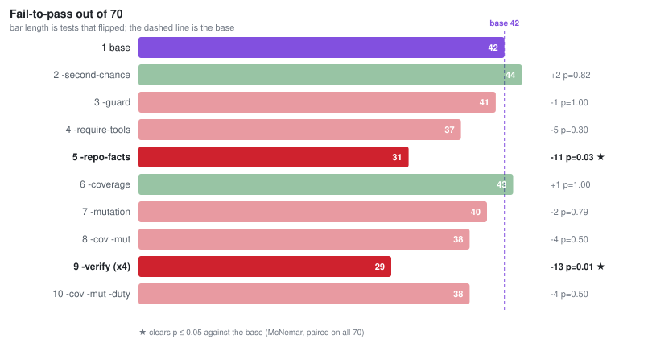
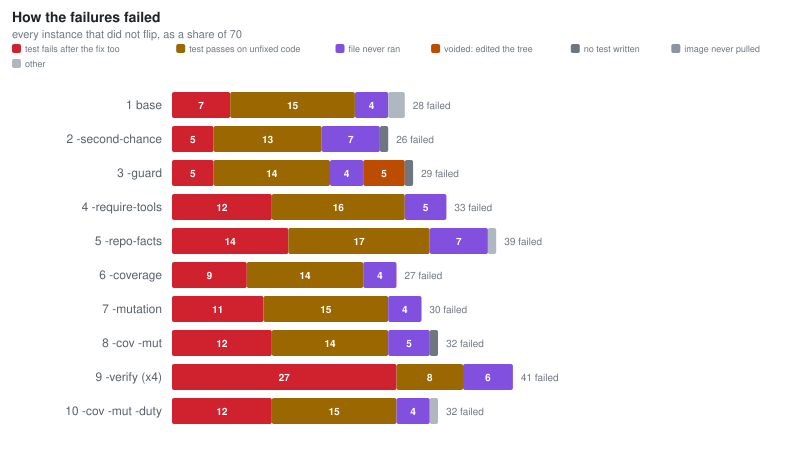
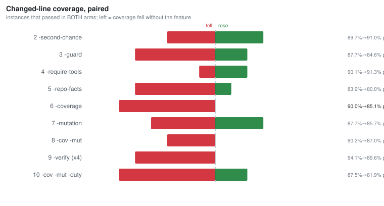
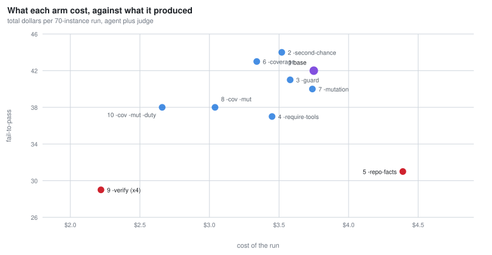

# Ten arms on seventy pull requests

Every arm is the same seventy SWE-bench Verified instances, the same model
(`qwen3-coder-30b-a3b-instruct` pinned to one provider), the same harness commit, and
`--second-chance` on, except where the arm is about removing it. Each withholds exactly
one thing from the agent. The harness measures the same quantities either way, so the
arms differ only by what the agent was given.

Every comparison below is **paired**: the same instance in two arms, read as a
flip table rather than two totals. On seventy instances with this much run-to-run
movement, totals are not readable and pairing is not optional.

## First: did the runs themselves hold up?

A number is worth what the run behind it is worth, and "the agent did badly" and "the
harness fell over" produce the same verdict unless somebody checks. All 700 runs were
swept before anything below was read. `audit.py` reproduces it.

| | across all ten arms |
|---|---|
| runs completed | **700 / 700** |
| duplicate or missing instances | 0 |
| agent errors | 0 |
| runs that ended in a state other than FINISHED | 0 |
| runs that took zero actions | 0 |
| runs that hit the action cap | 0 |
| judge calls that failed | 0 |
| harness tracebacks in any log | 0 |
| model calls | **23,013** |
| transport errors | 0 |
| empty replies | 0 |
| provider | SiliconFlow, 100% |
| arms whose instance set differed from the base | none — all ten ran the same 70 |

Two things looked like anomalies and are not.

**64 "tool errors", all from `mutation`, and all refusals by design.** 53 of them are the
tool declining an ill-posed question -- *your test does not pass on the fixed code yet, so
asking what it notices about a wrong fix has no answer* -- and the rest are the same for a
file that collects nothing. They appear in exactly the six arms that hold the mutation tool
and in none of the four that do not, which is the pattern a working refusal produces.

**Exception names in the logs are bug titles, not failures.** `IndexError` appears 143
times, `TypeError` 55, `OverflowError` 32. Every one is inside a SWE-bench problem
statement being echoed into the flow log -- *"IndexError thrown with LogisticRegressionCV
and refit=False"*, *"sqrtdenest raises IndexError"*. No exception name appears in a harness
frame, and there is not one traceback in 700 runs.

So nothing below is an artefact of a run that went wrong. The failures counted in this
document are the agent's.

## What flipped

| # | arm | withheld | YES | net | up | down | p |
|---|---|---|---:|---:|---:|---:|---:|
| 1 | `base` | everything | **42** | — | 0 | 0 | — |
| 2 | `-second-chance` | second chance | **44** | +2 | 11 | 9 | 0.824 |
| 3 | `-guard` | guard | **41** | -1 | 9 | 10 | 1.000 |
| 4 | `-require-tools` | tool duty | **37** | -5 | 5 | 10 | 0.302 |
| 5 | `-repo-facts` | testing briefing | **31** | -11 | 5 | 16 | 0.027 ★ |
| 6 | `-coverage` | coverage tool | **43** | +1 | 9 | 8 | 1.000 |
| 7 | `-mutation` | mutation tool | **40** | -2 | 6 | 8 | 0.790 |
| 8 | `-cov -mut` | both instruments | **38** | -4 | 8 | 12 | 0.503 |
| 9 | `-verify (x4)` | all instruments + duty | **29** | -13 | 5 | 18 | 0.011 ★ |
| 10 | `-cov -mut -duty` | two instruments + duty | **38** | -4 | 8 | 12 | 0.503 |

**Two of nine comparisons clear p ≤ 0.05**: arm 5 (`-repo-facts`), arm 9 (`-verify (x4)`).

Everything else sits between −5 and +2 with p from 0.30 to 1.00. Those are not small
effects that need more data to confirm; on this corpus they are indistinguishable from
re-running the same configuration twice.

## How the failures failed

The verdict count says how many arms lost. This says what they lost to, and it is where
the instruments separate.

| # | arm | fails after the fix | passes at base | never ran | other |
|---|---|---:|---:|---:|---:|
| 1 | `base` | 7 | 15 | 4 | 2 |
| 2 | `-second-chance` | 5 | 13 | 7 | 1 |
| 3 | `-guard` | 5 | 14 | 4 | 6 |
| 4 | `-require-tools` | 12 | 16 | 5 | 0 |
| 5 | `-repo-facts` | 14 | 17 | 7 | 1 |
| 6 | `-coverage` | 9 | 14 | 4 | 0 |
| 7 | `-mutation` | 11 | 15 | 4 | 0 |
| 8 | `-cov -mut` | 12 | 14 | 5 | 1 |
| 9 | `-verify (x4)` | **27** | 8 | 6 | 0 |
| 10 | `-cov -mut -duty` | 12 | 15 | 4 | 1 |

## Changed-line coverage, paired

Only instances that passed in **both** arms, so the comparison is about test quality
rather than how many tests survived. An arm that produced fewer but easier tests scores
better on any unpaired coverage figure, which is exactly the trap here.

| # | arm | paired n | with | without | fell | rose | p |
|---|---|---:|---:|---:|---:|---:|---:|
| 2 | `-second-chance` | 33 | 89.7% | 91.0% | 3 | 3 | 1.00 |
| 3 | `-guard` | 32 | 87.7% | 84.6% | 5 | 2 | 0.45 |
| 4 | `-require-tools` | 32 | 90.1% | 91.3% | 1 | 2 | 1.00 |
| 5 | `-repo-facts` | 26 | 83.9% | 80.0% | 5 | 1 | 0.22 |
| 6 | `-coverage` | 34 | 90.0% | 85.1% | 6 | 0 | 0.03 |
| 7 | `-mutation` | 34 | 87.7% | 85.7% | 4 | 3 | 1.00 |
| 8 | `-cov -mut` | 30 | 90.2% | 87.0% | 3 | 0 | 0.25 |
| 9 | `-verify (x4)` | 24 | 94.1% | 89.6% | 5 | 0 | 0.06 |
| 10 | `-cov -mut -duty` | 30 | 87.5% | 81.9% | 6 | 2 | 0.29 |

## What each arm cost

| # | arm | agent | judge | total | tokens | actions | per YES |
|---|---|---:|---:|---:|---:|---:|---:|
| 1 | `base` | $3.46 | $0.29 | **$3.75** | 47.5M | 2411 | $0.089 |
| 2 | `-second-chance` | $3.52 | $0.00 | **$3.52** | 48.3M | 2445 | $0.080 |
| 3 | `-guard` | $3.58 | $0.00 | **$3.58** | 49.0M | 2434 | $0.087 |
| 4 | `-require-tools` | $3.19 | $0.26 | **$3.45** | 43.8M | 2295 | $0.093 |
| 5 | `-repo-facts` | $4.15 | $0.24 | **$4.39** | 57.3M | 2801 | $0.142 |
| 6 | `-coverage` | $2.97 | $0.37 | **$3.34** | 40.6M | 2243 | $0.078 |
| 7 | `-mutation` | $3.41 | $0.33 | **$3.74** | 46.7M | 2409 | $0.093 |
| 8 | `-cov -mut` | $2.72 | $0.32 | **$3.04** | 37.1M | 2147 | $0.080 |
| 9 | `-verify (x4)` | $1.97 | $0.25 | **$2.22** | 26.7M | 1825 | $0.077 |
| 10 | `-cov -mut -duty` | $2.35 | $0.31 | **$2.66** | 32.0M | 1978 | $0.070 |

## Isolating `verify`

Arm 9 is a four-way change: `verify` is a dependency of the coverage tool, the
mutation tool and the tool duty, so withholding it withholds all four and leaves the
agent no instruments at all. Arm 10 withholds the other three and keeps `verify`, so
**the pair differs by that one tool**.

| | fail-to-pass | up | down | p |
|---|---:|---:|---:|---:|
| arm 10 → arm 9, removing `verify` | 38 → 29 (-9) | 8 | 17 | **0.108** |

On the verdict count that is suggestive and short of significant, with 25 instances
discordant. But the verdict is the wrong place to look: a broken test only changes a
verdict when that instance would otherwise have passed, and most would not have. The
mechanism is where the evidence is.

| paired on *did this instance produce a test that fails after the fix?* | |
|---|---:|
| broken with `verify` (arm 10) | 12 |
| broken without it (arm 9) | **27** |
| became broken when `verify` was removed | **20** |
| stopped being broken | 5 |
| McNemar | **p = 0.0041** |

**This is the firmest result in the series.** And the reason is structural, not a
matter of the model trying harder. The agent works in a checkout at base and has
never seen the fix; when it runs its own test there, a correct test and a broken one
look identical, because both fail. Only `verify` applies the patch and runs the test
on both sides. It is the single channel through which the agent can learn that its
test fails for the wrong reason, and that fact cannot be handed over any other way
without also telling it what the fix does.

## Where a single arm was not enough

Arm 8 withholds two instruments at once, which makes some comparisons available
twice. Twice is the minimum needed to notice when a result does not hold.

**The coverage tool.** Arm 6 looked like a finding and did not survive re-asking:

| pair | n | coverage fell | rose | p |
|---|---:|---:|---:|---:|
| base -> arm 6 | 34 | 6 | 0 | 0.03 |
| arm 7 -> arm 8 | 30 | 3 | 3 | 1.00 |
| arm 10 -> arm 9 | 21 | 2 | 1 | 1.00 |

The first row was reported as a result when it was found. The second asks the same
question of a different set of instance-pairs and answers three and three. The
direction has never reversed -- no arm has ever shown coverage *rising* when the tool
was removed -- but five points was one arm's number, not an established effect.

**The mutation tool.** Two independent tests, both null:

| pair | up | down | p |
|---|---:|---:|---:|
| base -> arm 7 | 6 | 8 | 0.79 |
| arm 6 -> arm 8 | 5 | 10 | 0.30 |

## What the arms showed beyond the score

Six of the nine comparisons are indistinguishable from noise on fail-to-pass. That does not
make those arms empty: each one counts a specific event, and a count does not need a
significance test to be true.

| arm | what it counted |
|---|---|
| 3 `-guard` | **6 of 70** edited a file that was already in the checkout — and in every one of the six it was *the exact file the pull request fixes*. With the guard on, those edits are reverted between actions and the tree is clean by the time anything looks, so the base records zero. This arm is the only way the rate is visible at all. Four of the six were YES in the base: the guard is not costing verdicts, it is rescuing them. |
| 4 `-require-tools` | **21 of 70** finished having left a registered instrument uncalled, **4** never calling `verify` at all — and two of those four still returned a YES, a test that flipped without the agent ever checking that it did. Every one of the 21 would have been sent back under the default. |
| 5 `-repo-facts` | **52 of 70** wrote the test to the repository root. The briefed base put 26 of those same instances in django's `tests/`. But placement is not the whole story: agents that chose a sensible directory anyway still lost 11 points, so the briefing is worth more than the path it names. |
| 1 base | **37** runs were refused a stop, **10** ended YES — but 9 of those 10 carried `loop_open`, which belongs to `require-tools` and fires either way. Of the **22** refused for a reason `--second-chance` itself adds, **1** converted. **17 were told their test passes on unfixed code and not one fixed it.** |

That last line is why arm 2 is flat. Removing the second chance cost nothing measurable
because it was buying one instance.

## What is wrong with this evidence

**The noise floor was never measured.** No arm was ever repeated. The one direct sample
available — `matplotlib-24870` re-run five times on an unchanged configuration — came back
4 YES and 1 NO, and between any two arms here 14 to 25 of 70 instances change verdict. With
that much movement a net difference under about ten instances cannot be read, which is
seven of these nine comparisons. One more run of the base, at roughly \$3.75, would make
every borderline row in the table interpretable. It is the cheapest outstanding improvement
to this experiment by a wide margin.

**The judge is not constant across the series.** Arms 2 and 3 were judged by `gpt-5.5`;
arms 1, 4 and 5 by `gpt-5.6-luna` under the original prompt; arms 6 to 10 by luna under a
revised one. Fail-to-pass is untouched — the judge runs after the verdict and never feeds
it, so every number above stands — but the `concept`, `issue` and `readable` columns are
**not comparable between arms** and are deliberately absent from this document. Measured
head to head on the same 17 tests, luna was the more generous judge on 9 of 10
disagreements (p = 0.02), and on inspection `gpt-5.5` was the better judge on 8 of those 10.

**The mutation score is asymmetric by construction.** When the agent holds the mutation
tool the harness scores it on the held-out half of the pool; when it does not, on the whole
pool. Rates stay comparable, since both are kill rates on mutants the agent never saw, but
raw counts are not, and the half-pool figure is the noisier one.

**The corpus denominator is an approximation.** `executable_changed_lines` is
`len(hit) + len(missed)` over the files a particular test's coverage run traced, so it
moves with the test — two arms disagree about `sphinx-7590` (47 lines against 54). The
fixed denominator used here is counted statically from each `fix.diff` instead. It is
stable and covers all 70, but it is not the same quantity as the numerator, so the
corpus-coverage percentages rank arms honestly without being exact for any one patch.

## What the series establishes

**Tell the agent how the project tests.** Arm 5 is the largest effect measured and the
plainest intervention: the target convention, where a test has to live to be collected, the
neighbouring tests, the test configuration. Withholding it costs 11 instances and *raises*
the bill by a quarter, because the agent spends the difference working out what it could
have been told.

**Give the agent a way to find out whether its test is broken.** That is `verify`, and it
is not interchangeable with anything else. Removing it triples the number of tests that
fail after the fix as well as before, p = 0.004. The agent cannot substitute for it by
running the test itself, because at base a broken test and a correct one are the same
observation.

**The other two instruments are close to free to remove.** Coverage and mutation together
cost about a third of the run — \$3.75 against \$2.66 — for no measurable change in
fail-to-pass and, on the best evidence available, a coverage effect that did not replicate.
Arm 10 is the configuration that result points at: keep `verify`, drop the rest, pay 71% of
the base and lose four instances at p = 0.50.

**And the guard stays on.** It never showed up in a score, which is the point: it is an
integrity check, not an instrument. What arm 3 proves is that one run in twelve reaches for
the library source, and that the guard both stops it and salvages four of those runs into
passing tests.
