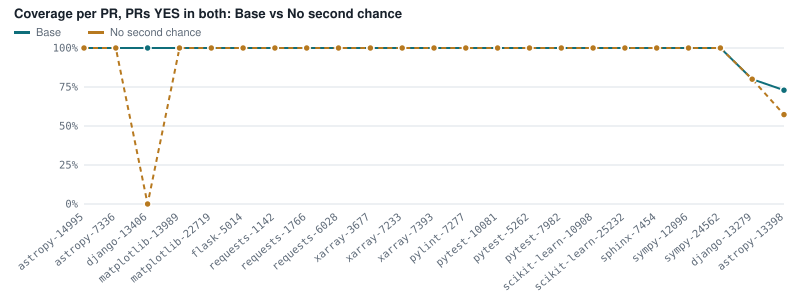
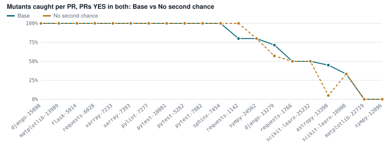
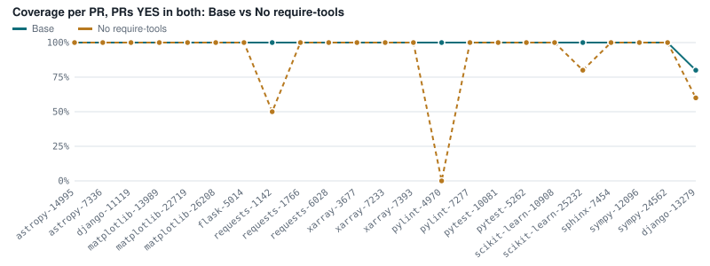
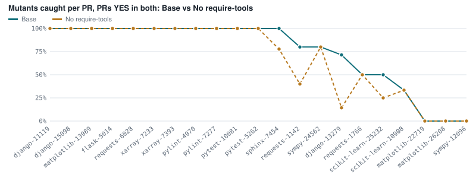
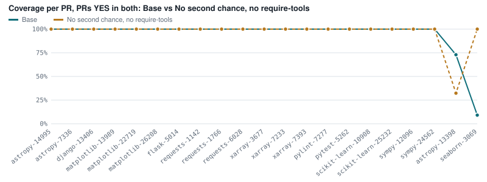
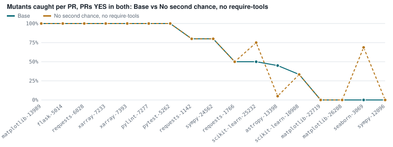
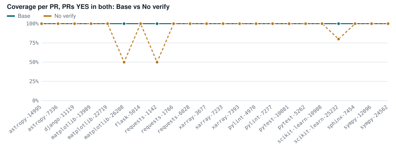
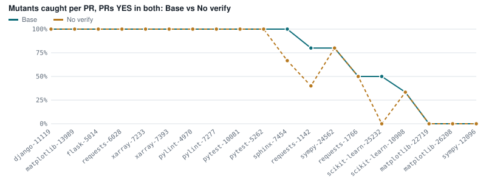
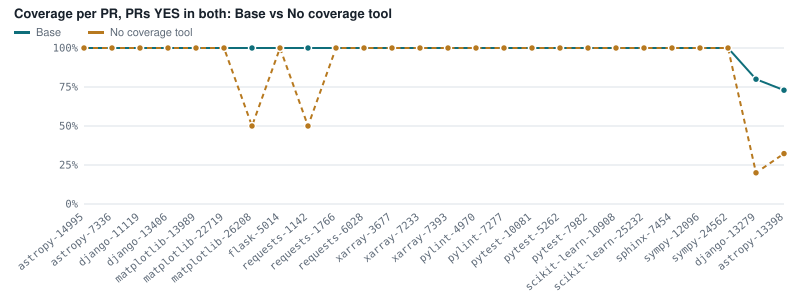
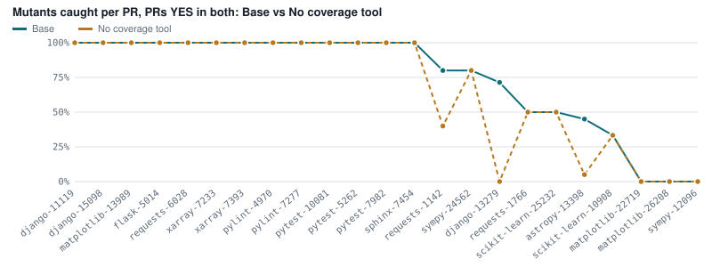

# F2P Flag Ablations

An agent writes a test that must fail before a SWE-bench fix and pass after it. Each experiment runs the same 36 pull requests with one set of add-ons, and this page compares what they produced.

PRs **36** · model **qwen3-coder-30b-a3b** · temperature **0.3** · action cap **125** · mutants **20**, scored on the held-out half · per PR: base's best run, each other experiment's worst

## Scoreboard

| Experiment | verify | coverage | mutation | guard | require-tools | scores shown | second chance | YES | first attempt | after restart | coverage, pooled over PRs YES in both with base | coverage, mean | mutants caught, mean | actions | cost |
|---|---|---|---|---|---|---|---|---:|---:|---:|---:|---:|---:|---:|---:|
| **Base** | ● | ● | ● | ● | ● | ○ | ● | **30/36** | 28 | 2 | reference | 94.9% (27) | 71.2% (24) | 1,925 | $3.60 |
| **No second chance** | ● | ● | ● | ● | ● | ○ | ○ | **27/36** | 27 | – | 69.7% (base 81.4%, 23 PRs) | 93.2% (24) | 75.0% (21) | 1,538 | $2.73 |
| **No require-tools** | ● | ● | ● | ● | ○ | ○ | ● | **26/36** | 25 | 1 | 88.2% (base 98.0%, 23 PRs) | 90.9% (23) | 67.6% (21) | 1,660 | $2.64 |
| **No second chance, no require-tools** | ● | ● | ● | ● | ○ | ○ | ○ | **23/36** | 23 | – | 55.2% (base 75.2%, 21 PRs) | 96.8% (21) | 64.2% (17) | 1,137 | $1.55 |
| **No verify** | ○ | ○ | ○ | ● | ○ | ○ | ● | **25/36** | 20 | 5 | 93.5% (base 100.0%, 22 PRs) | 95.0% (24) | 68.1% (21) | 1,161 | $1.30 |
| **No coverage tool** | ● | ○ | ● | ● | ● | ○ | ● | **28/36** | 27 | 1 | 52.7% (base 82.0%, 26 PRs) | 90.5% (26) | 67.8% (23) | 1,781 | $3.09 |

● on · ○ off. Means: the per-PR figures averaged over the experiment's own YES PRs. Pooled: covered lines over all changed lines on the PRs YES in both the experiment and base.

## Each experiment against base

### Base vs No second chance

| | Base | No second chance |
|---|---:|---:|
| fail-to-pass | 30/36 | 27/36 |
| first attempt | 28 | 27 |
| YES after the restart | 2 | – |
| coverage, mean of per-PR over own YES | 94.9% | 93.2% |
| mutants caught, mean of per-PR over own YES | 71.2% | 75.0% |
| changed-line coverage, pooled over 23 PRs YES in both | 81.4% (118/145) | 69.7% (101/145) |
| &nbsp;&nbsp;without `astropy-13398`, the PR that moves the gap most | 98.0% | 93.9% |
| mutants caught, pooled over 20 PRs YES in both | 71.6% (58/81) | 61.7% (50/81) |
| &nbsp;&nbsp;without `astropy-13398`, the PR that moves the gap most | 80.3% | 80.3% |
| actions | 1,925 | 1,538 |
| model cost | $3.60 | $2.73 |

26 PRs are YES in both.

Verdicts that differ (5): `django-11119` YES→NO, `matplotlib-26208` YES→NO, `seaborn-3069` YES→NO, `pylint-4970` YES→NO, `pylint-6903` NO→YES

### Base vs No require-tools

| | Base | No require-tools |
|---|---:|---:|
| fail-to-pass | 30/36 | 26/36 |
| first attempt | 28 | 25 |
| YES after the restart | 2 | 1 |
| coverage, mean of per-PR over own YES | 94.9% | 90.9% |
| mutants caught, mean of per-PR over own YES | 71.2% | 67.6% |
| changed-line coverage, pooled over 23 PRs YES in both | 98.0% (50/51) | 88.2% (45/51) |
| &nbsp;&nbsp;without `pylint-4970`, the PR that moves the gap most | 98.0% | 91.8% |
| mutants caught, pooled over 21 PRs YES in both | 79.7% (51/64) | 65.6% (42/64) |
| &nbsp;&nbsp;without `django-13279`, the PR that moves the gap most | 80.7% | 71.9% |
| actions | 1,925 | 1,660 |
| model cost | $3.60 | $2.64 |

26 PRs are YES in both.

Verdicts that differ (4): `astropy-13398` YES→NO, `django-13406` YES→NO, `seaborn-3069` YES→NO, `pytest-7982` YES→NO

### Base vs No second chance, no require-tools

| | Base | No second chance, no require-tools |
|---|---:|---:|
| fail-to-pass | 30/36 | 23/36 |
| first attempt | 28 | 23 |
| YES after the restart | 2 | – |
| coverage, mean of per-PR over own YES | 94.9% | 96.8% |
| mutants caught, mean of per-PR over own YES | 71.2% | 64.2% |
| changed-line coverage, pooled over 21 PRs YES in both | 75.2% (109/145) | 55.2% (80/145) |
| &nbsp;&nbsp;without `astropy-13398`, the PR that moves the gap most | 79.6% | 100.0% |
| mutants caught, pooled over 17 PRs YES in both | 49.3% (37/75) | 54.7% (41/75) |
| &nbsp;&nbsp;without `seaborn-3069`, the PR that moves the gap most | 62.7% | 50.8% |
| actions | 1,925 | 1,137 |
| model cost | $3.60 | $1.55 |

23 PRs are YES in both.

Verdicts that differ (7): `django-11119` YES→NO, `django-13279` YES→NO, `django-15098` YES→NO, `pylint-4970` YES→NO, `pytest-10081` YES→NO, `pytest-7982` YES→NO, `sphinx-7454` YES→NO

### Base vs No verify

| | Base | No verify |
|---|---:|---:|
| fail-to-pass | 30/36 | 25/36 |
| first attempt | 28 | 20 |
| YES after the restart | 2 | 5 |
| coverage, mean of per-PR over own YES | 94.9% | 95.0% |
| mutants caught, mean of per-PR over own YES | 71.2% | 68.1% |
| changed-line coverage, pooled over 22 PRs YES in both | 100.0% (46/46) | 93.5% (43/46) |
| &nbsp;&nbsp;without `matplotlib-26208`, the PR that moves the gap most | 100.0% | 95.5% |
| mutants caught, pooled over 19 PRs YES in both | 80.4% (45/56) | 67.9% (38/56) |
| &nbsp;&nbsp;without `sphinx-7454`, the PR that moves the gap most | 76.6% | 68.1% |
| actions | 1,925 | 1,161 |
| model cost | $3.60 | $1.30 |

23 PRs are YES in both.

Verdicts that differ (9): `astropy-13398` YES→NO, `django-13279` YES→NO, `django-13406` YES→NO, `django-15098` YES→NO, `django-16333` NO→YES, `django-17029` YES→NO, `seaborn-3069` YES→NO, `pytest-7982` YES→NO, `sphinx-9602` NO→YES

### Base vs No coverage tool

| | Base | No coverage tool |
|---|---:|---:|
| fail-to-pass | 30/36 | 28/36 |
| first attempt | 28 | 27 |
| YES after the restart | 2 | 1 |
| coverage, mean of per-PR over own YES | 94.9% | 90.5% |
| mutants caught, mean of per-PR over own YES | 71.2% | 67.8% |
| changed-line coverage, pooled over 26 PRs YES in both | 82.0% (123/150) | 52.7% (79/150) |
| &nbsp;&nbsp;without `astropy-13398`, the PR that moves the gap most | 98.1% | 88.9% |
| mutants caught, pooled over 23 PRs YES in both | 71.8% (61/85) | 54.1% (46/85) |
| &nbsp;&nbsp;without `astropy-13398`, the PR that moves the gap most | 80.0% | 69.2% |
| actions | 1,925 | 1,781 |
| model cost | $3.60 | $3.09 |

28 PRs are YES in both.

Verdicts that differ (2): `django-17029` YES→NO, `seaborn-3069` YES→NO

## What each flag does

Each row compares two experiments that differ only by that flag. The means are over each experiment's own YES PRs; the detail columns pool lines and mutants over the PRs YES in both.

| Flag | Other flags | YES, on vs off | coverage mean | mutants mean | detail: lines covered, PRs YES in both | detail: mutants caught, PRs YES in both | cost |
|---|---|---:|---:|---:|---:|---:|---:|
| Second chance | require-tools on | 30 vs 27 (+3) | 94.9% vs 93.2% | 71.2% vs 75.0% | 81.4% vs 69.7% · 23 PRs without astropy-13398: 98.0% vs 93.9% | 71.6% vs 61.7% · 20 PRs without astropy-13398: 80.3% vs 80.3% | $3.60 vs $2.73 |
| Second chance | require-tools off | 26 vs 23 (+3) | 90.9% vs 96.8% | 67.6% vs 64.2% | 94.4% vs 100.0% · 18 PRs without requests-1142: 97.1% vs 100.0% | 64.1% vs 74.4% · 15 PRs without scikit-learn-25232: 68.6% vs 74.3% | $2.64 vs $1.55 |
| Require-tools | second chance on | 30 vs 26 (+4) | 94.9% vs 90.9% | 71.2% vs 67.6% | 98.0% vs 88.2% · 23 PRs without pylint-4970: 98.0% vs 91.8% | 79.7% vs 65.6% · 21 PRs without django-13279: 80.7% vs 71.9% | $3.60 vs $2.64 |
| Require-tools | second chance off | 27 vs 23 (+4) | 93.2% vs 96.8% | 75.0% vs 64.2% | 67.4% vs 50.8% · 19 PRs without astropy-13398: 94.4% vs 100.0% | 51.7% vs 51.7% · 15 PRs without requests-1142: 47.2% vs 49.1% | $2.73 vs $1.55 |
| Verify (and coverage, mutation, require-tools) | guard and second chance on | 30 vs 25 (+5) | 94.9% vs 95.0% | 71.2% vs 68.1% | 100.0% vs 93.5% · 22 PRs without matplotlib-26208: 100.0% vs 95.5% | 80.4% vs 67.9% · 19 PRs without sphinx-7454: 76.6% vs 68.1% | $3.60 vs $1.30 |
| Coverage tool | everything else on | 30 vs 28 (+2) | 94.9% vs 90.5% | 71.2% vs 67.8% | 82.0% vs 52.7% · 26 PRs without astropy-13398: 98.1% vs 88.9% | 71.8% vs 54.1% · 23 PRs without astropy-13398: 80.0% vs 69.2% | $3.60 vs $3.09 |

## Every PR

Each cell: the verdict and, for a YES, changed-line coverage. ↻ marks a YES reached after the restart.

| PR | Base | No second chance | No require-tools | No second chance, no require-tools | No verify | No coverage tool |
|---|---:|---:|---:|---:|---:|---:|
| `astropy-13398` | 73% | 57% | NO | 32% | NO | 32% |
| `astropy-14995` | 100% | 100% | 100% | 100% | ↻ 100% | 100% |
| `astropy-7336` | 100% | 100% | 100% | 100% | ↻ 100% | 100% |
| `django-11119` | 100% | NO | 100% | NO | 100% | 100% |
| `django-13279` | 80% | 80% | 60% | NO | NO | 20% |
| `django-13406` | 100% | 0% | NO | 100% | NO | 100% |
| `django-15098` | YES | YES | YES | NO | NO | YES |
| `django-16333` | NO | NO | NO | NO | 100% | NO |
| `django-17029` | YES | YES | YES | YES | NO | NO |
| `matplotlib-13989` | 100% | 100% | 100% | 100% | 100% | 100% |
| `matplotlib-22719` | 100% | 100% | 100% | 100% | 100% | 100% |
| `matplotlib-26208` | 100% | NO | 100% | 100% | 50% | 50% |
| `seaborn-3069` | ↻ 9% | NO | NO | 100% | NO | NO |
| `seaborn-3187` | NO | NO | NO | NO | NO | NO |
| `flask-5014` | 100% | 100% | 100% | 100% | 100% | 100% |
| `requests-1142` | 100% | 100% | 50% | 100% | 50% | 50% |
| `requests-1766` | 100% | 100% | 100% | 100% | 100% | 100% |
| `requests-6028` | 100% | 100% | 100% | 100% | 100% | 100% |
| `xarray-3677` | 100% | 100% | 100% | 100% | 100% | 100% |
| `xarray-7233` | 100% | 100% | 100% | 100% | 100% | 100% |
| `xarray-7393` | 100% | 100% | 100% | 100% | 100% | 100% |
| `pylint-4970` | 100% | NO | 0% | NO | 100% | ↻ 100% |
| `pylint-6903` | NO | 100% | NO | NO | NO | NO |
| `pylint-7277` | 100% | 100% | 100% | 100% | 100% | 100% |
| `pytest-10081` | 100% | 100% | ↻ 100% | NO | ↻ 100% | 100% |
| `pytest-5262` | 100% | 100% | 100% | 100% | ↻ 100% | 100% |
| `pytest-7982` | ↻ 100% | 100% | NO | NO | NO | 100% |
| `scikit-learn-10908` | 100% | 100% | 100% | 100% | 100% | 100% |
| `scikit-learn-25232` | 100% | 100% | 80% | 100% | 80% | 100% |
| `scikit-learn-25747` | YES | YES | YES | YES | YES | YES |
| `sphinx-10614` | NO | NO | NO | NO | NO | NO |
| `sphinx-7454` | 100% | 100% | 100% | NO | 100% | 100% |
| `sphinx-9602` | NO | NO | NO | NO | ↻ 100% | NO |
| `sympy-12096` | 100% | 100% | 100% | 100% | 100% | 100% |
| `sympy-21612` | NO | NO | NO | NO | NO | NO |
| `sympy-24562` | 100% | 100% | 100% | 100% | 100% | 100% |
